# Sync App 重构 —— 完整架构模型图册

> **配套文档**：
> - [`SYNC_APP_REFACTOR_EXECUTION_SPEC.md`](SYNC_APP_REFACTOR_EXECUTION_SPEC.md)（第 1 部分：总纲）
> - [`SYNC_APP_REFACTOR_EXECUTION_SPEC_PART2.md`](SYNC_APP_REFACTOR_EXECUTION_SPEC_PART2.md)（第 2 部分：阶段 1-3）
> - [`SYNC_APP_REFACTOR_EXECUTION_SPEC_PART3.md`](SYNC_APP_REFACTOR_EXECUTION_SPEC_PART3.md)（第 3 部分：阶段 4-7）
>
> **本文件**：全部架构模型图，共 **18 张**，分 6 组。
> 所有图均为 Mermaid，可在 VS Code / GitHub / Typora 直接渲染。

---

## 图册目录

| 组 | 图号 | 名称 |
|---|---|---|
| **A 全局** | 图 1 | 全局总览架构图（一图看全） |
| | 图 2 | 三层路由模型图 |
| | 图 3 | 完整路由树（L1/L2/L3 全量） |
| **B 分层** | 图 4 | 五层分层架构图 |
| | 图 5 | Provider 树与数据流图 |
| | 图 6 | 目录结构图 |
| **C 阶段 1-3** | 图 7 | 阶段 1 地基组件依赖图 |
| | 图 8 | 阶段 2 首页组件树 |
| | 图 9 | 阶段 3 空间页 + 设置页拆分图 |
| **D 阶段 4-7** | 图 10 | 阶段 4 聊天 IM 化改造图 |
| | 图 11 | 阶段 5 放映厅 + 浏览器拆分图 |
| | 图 12 | 阶段 6 私密空间 + 朋友圈图 |
| | 图 13 | 阶段 7 收口流程图 |
| **E 数据** | 图 14 | 数据模型 ER 图（现有 + 新增） |
| | 图 15 | 数据访问分层图（双后端预留） |
| | 图 16 | 实时同步时序图 |
| **F 体系** | 图 17 | 动效 + 触感体系图 |
| | 图 18 | 七阶段执行甘特图 |

---

# A 组：全局架构

## 图 1：全局总览架构图（一图看全）

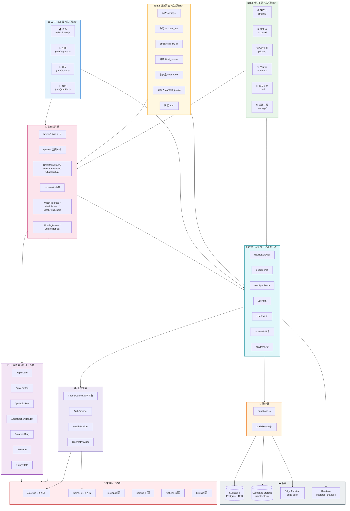

---

## 图 2：三层路由模型图

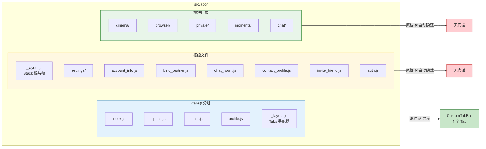

> **核心结论**：底栏显示/隐藏**零代码**，完全由 Expo Router 的 `(tabs)` 分组决定。任何放在 `(tabs)/` 外的路由天然无底栏。

---

## 图 3：完整路由树（L1/L2/L3 全量）

```mermaid
graph TD
    ROOT["/ 根路由<br/>_layout.js<br/>ThemeProvider→Auth→Health→Cinema→Stack"]

    ROOT --> TABS["(tabs) L1<br/>底栏 ✅"]
    ROOT --> L2A["settings/ L2"]
    ROOT --> L2B["account_info L2"]
    ROOT --> L2C["bind_partner L2"]
    ROOT --> L2D["invite_friend L2"]
    ROOT --> L2E["chat_room L2"]
    ROOT --> L2F["contact_profile L2"]
    ROOT --> L2G["auth L2"]
    ROOT --> L3A["cinema/ L3"]
    ROOT --> L3B["browser/ L3"]
    ROOT --> L3C["private/ L3"]
    ROOT --> L3D["moments/ L3"]
    ROOT --> L3E["chat/ L3"]

    TABS --> T1["🏠 首页 index"]
    TABS --> T2["🧩 空间 space"]
    TABS --> T3["💬 聊天 chat"]
    TABS --> T4["👤 我的 profile"]

    L2A --> S1["index 设置主页"]
    L2A --> S2["account 账号"]
    L2A --> S3["privacy 隐私"]
    L2A --> S4["security 安全"]
    L2A --> S5["appearance 外观"]
    L2A --> S6["about 关于"]

    L3A --> C1["index 大厅"]
    L3A --> C2["room/[roomId] 房间"]
    L3A --> C3["search 搜索大厅"]
    L3A --> C4["create 创建房间"]

    L3B --> B1["index 浏览器主页"]
    L3B --> B2["history 历史"]
    L3B --> B3["bookmarks 书签"]

    L3C --> P1["index 私密主页"]
    L3C --> P2["album 私密相册"]
    L3C --> P3["notes 私密笔记"]

    L3D --> M1["index 朋友圈流"]
    L3D --> M2["publish 发布"]
    L3D --> M3["[momentId] 详情"]

    L3E --> H1["contacts 联系人"]
    L3E --> H2["search 搜索加友"]

    style TABS fill:#E3F2FD,stroke:#1976D2,stroke-width:3px
    style L2A fill:#FFF8E1,stroke:#F9A825
    style L2B fill:#FFF8E1,stroke:#F9A825
    style L2C fill:#FFF8E1,stroke:#F9A825
    style L2D fill:#FFF8E1,stroke:#F9A825
    style L2E fill:#FFF8E1,stroke:#F9A825
    style L2F fill:#FFF8E1,stroke:#F9A825
    style L2G fill:#FFF8E1,stroke:#F9A825
    style L3A fill:#E8F5E9,stroke:#388E3C
    style L3B fill:#E8F5E9,stroke:#388E3C
    style L3C fill:#E8F5E9,stroke:#388E3C
    style L3D fill:#E8F5E9,stroke:#388E3C
    style L3E fill:#E8F5E9,stroke:#388E3C
```

---

# B 组：分层架构

## 图 4：五层分层架构图

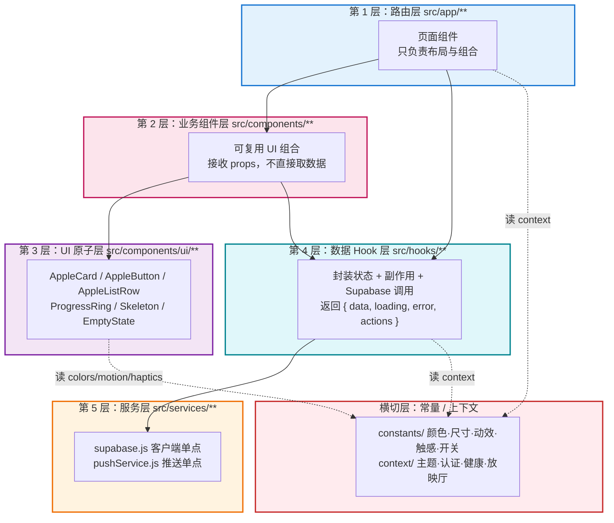

**依赖方向铁律**：只能**自上而下**依赖，禁止反向。UI 层（第 1-3 层）**禁止**直接 `import { supabase }`。

---

## 图 5：Provider 树与数据流图

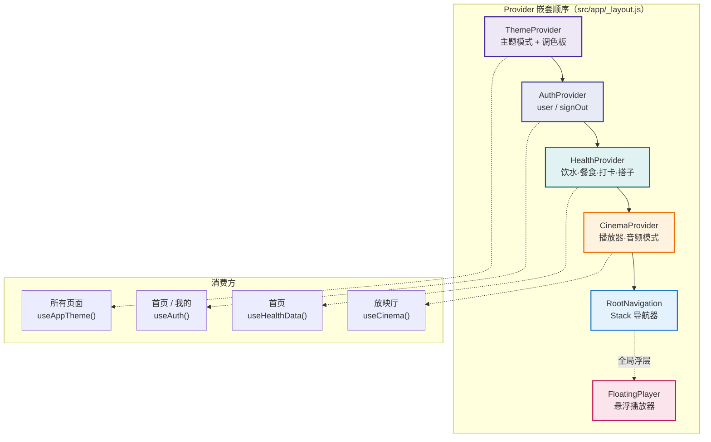

**数据流方向**：

```
用户操作 → 页面 → hook action → supabase → 返回 → hook state → 页面重渲染
                                    ↓
                            Realtime 推送 → hook 订阅 → state 更新 → 自动重渲染
```

---

## 图 6：目录结构图

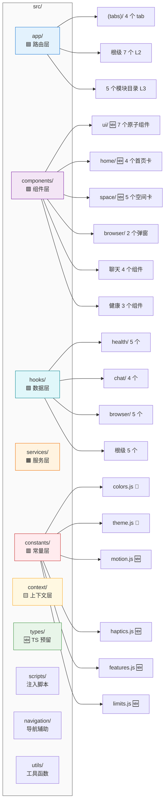

---

# C 组：阶段 1-3 架构

## 图 7：阶段 1 地基组件依赖图

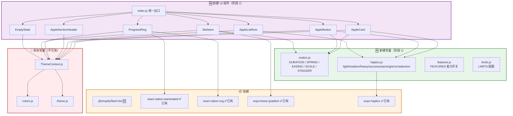

---

## 图 8：阶段 2 首页组件树

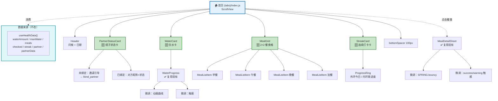

---

## 图 9：阶段 3 空间页 + 设置页拆分图

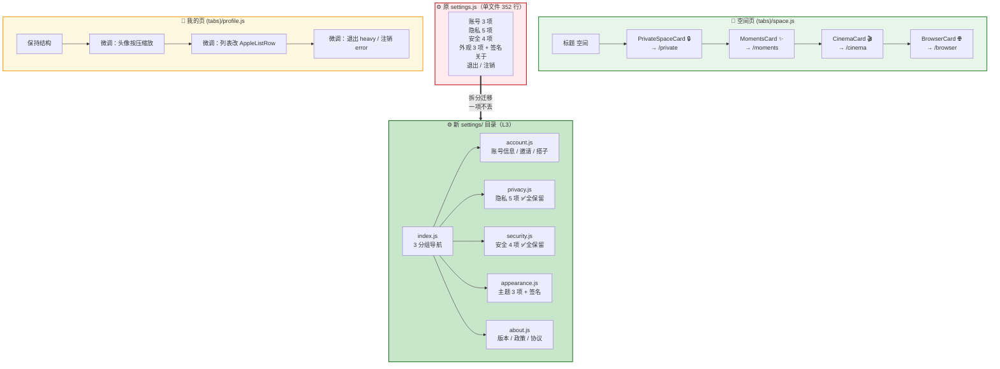

---

# D 组：阶段 4-7 架构

## 图 10：阶段 4 聊天 IM 化改造图

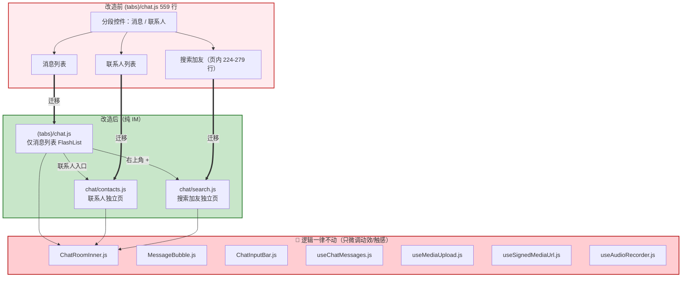

---

## 图 11：阶段 5 放映厅 + 浏览器拆分图

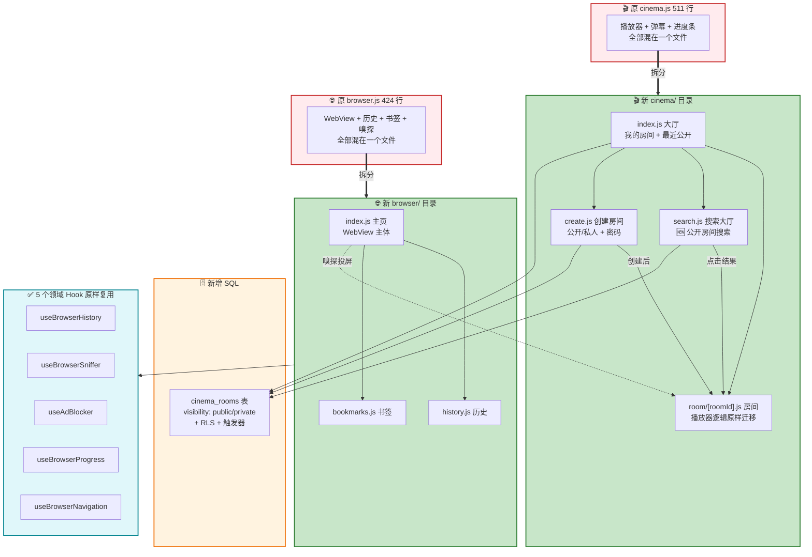

---

## 图 12：阶段 6 私密空间 + 朋友圈图

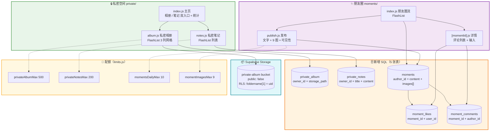

---

## 图 13：阶段 7 收口流程图

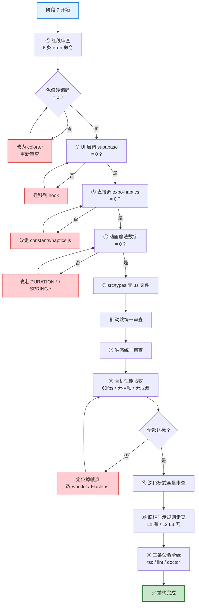

---

# E 组：数据架构

## 图 14：数据模型 ER 图（现有 + 新增）

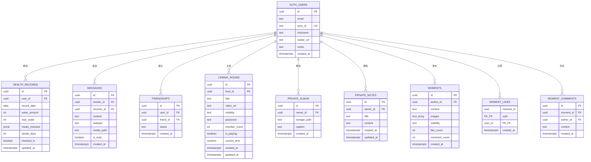

**图例**：
- 🟢 现有表：`AUTH_USERS` / `HEALTH_RECORDS` / `MESSAGES` / `FRIENDSHIPS`
- 🆕 新增表（阶段 5）：`CINEMA_ROOMS`
- 🆕 新增表（阶段 6）：`PRIVATE_ALBUM` / `PRIVATE_NOTES` / `MOMENTS` / `MOMENT_LIKES` / `MOMENT_COMMENTS`

---

## 图 15：数据访问分层图（双后端预留）

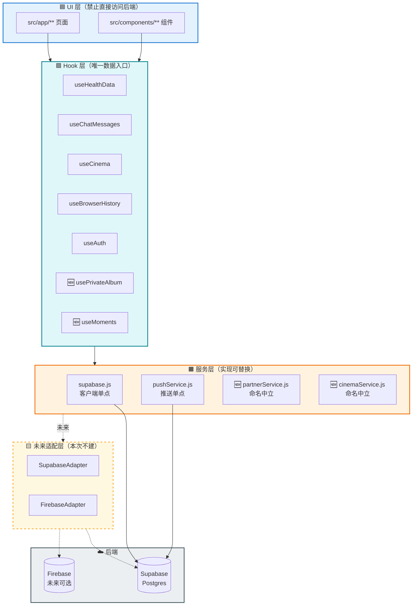

**铁律**：`src/app/**` 与 `src/components/**` 中 **grep `supabase.` 必须为 0 行**。这是未来接 Firebase 的唯一保障。

---

## 图 16：实时同步时序图

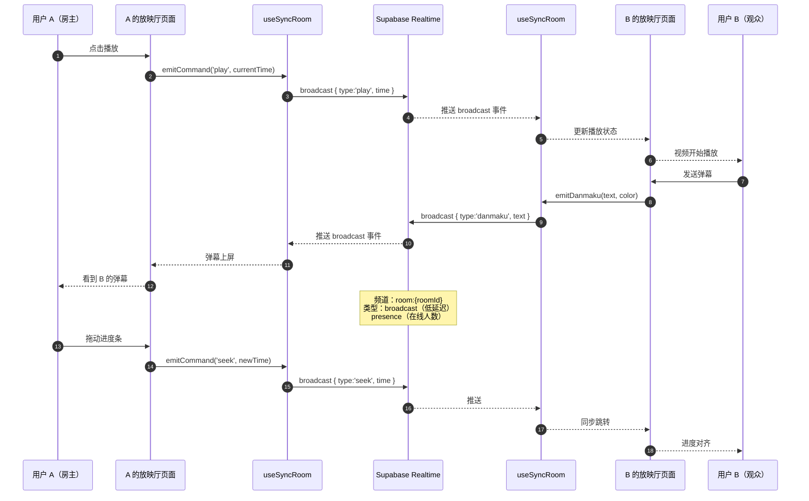

---

# F 组：体系与计划

## 图 17：动效 + 触感体系图

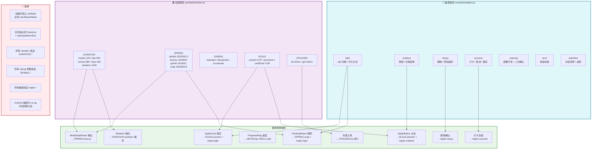

---

## 图 18：七阶段执行甘特图

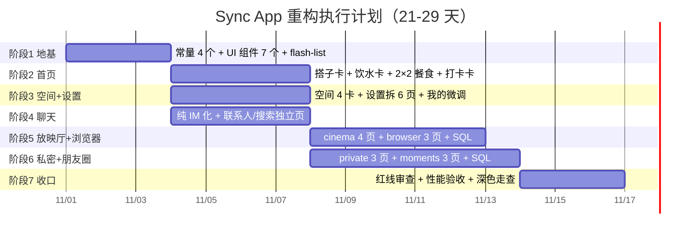

**关键路径**：阶段 1 → 阶段 3 → 阶段 6 → 阶段 7（3+4+6+3 = 16 天）
**并行机会**：阶段 2 / 3 / 4 可在阶段 1 完成后并行；阶段 5 / 6 可在阶段 3 完成后并行

---

# 附录：图册使用说明

## A.1 图与文档章节对照

| 图号 | 对应文档章节 |
|---|---|
| 图 1 全局总览 | 第 1 部分 §2.2 |
| 图 2 三层路由 | 第 1 部分 §2.1 |
| 图 3 完整路由树 | 第 1 部分 §5.1-5.3 |
| 图 4 五层分层 | 第 1 部分 §2.4 + §7.3 |
| 图 5 Provider 树 | 第 1 部分 §2.4 |
| 图 6 目录结构 | 第 1 部分 §7.1 + §9.1 |
| 图 7 阶段 1 依赖 | 第 2 部分 §11 |
| 图 8 阶段 2 首页 | 第 2 部分 §12 |
| 图 9 阶段 3 空间+设置 | 第 2 部分 §13 |
| 图 10 阶段 4 聊天 | 第 3 部分 §14 |
| 图 11 阶段 5 放映厅+浏览器 | 第 3 部分 §15 |
| 图 12 阶段 6 私密+朋友圈 | 第 3 部分 §16 |
| 图 13 阶段 7 收口 | 第 3 部分 §17 |
| 图 14 数据 ER | 第 3 部分 §15.2 + §16.2 + §16.7 |
| 图 15 数据访问分层 | 第 1 部分 §7.3 |
| 图 16 实时同步时序 | 第 3 部分 §15.4 |
| 图 17 动效+触感体系 | 第 1 部分 §4.1-4.2 + 第 2 部分 §11.2-11.3 |
| 图 18 甘特图 | 第 2 部分 §10.1 |

## A.2 渲染方式

| 环境 | 方式 |
|---|---|
| **VS Code** | 安装 `Markdown Preview Mermaid Support` 插件，`Cmd+Shift+V` 预览 |
| **GitHub / GitLab** | 直接推送，网页自动渲染 |
| **Typora** | 原生支持，直接打开 |
| **导出 PDF** | 用 `yzane.markdown-pdf` 插件（已检测到日志），或 `mermaid-cli` |
| **在线** | 复制代码块到 https://mermaid.live |

## A.3 图册统计

| 组 | 图数 | 覆盖内容 |
|---|---|---|
| A 全局 | 3 | 总览 / 路由模型 / 路由树 |
| B 分层 | 3 | 五层架构 / Provider / 目录 |
| C 阶段 1-3 | 3 | 地基依赖 / 首页树 / 空间+设置 |
| D 阶段 4-7 | 4 | 聊天 / 放映厅+浏览器 / 私密+朋友圈 / 收口流程 |
| E 数据 | 3 | ER 图 / 访问分层 / 实时时序 |
| F 体系 | 2 | 动效+触感 / 甘特图 |
| **合计** | **18** | 覆盖全部 7 阶段 + 数据 + 体系 |

---

> **图册结束。** 配合三份执行书使用：先看图建立全局认知，再按阶段读细则执行。