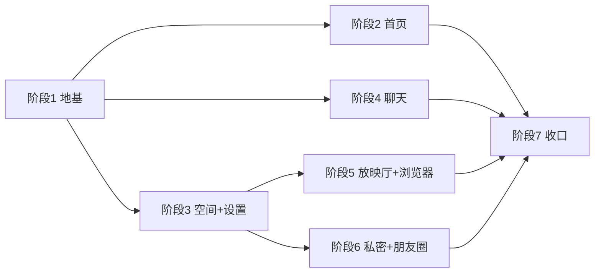
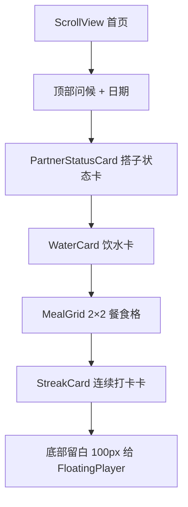
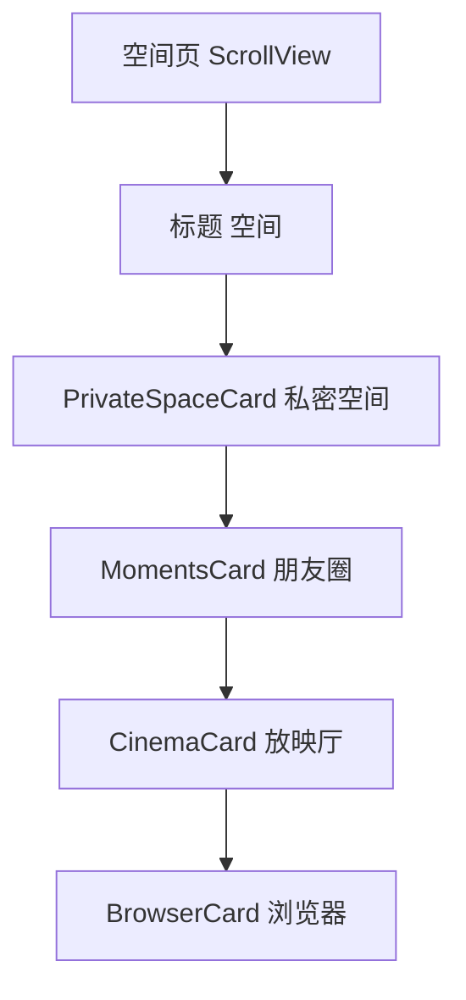

# Sync App 页面重构与 UI 架构 —— 最终执行书（第 2 部分：阶段 1-3 细则）

> **文档拆分**：
> - [`SYNC_APP_REFACTOR_EXECUTION_SPEC.md`](SYNC_APP_REFACTOR_EXECUTION_SPEC.md)（第 1 部分）：全局约束、需求决策、架构总览、视觉守则、动效规范、路由总表、数据层、TS/双后端/商业化前瞻、风险矩阵、文件索引
> - **本文件（第 2 部分）**：阶段 1-3 逐阶段执行细则
> - [`SYNC_APP_REFACTOR_EXECUTION_SPEC_PART3.md`](SYNC_APP_REFACTOR_EXECUTION_SPEC_PART3.md)：阶段 4-7 逐阶段执行细则

---

## 目录

- [§10 阶段总览与依赖关系](#10-阶段总览与依赖关系)
- [§11 阶段 1：地基（常量 / UI 组件 / 依赖）](#11-阶段-1地基常量--ui-组件--依赖)
- [§12 阶段 2：首页重写](#12-阶段-2首页重写)
- [§13 阶段 3：空间页 + 设置页拆分 + 我的页](#13-阶段-3空间页--设置页拆分--我的页)

---

## §10 阶段总览与依赖关系

### 10.1 七阶段一览

| 阶段 | 名称 | 预估 | 依赖 | 可独立交付 |
|---|---|---|---|---|
| **1** | 地基：常量 + UI 组件库 + 依赖 | 2-3 天 | 无 | ✅ |
| **2** | 首页重写（搭子卡 + 饮水 + 2×2 餐食 + 打卡） | 3-4 天 | 阶段 1 | ✅ |
| **3** | 空间页 4 卡 + 设置页拆 L3 + 我的页微调 | 3-4 天 | 阶段 1 | ✅ |
| **4** | 聊天页纯 IM 化 + 聊天相关页微调 | 3-4 天 | 阶段 1 | ✅ |
| **5** | 放映厅拆分 + 搜索大厅 + 浏览器拆分 | 4-5 天 | 阶段 1、3 | ✅ |
| **6** | 私密空间 + 朋友圈（新建 + SQL） | 4-6 天 | 阶段 1、3 | ✅ |
| **7** | 全局收口：动效统一 / 触感统一 / 红线审查 | 2-3 天 | 阶段 1-6 | ✅ |

**总计：21-29 天**（单人全职；若只做 1-5 阶段约 15-20 天）

### 10.2 依赖关系图



### 10.3 每个阶段的通用执行流程

```
1. 读第 1 部分对应章节（视觉守则 / 动效规范 / 路由总表）
2. 按本文件该阶段「改动清单」逐文件改
3. 每改完一个文件 → 保存 → 热重载目视检查
4. 该阶段全部改完 → 跑 §9.4 三条验收命令
5. 真机（iOS + Android）逐页走查：浅色 / 深色 / 动效 / 触感
6. 对照该阶段「验收清单」逐项打勾
7. 打勾全绿 → 进入下一阶段
```

---

## §11 阶段 1：地基（常量 / UI 组件 / 依赖）

> **目标**：建立后续所有阶段共用的「苹果风组件库 + 动效常量 + 触感封装 + 商业化开关」，并安装唯一新依赖。
> **不改任何现有页面**，纯新增文件。

### 11.1 安装依赖

```bash
npx expo install @shopify/flash-list
npx expo-doctor
```

**验收**：`package.json` 出现 `@shopify/flash-list`，`expo-doctor` 无 error。

> ⚠️ 必须用 `npx expo install`（不是 `npm install`），确保解析到 SDK 58 兼容版本。

### 11.2 新建 `src/constants/motion.js`

统一动效参数（第 1 部分 §4.1 的代码落地）。

```js
// 统一动效参数：所有动画必须从这里取，禁止页面内写魔法数字
// 未来 TS 化：export const SPRING = {...} as const;

export const DURATION = {
  instant: 120,   // 按压反馈
  fast: 200,      // 小元素出现
  normal: 280,    // 卡片入场
  slow: 400,      // 页面转场
  skeleton: 1200, // 骨架屏微光循环
};

export const SPRING = {
  // 苹果默认弹簧：轻快、无过冲
  default: { damping: 20, stiffness: 220, mass: 0.9 },
  // 弹性更强：用于 Sheet / 弹窗
  bouncy: { damping: 16, stiffness: 180, mass: 1 },
  // 沉稳：用于大卡片 / 页面级
  gentle: { damping: 24, stiffness: 160, mass: 1 },
  // 吸附：FloatingPlayer 贴边
  snap: { damping: 18, stiffness: 260, mass: 0.8 },
};

export const EASING = {
  // 苹果标准缓动（近似 cubic-bezier(0.25, 0.1, 0.25, 1)）
  standard: [0.25, 0.1, 0.25, 1],
  // 减速（入场）
  decelerate: [0.0, 0.0, 0.2, 1],
  // 加速（退场）
  accelerate: [0.4, 0.0, 1, 1],
};

export const SCALE = {
  pressIn: 0.97,   // 按压缩放
  pressOut: 1,
  cardEnter: 0.96, // 卡片入场起始缩放
};

export const STAGGER = {
  list: 40,   // 列表项逐个入场间隔（ms）
  grid: 30,   // 网格项间隔
};
```

### 11.3 新建 `src/constants/haptics.js`

触感封装（第 1 部分 §4.2 的代码落地）。

```js
import * as Haptics from 'expo-haptics';
import { Platform } from 'react-native';

// 触感反馈统一出口：所有页面只调这里，不直接 import expo-haptics
// Android 上 expo-haptics 为 no-op，属预期行为，不加判断分支

const isIOS = Platform.OS === 'ios';

export const haptic = {
  /** 轻触：切换 tab、选中、开关 */
  light: () => {
    if (isIOS) Haptics.impactAsync(Haptics.ImpactFeedbackStyle.Light);
  },
  /** 中触：按钮点击、卡片进入详情 */
  medium: () => {
    if (isIOS) Haptics.impactAsync(Haptics.ImpactFeedbackStyle.Medium);
  },
  /** 重触：删除、危险操作确认前 */
  heavy: () => {
    if (isIOS) Haptics.impactAsync(Haptics.ImpactFeedbackStyle.Heavy);
  },
  /** 成功：打卡完成、发送成功、保存成功 */
  success: () => {
    if (isIOS) Haptics.notificationAsync(Haptics.NotificationFeedbackType.Success);
  },
  /** 警告：配额不足、需二次确认 */
  warning: () => {
    if (isIOS) Haptics.notificationAsync(Haptics.NotificationFeedbackType.Warning);
  },
  /** 错误：操作失败 */
  error: () => {
    if (isIOS) Haptics.notificationAsync(Haptics.NotificationFeedbackType.Error);
  },
  /** 选择变化：滚轮、分段控件切换 */
  selection: () => {
    if (isIOS) Haptics.selectionAsync();
  },
};
```

### 11.4 新建 `src/constants/features.js` 与 `src/constants/limits.js`

见第 1 部分 §7.4。

```js
// src/constants/features.js
export const FEATURES = {
  privateSpace: true,
  moments: true,
  cinemaHD: true,
  adFree: true,
  searchHall: true,
};
```

```js
// src/constants/limits.js
// 配额常量：本次固定值，未来按会员等级动态取值
export const LIMITS = {
  privateAlbumMax: 500,      // 私密相册最多张数
  privateNotesMax: 200,      // 私密笔记最多条数
  momentsDailyMax: 10,       // 每日发布朋友圈上限
  momentImagesMax: 9,        // 单条朋友圈最多图
  cinemaRoomTitleMax: 30,    // 放映厅房间标题字数
  danmakuMaxLength: 50,      // 弹幕字数
};
```

### 11.5 新建 `src/types/README.md`

```markdown
# src/types —— TS 转型契约预留目录

> ⚠️ 本目录**当前只放 README**，不写任何 `.ts` 文件。
> 未来全面 JS→TS 迁移时，类型定义集中在此目录。

## 未来文件规划

| 文件 | 内容 |
|---|---|
| `user.ts` | `User` / `SyncId` / `PartnerStatus` / `AuthState` |
| `health.ts` | `WaterRecord` / `MealCheck` / `StreakState` / `HealthRecordRow` |
| `social.ts` | `Moment` / `Comment` / `Like` / `FriendRequest` |
| `media.ts` | `SniffedMedia` / `RoomState` / `SyncSignal` / `Danmaku` |
| `cinema.ts` | `CinemaRoom` / `RoomVisibility` / `PlaybackCommand` |
| `browser.ts` | `BrowserTab` / `HistoryEntry` / `Bookmark` |

## 迁移顺序建议

1. `constants/` → 加 `as const`
2. `types/` → 写类型定义
3. `services/` → 绑定 Supabase 生成类型
4. `hooks/` → 加返回类型
5. `components/` → 加 Props 类型
6. `app/` → 改 `.tsx`，加路由参数类型
7. `tsconfig.json` → 开 `strict: true`
```

### 11.6 新建 `src/components/ui/AppleCard.js`

```js
import { useRef } from 'react';
import { Animated, Pressable, StyleSheet } from 'react-native';
import { useAppTheme } from '../../context/ThemeContext';
import { DURATION, SCALE } from '../../constants/motion';
import { haptic } from '../../constants/haptics';

// 苹果风卡片：圆角 + 液态玻璃背景 + 按压缩放 + 触感
// 色值全部来自 useAppTheme().colors，禁止硬编码
export default function AppleCard({
  children,
  onPress,
  onLongPress,
  style,
  disabled = false,
  hapticOnPress = 'light',
  accessibilityLabel,
}) {
  const { colors } = useAppTheme();
  const scale = useRef(new Animated.Value(1)).current;

  const animateTo = (to) => {
    Animated.timing(scale, {
      toValue: to,
      duration: DURATION.instant,
      useNativeDriver: true,
    }).start();
  };

  const handlePressIn = () => animateTo(SCALE.pressIn);
  const handlePressOut = () => animateTo(SCALE.pressOut);

  const handlePress = (e) => {
    if (hapticOnPress && haptic[hapticOnPress]) haptic[hapticOnPress]();
    if (onPress) onPress(e);
  };

  const content = (
    <Animated.View
      style={[
        styles.card,
        {
          backgroundColor: colors.card,
          borderColor: colors.cardBorder,
          transform: [{ scale }],
        },
        style,
      ]}
    >
      {children}
    </Animated.View>
  );

  if (!onPress && !onLongPress) return content;

  return (
    <Pressable
      onPress={handlePress}
      onLongPress={onLongPress}
      onPressIn={handlePressIn}
      onPressOut={handlePressOut}
      disabled={disabled}
      accessibilityRole="button"
      accessibilityLabel={accessibilityLabel}
    >
      {content}
    </Pressable>
  );
}

const styles = StyleSheet.create({
  card: {
    borderRadius: 20,
    borderWidth: StyleSheet.hairlineWidth,
    padding: 16,
    overflow: 'hidden',
  },
});
```

### 11.7 新建 `src/components/ui/AppleButton.js`

```js
import { useRef } from 'react';
import { Animated, Pressable, StyleSheet, Text } from 'react-native';
import { useAppTheme } from '../../context/ThemeContext';
import { DURATION, SCALE } from '../../constants/motion';
import { haptic } from '../../constants/haptics';

// 苹果风按钮：主色填充 / 描边 / 文字三种变体
export default function AppleButton({
  title,
  onPress,
  variant = 'filled', // 'filled' | 'outline' | 'text'
  size = 'md',        // 'sm' | 'md' | 'lg'
  disabled = false,
  style,
  textStyle,
}) {
  const { colors } = useAppTheme();
  const scale = useRef(new Animated.Value(1)).current;

  const animateTo = (to) =>
    Animated.timing(scale, {
      toValue: to,
      duration: DURATION.instant,
      useNativeDriver: true,
    }).start();

  const handlePress = () => {
    haptic.medium();
    if (onPress) onPress();
  };

  const bg =
    variant === 'filled' ? colors.primary : 'transparent';
  const border =
    variant === 'outline' ? colors.primary : 'transparent';
  const fg = variant === 'filled' ? '#FFFFFF' : colors.primary;

  const paddingV = size === 'sm' ? 8 : size === 'lg' ? 16 : 12;
  const fontSize = size === 'sm' ? 14 : size === 'lg' ? 18 : 16;

  return (
    <Pressable
      onPress={handlePress}
      onPressIn={() => animateTo(SCALE.pressIn)}
      onPressOut={() => animateTo(SCALE.pressOut)}
      disabled={disabled}
      accessibilityRole="button"
      accessibilityLabel={title}
    >
      <Animated.View
        style={[
          styles.btn,
          {
            backgroundColor: bg,
            borderColor: border,
            borderWidth: variant === 'outline' ? 1.5 : 0,
            paddingVertical: paddingV,
            opacity: disabled ? 0.4 : 1,
            transform: [{ scale }],
          },
          style,
        ]}
      >
        <Text style={[styles.text, { color: fg, fontSize }, textStyle]}>
          {title}
        </Text>
      </Animated.View>
    </Pressable>
  );
}

const styles = StyleSheet.create({
  btn: {
    borderRadius: 14,
    alignItems: 'center',
    justifyContent: 'center',
    paddingHorizontal: 20,
  },
  text: {
    fontWeight: '600',
  },
});
```

### 11.8 新建 `src/components/ui/AppleListRow.js`

```js
import { Pressable, StyleSheet, Text, View } from 'react-native';
import { useAppTheme } from '../../context/ThemeContext';
import { haptic } from '../../constants/haptics';

// 苹果风列表行：左图标 + 标题 + 右值 + 箭头
export default function AppleListRow({
  title,
  value,
  icon,
  iconBg,
  onPress,
  isDestructive = false,
  hideArrow = false,
  isFirst = false,
  isLast = false,
}) {
  const { colors } = useAppTheme();

  const handlePress = () => {
    if (isDestructive) haptic.heavy();
    else haptic.light();
    if (onPress) onPress();
  };

  return (
    <Pressable
      onPress={onPress ? handlePress : undefined}
      style={({ pressed }) => [
        styles.row,
        {
          backgroundColor: colors.card,
          borderTopLeftRadius: isFirst ? 14 : 0,
          borderTopRightRadius: isFirst ? 14 : 0,
          borderBottomLeftRadius: isLast ? 14 : 0,
          borderBottomRightRadius: isLast ? 14 : 0,
          opacity: pressed ? 0.6 : 1,
        },
      ]}
      accessibilityRole="button"
      accessibilityLabel={title}
    >
      {icon ? (
        <View style={[styles.iconBox, { backgroundColor: iconBg || colors.iconBackground }]}>
          <Text style={styles.iconText}>{icon}</Text>
        </View>
      ) : null}
      <Text
        style={[
          styles.title,
          { color: isDestructive ? '#FF3B30' : colors.textPrimary },
        ]}
      >
        {title}
      </Text>
      {value ? (
        <Text style={[styles.value, { color: colors.textSecondary }]} numberOfLines={1}>
          {value}
        </Text>
      ) : null}
      {!hideArrow && onPress ? (
        <Text style={[styles.arrow, { color: colors.textSecondary }]}>›</Text>
      ) : null}
    </Pressable>
  );
}

const styles = StyleSheet.create({
  row: {
    flexDirection: 'row',
    alignItems: 'center',
    minHeight: 52,
    paddingHorizontal: 16,
    gap: 12,
  },
  iconBox: {
    width: 28,
    height: 28,
    borderRadius: 7,
    alignItems: 'center',
    justifyContent: 'center',
  },
  iconText: { fontSize: 15 },
  title: { flex: 1, fontSize: 16 },
  value: { fontSize: 15, maxWidth: '45%' },
  arrow: { fontSize: 20, fontWeight: '300' },
});
```

### 11.9 新建 `src/components/ui/AppleSectionHeader.js`

```js
import { StyleSheet, Text, View } from 'react-native';
import { useAppTheme } from '../../context/ThemeContext';

// 苹果风分组标题：小写大写字母间距
export default function AppleSectionHeader({ title, right }) {
  const { colors } = useAppTheme();
  return (
    <View style={styles.wrap}>
      <Text style={[styles.title, { color: colors.textSecondary }]}>
        {title}
      </Text>
      {right}
    </View>
  );
}

const styles = StyleSheet.create({
  wrap: {
    flexDirection: 'row',
    alignItems: 'center',
    justifyContent: 'space-between',
    paddingHorizontal: 20,
    paddingTop: 24,
    paddingBottom: 8,
  },
  title: {
    fontSize: 13,
    fontWeight: '500',
    letterSpacing: 0.4,
    textTransform: 'uppercase',
  },
});
```

### 11.10 新建 `src/components/ui/ProgressRing.js`

双环进度（react-native-svg，已安装）。

```js
import { useEffect } from 'react';
import { View } from 'react-native';
import Svg, { Circle } from 'react-native-svg';
import Animated, {
  useAnimatedProps,
  useSharedValue,
  withTiming,
  Easing,
} from 'react-native-reanimated';
import { useAppTheme } from '../../context/ThemeContext';

const AnimatedCircle = Animated.createAnimatedComponent(Circle);

// 双环进度：外环=主进度，内环=次进度
// 用 Reanimated worklet 驱动 strokeDashoffset，UI 线程动画不掉帧
export default function ProgressRing({
  size = 120,
  strokeWidth = 10,
  outerProgress = 0,   // 0-1
  innerProgress = 0,   // 0-1
  outerColor,
  innerColor,
  trackColor,
  children,
}) {
  const { colors } = useAppTheme();
  const radius = (size - strokeWidth) / 2;
  const innerRadius = radius - strokeWidth - 4;
  const circumference = 2 * Math.PI * radius;
  const innerCircumference = 2 * Math.PI * innerRadius;

  const outer = useSharedValue(0);
  const inner = useSharedValue(0);

  useEffect(() => {
    outer.value = withTiming(Math.max(0, Math.min(1, outerProgress)), {
      duration: 700,
      easing: Easing.out(Easing.cubic),
    });
  }, [outerProgress]);

  useEffect(() => {
    inner.value = withTiming(Math.max(0, Math.min(1, innerProgress)), {
      duration: 700,
      easing: Easing.out(Easing.cubic),
    });
  }, [innerProgress]);

  const outerProps = useAnimatedProps(() => ({
    strokeDashoffset: circumference * (1 - outer.value),
  }));

  const innerProps = useAnimatedProps(() => ({
    strokeDashoffset: innerCircumference * (1 - inner.value),
  }));

  const cx = size / 2;
  const cy = size / 2;

  return (
    <View style={{ width: size, height: size, alignItems: 'center', justifyContent: 'center' }}>
      <Svg width={size} height={size} style={{ position: 'absolute' }}>
        {/* 外环轨道 */}
        <Circle
          cx={cx} cy={cy} r={radius}
          stroke={trackColor || colors.separator}
          strokeWidth={strokeWidth}
          fill="none"
        />
        {/* 外环进度 */}
        <AnimatedCircle
          cx={cx} cy={cy} r={radius}
          stroke={outerColor || colors.primary}
          strokeWidth={strokeWidth}
          fill="none"
          strokeLinecap="round"
          strokeDasharray={circumference}
          animatedProps={outerProps}
          transform={`rotate(-90 ${cx} ${cy})`}
        />
        {/* 内环轨道 */}
        <Circle
          cx={cx} cy={cy} r={innerRadius}
          stroke={trackColor || colors.separator}
          strokeWidth={strokeWidth * 0.7}
          fill="none"
        />
        {/* 内环进度 */}
        <AnimatedCircle
          cx={cx} cy={cy} r={innerRadius}
          stroke={innerColor || colors.success}
          strokeWidth={strokeWidth * 0.7}
          fill="none"
          strokeLinecap="round"
          strokeDasharray={innerCircumference}
          animatedProps={innerProps}
          transform={`rotate(-90 ${cx} ${cy})`}
        />
      </Svg>
      {children}
    </View>
  );
}
```

### 11.11 新建 `src/components/ui/Skeleton.js`

```js
import { useEffect, useRef } from 'react';
import { Animated, StyleSheet, View } from 'react-native';
import { LinearGradient } from 'expo-linear-gradient';
import { useAppTheme } from '../../context/ThemeContext';
import { DURATION } from '../../constants/motion';

// 骨架屏：微光从左到右循环
export default function Skeleton({ width = '100%', height = 16, radius = 8, style }) {
  const { colors, isDark } = useAppTheme();
  const shimmer = useRef(new Animated.Value(0)).current;

  useEffect(() => {
    const loop = Animated.loop(
      Animated.timing(shimmer, {
        toValue: 1,
        duration: DURATION.skeleton,
        useNativeDriver: true,
      })
    );
    loop.start();
    return () => loop.stop();
  }, []);

  const translateX = shimmer.interpolate({
    inputRange: [0, 1],
    outputRange: [-200, 200],
  });

  const base = isDark ? 'rgba(255,255,255,0.06)' : 'rgba(0,0,0,0.05)';
  const highlight = isDark ? 'rgba(255,255,255,0.14)' : 'rgba(255,255,255,0.6)';

  return (
    <View
      style={[
        { width, height, borderRadius: radius, backgroundColor: base, overflow: 'hidden' },
        style,
      ]}
    >
      <Animated.View
        style={[StyleSheet.absoluteFill, { transform: [{ translateX }] }]}
      >
        <LinearGradient
          colors={['transparent', highlight, 'transparent']}
          start={{ x: 0, y: 0.5 }}
          end={{ x: 1, y: 0.5 }}
          style={StyleSheet.absoluteFill}
        />
      </Animated.View>
    </View>
  );
}
```

### 11.12 新建 `src/components/ui/EmptyState.js`

```js
import { StyleSheet, Text, View } from 'react-native';
import { useAppTheme } from '../../context/ThemeContext';

// 空状态：图标 + 标题 + 副标题 + 可选按钮
export default function EmptyState({ icon = '📭', title, subtitle, action }) {
  const { colors } = useAppTheme();
  return (
    <View style={styles.wrap}>
      <Text style={styles.icon}>{icon}</Text>
      <Text style={[styles.title, { color: colors.textPrimary }]}>{title}</Text>
      {subtitle ? (
        <Text style={[styles.subtitle, { color: colors.textSecondary }]}>
          {subtitle}
        </Text>
      ) : null}
      {action ? <View style={styles.action}>{action}</View> : null}
    </View>
  );
}

const styles = StyleSheet.create({
  wrap: {
    flex: 1,
    alignItems: 'center',
    justifyContent: 'center',
    paddingHorizontal: 40,
    paddingVertical: 60,
  },
  icon: { fontSize: 48, marginBottom: 16 },
  title: { fontSize: 17, fontWeight: '600', textAlign: 'center' },
  subtitle: {
    fontSize: 14,
    textAlign: 'center',
    marginTop: 8,
    lineHeight: 20,
  },
  action: { marginTop: 24 },
});
```

### 11.13 新建 `src/components/ui/index.js`（统一出口）

```js
export { default as AppleCard } from './AppleCard';
export { default as AppleButton } from './AppleButton';
export { default as AppleListRow } from './AppleListRow';
export { default as AppleSectionHeader } from './AppleSectionHeader';
export { default as ProgressRing } from './ProgressRing';
export { default as Skeleton } from './Skeleton';
export { default as EmptyState } from './EmptyState';
```

### 11.14 阶段 1 验收清单

- [ ] `npx expo install @shopify/flash-list` 成功，`package.json` 已更新
- [ ] `npx expo-doctor` 无 error
- [ ] `src/constants/motion.js` / `haptics.js` / `features.js` / `limits.js` 已建
- [ ] `src/types/README.md` 已建，目录内**无** `.ts` 文件
- [ ] `src/components/ui/` 下 7 个组件 + `index.js` 已建
- [ ] 所有组件颜色均来自 `useAppTheme().colors`，**零硬编码 hex**
- [ ] `npx tsc --noEmit` 通过
- [ ] `npx expo lint` 通过
- [ ] 临时在任一页面引入 `<AppleCard>` 目视确认渲染正常（确认后移除）

---

## §12 阶段 2：首页重写

> **目标**：把 [`src/app/(tabs)/index.js`](src/app/(tabs)/index.js:15) 从「DietScreen」重写为「健康总览首页」。
> **布局**：搭子状态卡（Q1-B）→ 饮水卡 → 2×2 餐食格（Q3-D）→ 连续打卡卡。
> **数据**：全部来自 [`useHealthData`](src/hooks/useHealthData.js:15)，**不改数据层**。

### 12.1 首页结构图



### 12.2 新建 `src/components/home/PartnerStatusCard.js`

Q1-B：邀请搭子引导卡（未绑定时显示引导，已绑定时显示对方状态）。

```js
import { StyleSheet, Text, View } from 'react-native';
import { router } from 'expo-router';
import { useAppTheme } from '../../context/ThemeContext';
import AppleCard from '../ui/AppleCard';
import AppleButton from '../ui/AppleButton';

// 搭子状态卡：未绑定→引导邀请；已绑定→显示对方今日进度
export default function PartnerStatusCard({ partner, partnerData }) {
  const { colors } = useAppTheme();

  if (!partner) {
    return (
      <AppleCard style={styles.card}>
        <Text style={[styles.title, { color: colors.textPrimary }]}>
          找个健康搭子
        </Text>
        <Text style={[styles.desc, { color: colors.textSecondary }]}>
          邀请好友成为你的健康守护人，互相监督打卡进度
        </Text>
        <AppleButton
          title="邀请搭子"
          variant="filled"
          size="sm"
          style={styles.btn}
          onPress={() => router.push('/bind_partner')}
        />
      </AppleCard>
    );
  }

  const done = partnerData?.checked ?? false;
  return (
    <AppleCard style={styles.card}>
      <View style={styles.row}>
        <View style={[styles.avatar, { backgroundColor: colors.primary }]}>
          <Text style={styles.avatarText}>
            {(partner.nickname || '搭')[0]}
          </Text>
        </View>
        <View style={styles.info}>
          <Text style={[styles.name, { color: colors.textPrimary }]}>
            {partner.nickname || '健康搭子'}
          </Text>
          <Text style={[styles.status, { color: colors.textSecondary }]}>
            {done ? '今日已打卡 ✓' : '今日还未打卡'}
          </Text>
        </View>
        <View
          style={[
            styles.dot,
            { backgroundColor: done ? colors.success : colors.separator },
          ]}
        />
      </View>
    </AppleCard>
  );
}

const styles = StyleSheet.create({
  card: { marginHorizontal: 16, marginTop: 12 },
  title: { fontSize: 17, fontWeight: '600' },
  desc: { fontSize: 14, marginTop: 6, lineHeight: 20 },
  btn: { marginTop: 14, alignSelf: 'flex-start' },
  row: { flexDirection: 'row', alignItems: 'center', gap: 12 },
  avatar: {
    width: 44, height: 44, borderRadius: 22,
    alignItems: 'center', justifyContent: 'center',
  },
  avatarText: { color: '#FFFFFF', fontSize: 18, fontWeight: '600' },
  info: { flex: 1 },
  name: { fontSize: 16, fontWeight: '600' },
  status: { fontSize: 13, marginTop: 2 },
  dot: { width: 10, height: 10, borderRadius: 5 },
});
```

### 12.3 新建 `src/components/home/WaterCard.js`

```js
import { StyleSheet, Text, View } from 'react-native';
import { useAppTheme } from '../../context/ThemeContext';
import AppleCard from '../ui/AppleCard';
import WaterProgress from '../WaterProgress';

// 饮水卡：复用现有 WaterProgress（不改其内部逻辑）
export default function WaterCard({
  waterAmount,
  maxWater,
  onSetWater,
  setScrollEnabled,
  onAdd,
  onMinus,
}) {
  const { colors } = useAppTheme();
  return (
    <AppleCard style={styles.card}>
      <View style={styles.header}>
        <Text style={[styles.title, { color: colors.textPrimary }]}>今日饮水</Text>
        <Text style={[styles.value, { color: colors.primary }]}>
          {waterAmount} / {maxWater} ml
        </Text>
      </View>
      <WaterProgress
        waterAmount={waterAmount}
        maxWater={maxWater}
        onSetWater={onSetWater}
        setScrollEnabled={setScrollEnabled}
        onAdd={onAdd}
        onMinus={onMinus}
      />
    </AppleCard>
  );
}

const styles = StyleSheet.create({
  card: { marginHorizontal: 16, marginTop: 12 },
  header: {
    flexDirection: 'row',
    alignItems: 'center',
    justifyContent: 'space-between',
    marginBottom: 8,
  },
  title: { fontSize: 17, fontWeight: '600' },
  value: { fontSize: 15, fontWeight: '600' },
});
```

### 12.4 新建 `src/components/home/MealGrid.js`

Q3-D：2×2 四宫格。

```js
import { StyleSheet, View } from 'react-native';
import { useAppTheme } from '../../context/ThemeContext';
import AppleCard from '../ui/AppleCard';
import MealListItem from '../MealListItem';

// 2×2 餐食格：早餐 / 午餐 / 晚餐 / 加餐
export default function MealGrid({ meals, checkedMap, onPressMeal }) {
  const { colors } = useAppTheme();
  const list = Object.values(meals || {});

  return (
    <View style={styles.grid}>
      {list.map((meal) => (
        <AppleCard key={meal.id} style={styles.cell} onPress={() => onPressMeal(meal)}>
          <MealListItem
            meal={meal}
            checked={!!checkedMap?.[meal.id]}
            onPress={() => onPressMeal(meal)}
          />
        </AppleCard>
      ))}
    </View>
  );
}

const styles = StyleSheet.create({
  grid: {
    flexDirection: 'row',
    flexWrap: 'wrap',
    paddingHorizontal: 12,
    marginTop: 12,
    gap: 8,
  },
  cell: {
    width: '48%',
    padding: 12,
  },
});
```

### 12.5 新建 `src/components/home/StreakCard.js`

```js
import { StyleSheet, Text, View } from 'react-native';
import { useAppTheme } from '../../context/ThemeContext';
import AppleCard from '../ui/AppleCard';
import ProgressRing from '../ui/ProgressRing';

// 连续打卡卡：双环（外环=今日完成度，内环=连续天数进度）
export default function StreakCard({ streakDays = 0, todayProgress = 0, isDoneToday = false }) {
  const { colors } = useAppTheme();
  const weekProgress = Math.min(1, (streakDays % 7) / 7);

  return (
    <AppleCard style={styles.card}>
      <View style={styles.row}>
        <ProgressRing
          size={92}
          strokeWidth={9}
          outerProgress={todayProgress}
          innerProgress={weekProgress}
        >
          <Text style={[styles.days, { color: colors.textPrimary }]}>
            {streakDays}
          </Text>
          <Text style={[styles.daysLabel, { color: colors.textSecondary }]}>
            天
          </Text>
        </ProgressRing>
        <View style={styles.info}>
          <Text style={[styles.title, { color: colors.textPrimary }]}>
            {isDoneToday ? '今日已打卡' : '连续打卡'}
          </Text>
          <Text style={[styles.desc, { color: colors.textSecondary }]}>
            {isDoneToday
              ? `已坚持 ${streakDays} 天，继续保持`
              : '完成今日全部任务即可打卡'}
          </Text>
        </View>
      </View>
    </AppleCard>
  );
}

const styles = StyleSheet.create({
  card: { marginHorizontal: 16, marginTop: 12 },
  row: { flexDirection: 'row', alignItems: 'center', gap: 16 },
  days: { fontSize: 26, fontWeight: '700' },
  daysLabel: { fontSize: 11, marginTop: -2 },
  info: { flex: 1 },
  title: { fontSize: 17, fontWeight: '600' },
  desc: { fontSize: 13, marginTop: 6, lineHeight: 19 },
});
```

### 12.6 重写 `src/app/(tabs)/index.js`

**改动要点**：
- 保留原有 `useHealthData()` 消费方式（`waterAmount` / `maxWater` / `meals` / `checked` / `streak` / `partner` / `partnerData`）
- 保留原有 `MealDetailSheet` 交互
- 布局改为：问候 → 搭子卡 → 饮水卡 → 2×2 餐食 → 打卡卡
- 滚动容器用 `ScrollView`（首页内容不长，无需 FlashList）
- 底部留白 100px 给 FloatingPlayer

```js
import { useState } from 'react';
import { ScrollView, StyleSheet, Text, View } from 'react-native';
import { useAppTheme } from '../../context/ThemeContext';
import { useHealthData } from '../../hooks/useHealthData';
import PartnerStatusCard from '../../components/home/PartnerStatusCard';
import WaterCard from '../../components/home/WaterCard';
import MealGrid from '../../components/home/MealGrid';
import StreakCard from '../../components/home/StreakCard';
import MealDetailSheet from '../../components/MealDetailSheet';

// params: 无（tab 页）
export default function HomeScreen() {
  const { colors } = useAppTheme();
  const health = useHealthData();
  const [activeMeal, setActiveMeal] = useState(null);
  const [scrollEnabled, setScrollEnabled] = useState(true);

  const greeting = (() => {
    const h = new Date().getHours();
    if (h < 6) return '夜深了';
    if (h < 12) return '早上好';
    if (h < 18) return '下午好';
    return '晚上好';
  })();

  return (
    <View style={[styles.root, { backgroundColor: colors.background }]}>
      <ScrollView
        scrollEnabled={scrollEnabled}
        contentContainerStyle={styles.content}
        showsVerticalScrollIndicator={false}
      >
        <View style={styles.header}>
          <Text style={[styles.greeting, { color: colors.textPrimary }]}>
            {greeting}
          </Text>
          <Text style={[styles.date, { color: colors.textSecondary }]}>
            {new Date().toLocaleDateString('zh-CN', {
              month: 'long', day: 'numeric', weekday: 'long',
            })}
          </Text>
        </View>

        <PartnerStatusCard
          partner={health.partner}
          partnerData={health.partnerData}
        />

        <WaterCard
          waterAmount={health.waterAmount}
          maxWater={health.maxWater}
          onSetWater={health.setWater}
          setScrollEnabled={setScrollEnabled}
          onAdd={health.addWater}
          onMinus={health.minusWater}
        />

        <MealGrid
          meals={health.meals}
          checkedMap={health.checked}
          onPressMeal={setActiveMeal}
        />

        <StreakCard
          streakDays={health.streak?.days ?? 0}
          todayProgress={health.todayProgress ?? 0}
          isDoneToday={health.isDoneToday ?? false}
        />

        <View style={styles.bottomSpacer} />
      </ScrollView>

      {activeMeal ? (
        <MealDetailSheet
          meal={activeMeal}
          checked={!!health.checked?.[activeMeal.id]}
          onClose={() => setActiveMeal(null)}
          onConfirm={() => {
            health.toggleMeal?.(activeMeal.id);
            setActiveMeal(null);
          }}
          onUndo={() => {
            health.toggleMeal?.(activeMeal.id);
            setActiveMeal(null);
          }}
        />
      ) : null}
    </View>
  );
}

const styles = StyleSheet.create({
  root: { flex: 1 },
  content: { paddingTop: 8 },
  header: { paddingHorizontal: 20, paddingTop: 12, paddingBottom: 4 },
  greeting: { fontSize: 28, fontWeight: '700', letterSpacing: -0.4 },
  date: { fontSize: 14, marginTop: 4 },
  bottomSpacer: { height: 100 },
});
```

> ⚠️ **字段名以 [`useHealthData`](src/hooks/useHealthData.js:15) 实际返回为准**。执行时先读该文件第 235-241 行的 `value` 对象，把上面用到的 `health.xxx` 一一对齐；**不改数据层**。

### 12.7 微调 `src/components/WaterProgress.js`

**只改动画曲线，不改色值与尺寸**：

| 位置 | 原值 | 改为 |
|---|---|---|
| 水位动画 `Animated.timing` 的 `duration` | 现有值 | `DURATION.normal`（280ms） |
| 加减按钮按压 | 无 | 加 `haptic.light()` |
| 水位变化完成 | 无 | 加 `haptic.selection()` |

### 12.8 微调 `src/components/MealListItem.js`

| 改动 | 说明 |
|---|---|
| 加按压缩放 | 用 `Animated.Value` 0.97 → 1，`DURATION.instant` |
| 加触感 | 点击 `haptic.light()` |
| 勾选完成 | `haptic.success()` |

### 12.9 微调 `src/components/MealDetailSheet.js`

| 改动 | 说明 |
|---|---|
| Sheet 弹出曲线 | `Animated.spring` 参数改 `SPRING.bouncy` |
| 遮罩淡入 | `DURATION.fast` |
| 确认按钮 | `haptic.success()` |
| 撤销按钮 | `haptic.warning()` |

### 12.10 阶段 2 验收清单

- [ ] 首页显示：问候 + 日期 + 搭子卡 + 饮水卡 + 2×2 餐食 + 打卡卡
- [ ] 未绑定搭子时显示「邀请搭子」引导卡，点击跳转 `/bind_partner`
- [ ] 已绑定搭子时显示对方昵称 + 今日状态
- [ ] 饮水加减正常，水位动画流畅（真机 60fps）
- [ ] 2×2 餐食格点击弹出 `MealDetailSheet`，确认/撤销正常
- [ ] 打卡卡双环动画正常
- [ ] 深色模式逐项检查，无白底/黑字错位
- [ ] 底部 100px 留白，FloatingPlayer 不遮挡内容
- [ ] `npx tsc --noEmit` / `npx expo lint` 通过
- [ ] 真机 iOS + Android 走查

---

## §13 阶段 3：空间页 + 设置页拆分 + 我的页

> **目标**：
> 1. [`src/app/(tabs)/space.js`](src/app/(tabs)/space.js:12) 改为 4 卡布局（私密空间 / 朋友圈 / 放映厅 / 浏览器）
> 2. [`src/app/settings.js`](src/app/settings.js:46) 拆分为 L3 目录 `src/app/settings/`，**原有全部设置项一个不丢**
> 3. [`src/app/(tabs)/profile.js`](src/app/(tabs)/profile.js:18) 保持结构 + 苹果风微调

### 13.1 空间页结构图



### 13.2 新建 `src/components/space/SpaceCard.js`（通用卡）

```js
import { StyleSheet, Text, View } from 'react-native';
import { useAppTheme } from '../../context/ThemeContext';
import AppleCard from '../ui/AppleCard';

// 空间通用卡：图标 + 标题 + 副标题 + 可选角标
export default function SpaceCard({
  icon,
  title,
  subtitle,
  badge,
  accentColor,
  onPress,
}) {
  const { colors } = useAppTheme();
  return (
    <AppleCard style={styles.card} onPress={onPress} hapticOnPress="medium">
      <View style={styles.row}>
        <View
          style={[
            styles.iconBox,
            { backgroundColor: accentColor || colors.primary },
          ]}
        >
          <Text style={styles.icon}>{icon}</Text>
        </View>
        <View style={styles.info}>
          <View style={styles.titleRow}>
            <Text style={[styles.title, { color: colors.textPrimary }]}>
              {title}
            </Text>
            {badge ? (
              <View style={[styles.badge, { backgroundColor: colors.primary }]}>
                <Text style={styles.badgeText}>{badge}</Text>
              </View>
            ) : null}
          </View>
          <Text style={[styles.subtitle, { color: colors.textSecondary }]}>
            {subtitle}
          </Text>
        </View>
        <Text style={[styles.arrow, { color: colors.textSecondary }]}>›</Text>
      </View>
    </AppleCard>
  );
}

const styles = StyleSheet.create({
  card: { marginHorizontal: 16, marginTop: 12 },
  row: { flexDirection: 'row', alignItems: 'center', gap: 14 },
  iconBox: {
    width: 48, height: 48, borderRadius: 14,
    alignItems: 'center', justifyContent: 'center',
  },
  icon: { fontSize: 22 },
  info: { flex: 1 },
  titleRow: { flexDirection: 'row', alignItems: 'center', gap: 8 },
  title: { fontSize: 17, fontWeight: '600' },
  badge: { paddingHorizontal: 6, paddingVertical: 2, borderRadius: 8 },
  badgeText: { color: '#FFFFFF', fontSize: 11, fontWeight: '600' },
  subtitle: { fontSize: 13, marginTop: 4 },
  arrow: { fontSize: 22, fontWeight: '300' },
});
```

### 13.3 新建 4 个入口卡（薄封装）

```js
// src/components/space/PrivateSpaceCard.js
import { router } from 'expo-router';
import SpaceCard from './SpaceCard';
import { useAppTheme } from '../../context/ThemeContext';

export default function PrivateSpaceCard() {
  const { colors } = useAppTheme();
  return (
    <SpaceCard
      icon="🔒"
      title="私密空间"
      subtitle="只属于你的相册与笔记"
      accentColor={colors.primary}
      onPress={() => router.push('/private')}
    />
  );
}
```

```js
// src/components/space/MomentsCard.js
import { router } from 'expo-router';
import SpaceCard from './SpaceCard';
import { useAppTheme } from '../../context/ThemeContext';

export default function MomentsCard() {
  const { colors } = useAppTheme();
  return (
    <SpaceCard
      icon="✨"
      title="朋友圈"
      subtitle="记录此刻，与好友分享"
      accentColor={colors.success}
      onPress={() => router.push('/moments')}
    />
  );
}
```

```js
// src/components/space/CinemaCard.js
import { router } from 'expo-router';
import SpaceCard from './SpaceCard';
import { useAppTheme } from '../../context/ThemeContext';

export default function CinemaCard() {
  const { colors } = useAppTheme();
  return (
    <SpaceCard
      icon="🎬"
      title="放映厅"
      subtitle="一起看片，实时同步"
      accentColor={colors.primary}
      onPress={() => router.push('/cinema')}
    />
  );
}
```

```js
// src/components/space/BrowserCard.js
import { router } from 'expo-router';
import SpaceCard from './SpaceCard';
import { useAppTheme } from '../../context/ThemeContext';

export default function BrowserCard() {
  const { colors } = useAppTheme();
  return (
    <SpaceCard
      icon="🌐"
      title="浏览器"
      subtitle="嗅探媒体，一键投屏"
      accentColor={colors.iconBackground}
      onPress={() => router.push('/browser')}
    />
  );
}
```

### 13.4 重写 `src/app/(tabs)/space.js`

```js
import { ScrollView, StyleSheet, Text, View } from 'react-native';
import { useAppTheme } from '../../context/ThemeContext';
import PrivateSpaceCard from '../../components/space/PrivateSpaceCard';
import MomentsCard from '../../components/space/MomentsCard';
import CinemaCard from '../../components/space/CinemaCard';
import BrowserCard from '../../components/space/BrowserCard';

// params: 无（tab 页）
export default function SpaceScreen() {
  const { colors } = useAppTheme();
  return (
    <View style={[styles.root, { backgroundColor: colors.background }]}>
      <ScrollView contentContainerStyle={styles.content} showsVerticalScrollIndicator={false}>
        <Text style={[styles.title, { color: colors.textPrimary }]}>空间</Text>
        <PrivateSpaceCard />
        <MomentsCard />
        <CinemaCard />
        <BrowserCard />
        <View style={styles.bottomSpacer} />
      </ScrollView>
    </View>
  );
}

const styles = StyleSheet.create({
  root: { flex: 1 },
  content: { paddingTop: 8 },
  title: {
    fontSize: 34, fontWeight: '700',
    letterSpacing: -0.6,
    paddingHorizontal: 20, paddingTop: 12, paddingBottom: 4,
  },
  bottomSpacer: { height: 100 },
});
```

### 13.5 设置页拆分（**最关键：一个设置项都不能丢**）

#### 13.5.1 拆分前清单（从 [`settings.js`](src/app/settings.js:46) 逐项抄录）

| 原分组 | 原设置项 | 去向 |
|---|---|---|
| 账号 | 账号信息（`account_info`） | `settings/account.js` |
| 账号 | 邀请好友（`invite_friend`） | `settings/account.js` |
| 账号 | 绑定健康搭子（`bind_partner`） | `settings/account.js` |
| 隐私 | 隐私设置（`PRIVACY_SECTIONS` 5 项） | `settings/privacy.js` |
| 安全 | 安全设置（`SECURITY_SECTIONS` 4 项） | `settings/security.js` |
| 外观 | 主题模式（`THEME_OPTIONS` 3 项） | `settings/appearance.js` |
| 外观 | 个性签名（`handleSaveMotto`） | `settings/appearance.js` |
| 关于 | 关于 Sync | `settings/about.js` |
| 底部 | 退出登录（`handleSignOut`） | `settings/index.js` |
| 底部 | 注销账号（`performAccountDeletion`） | `settings/index.js` |

> ⚠️ 执行时必须先打开 [`settings.js`](src/app/settings.js:46) 逐行核对 `PRIVACY_SECTIONS`（84-105 行）与 `SECURITY_SECTIONS`（108-127 行）的**每一项 title**，全部搬过去，不得遗漏。

#### 13.5.2 新建 `src/app/settings/index.js`

```js
import { ScrollView, StyleSheet, Text, View } from 'react-native';
import { router } from 'expo-router';
import { useAppTheme } from '../../context/ThemeContext';
import AppleListRow from '../../components/ui/AppleListRow';
import AppleSectionHeader from '../../components/ui/AppleSectionHeader';

// params: 无
export default function SettingsHome() {
  const { colors } = useAppTheme();

  return (
    <View style={[styles.root, { backgroundColor: colors.background }]}>
      <ScrollView contentContainerStyle={styles.content} showsVerticalScrollIndicator={false}>
        <AppleSectionHeader title="账号" />
        <View style={styles.group}>
          <AppleListRow title="账号信息" icon="👤" isFirst onPress={() => router.push('/account_info')} />
          <AppleListRow title="邀请好友" icon="✉️" onPress={() => router.push('/invite_friend')} />
          <AppleListRow title="健康搭子" icon="🤝" isLast onPress={() => router.push('/bind_partner')} />
        </View>

        <AppleSectionHeader title="偏好" />
        <View style={styles.group}>
          <AppleListRow title="隐私" icon="🔐" isFirst onPress={() => router.push('/settings/privacy')} />
          <AppleListRow title="安全" icon="🛡️" onPress={() => router.push('/settings/security')} />
          <AppleListRow title="外观与主题" icon="🎨" isLast onPress={() => router.push('/settings/appearance')} />
        </View>

        <AppleSectionHeader title="其他" />
        <View style={styles.group}>
          <AppleListRow title="关于 Sync" icon="ℹ️" isFirst isLast onPress={() => router.push('/settings/about')} />
        </View>

        <View style={styles.bottomSpacer} />
      </ScrollView>
    </View>
  );
}

const styles = StyleSheet.create({
  root: { flex: 1 },
  content: { paddingBottom: 40 },
  group: { marginHorizontal: 16, borderRadius: 14, overflow: 'hidden' },
  bottomSpacer: { height: 60 },
});
```

#### 13.5.3 新建 `src/app/settings/account.js`

内容：账号信息入口 + 邀请好友 + 健康搭子（复用 `AppleListRow`）。逻辑与 [`settings.js`](src/app/settings.js:46) 中对应部分一致。

#### 13.5.4 新建 `src/app/settings/privacy.js`

把 [`settings.js`](src/app/settings.js:84) 的 `PRIVACY_SECTIONS` **原样搬入**，每项渲染为 `AppleListRow`，`value` 显示当前开关状态。

#### 13.5.5 新建 `src/app/settings/security.js`

把 [`settings.js`](src/app/settings.js:108) 的 `SECURITY_SECTIONS` **原样搬入**。

#### 13.5.6 新建 `src/app/settings/appearance.js`

把 [`settings.js`](src/app/settings.js:130) 的 `THEME_OPTIONS`（3 项：跟随系统 / 浅色 / 深色）与 `handleSaveMotto`（个性签名）搬入。

```js
// 主题选择：复用 ThemeContext 的 setThemeMode，不改色值
const { themeMode, setThemeMode } = useAppTheme();
// 选项：system / light / dark，点击后 haptic.selection()
```

#### 13.5.7 新建 `src/app/settings/about.js`

版本号、隐私政策、用户协议、开源许可（静态内容）。

#### 13.5.8 改造 `src/app/settings.js` 为重定向

```js
import { Redirect } from 'expo-router';

// 兼容旧路径：/settings 重定向到 /settings/index
export default function SettingsRedirect() {
  return <Redirect href="/settings" />;
}
```

> ⚠️ Expo Router 中 `src/app/settings.js` 与 `src/app/settings/index.js` 会冲突。**正确做法**：删除 `src/app/settings.js`，只保留 `src/app/settings/index.js`。所有 `router.push('/settings')` 调用无需改动（路径不变）。

### 13.6 微调 `src/app/(tabs)/profile.js`

| 改动 | 说明 |
|---|---|
| 头像区 | 加按压缩放 + `haptic.light()` |
| 列表项 | 改用 `AppleListRow`（保持原有跳转路径不变） |
| 退出登录 | `haptic.heavy()` |
| 注销账号 | `haptic.error()` |
| 色值 | 全部来自 `useAppTheme().colors`，不改 |

### 13.7 微调 `src/app/account_info.js`

| 改动 | 说明 |
|---|---|
| 编辑弹窗 | `SPRING.bouncy` |
| 复制 Sync ID | `haptic.success()` |
| 保存成功 | `haptic.success()` |
| 校验失败 | `haptic.error()` |

### 13.8 阶段 3 验收清单

- [ ] 空间页显示 4 卡，点击分别跳转 `/private` `/moments` `/cinema` `/browser`
- [ ] 设置页 `/settings` 正常打开，显示 3 个分组
- [ ] **逐项核对**：原 [`settings.js`](src/app/settings.js:46) 的每一个设置项都能在新设置页找到
- [ ] 隐私设置 5 项全部存在且可操作
- [ ] 安全设置 4 项全部存在且可操作
- [ ] 主题切换（跟随系统 / 浅色 / 深色）正常，切换后全局生效
- [ ] 个性签名保存正常
- [ ] 退出登录 / 注销账号正常
- [ ] 我的页结构不变，仅动效/触感增强
- [ ] 深色模式逐页检查
- [ ] `npx tsc --noEmit` / `npx expo lint` 通过

---

> **第 2 部分结束。** 阶段 4-7 细则见 [`SYNC_APP_REFACTOR_EXECUTION_SPEC_PART3.md`](SYNC_APP_REFACTOR_EXECUTION_SPEC_PART3.md)。