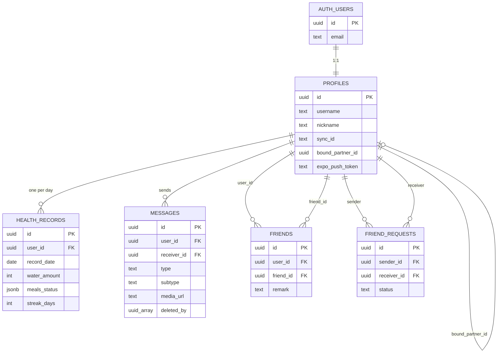

# Codebase map: what Sync looks like today

> This document does one thing: it lays out how the repo is put together right now. What it's built with, how it's layered, how routing works, how data moves.
>
> It doesn't grade anything and it doesn't keep a to-do list. For "which features are still shells", see the honest list in [`README.md`](../../README.md:176). For table structures, see [`docs/DB_SCHEMA_REFERENCE.md`](../DB_SCHEMA_REFERENCE.md:1).
>
> **How this differs from the rest of `specs/`**: those were written before the refactor and describe the target state. This one is written against the current code. When the two disagree, trust this one.
>
> Paths are relative to the repo root. Line numbers were correct when this was written; they drift.

[中文](CODEBASE_MAP.md) · English (this page)

---

## Contents

1. Project overview
2. Tech stack
3. Directory layering
4. Routing
5. Business modules
6. Cross-cutting capabilities
7. Data model
8. Data layer design
9. Realtime sync
10. The chat subsystem
11. Appendix: key file index

---

## 1. Project overview

Sync is a two-person mobile app. The core idea is "two people living a life together": checking in on water and meals, watching movies at the same time, messaging each other, seeing each other's status.

Technically it's a single Expo + Supabase React Native app with no backend of its own. Every server-side capability comes from Supabase: Postgres for data, Auth for login, Storage for media, Realtime for live events, Edge Functions for server logic.

Scale: 42 screen files in `src/app/`, 27 hooks in `src/hooks/`, 32 components in `src/components/` (8 of them in `ui/`), and 19 migrations in `supabase/migrations/`.

---

## 2. Tech stack

### 2.1 Runtime and framework

| Layer | Choice | Version |
|---|---|---|
| Runtime | Expo SDK | 58.0.21 |
| RN | react-native | 0.88.1 |
| React | react | 19.3.0 |
| Routing | expo-router | 58.0.28 |
| Language | JavaScript | — |
| Package manager | npm | — |

There is no `ios/` or `android/` directory. The project uses CNG (Continuous Native Generation): the native projects are generated at build time from `app.json` and config plugins. Anything that needs native behaviour changes goes through a config plugin — nobody edits the native directories by hand.

### 2.2 Backend

| Capability | How it's used | Key file |
|---|---|---|
| Auth | Email + password, session stored in SecureStore | [`src/services/supabase.js`](../../src/services/supabase.js:48) |
| Postgres | 7 business tables + RLS | [`docs/DB_SCHEMA_REFERENCE.md`](../DB_SCHEMA_REFERENCE.md:32) |
| Storage | Private `chat_media` bucket, accessed via signed URLs | [`src/hooks/chat/useSignedMediaUrl.js`](../../src/hooks/chat/useSignedMediaUrl.js:177) |
| Realtime | `postgres_changes` + `broadcast` + `presence` | [`src/hooks/chat/useChatMessages.js`](../../src/hooks/chat/useChatMessages.js:58) |
| Edge Functions | Deno, exactly one: `send-push` | [`supabase/functions/send-push/index.ts`](../../supabase/functions/send-push/index.ts:95) |

### 2.3 Client capability modules

All Expo official modules. No third-party native libraries except WebView and a couple of UI primitives:

- **Media**: `expo-video` (cinema + chat video), `expo-audio` (recording + voice playback), `expo-image-picker`, `expo-media-library`
- **Storage**: `expo-file-system` (sandbox media cache), `expo-secure-store` (session), `@react-native-async-storage/async-storage` (business cache)
- **System**: `expo-notifications`, `expo-haptics`, `expo-brightness`, `expo-screen-orientation`, `expo-location`
- **Web**: `react-native-webview`
- **Animation**: `react-native-reanimated` 4.7.1, `react-native-gesture-handler` 3.3.0, `lottie-react-native`
- **Lists**: `@shopify/flash-list` 2.3.2

### 2.4 Tooling

- **Lint**: ESLint 9 flat config + `eslint-config-expo`
- **Typecheck**: `npx tsc --noEmit` runs, but the source is JS, so it only does inference-level checking
- **CI**: GitHub Actions under `.github/`, runs lint
- **Build**: EAS Build; `runtimeVersion: "2.1"` in `app.json` enables OTA
- **Dependency pinning**: `overrides` in `package.json` force `minimatch@11.0.3` and `glob@14.0.3`

---

## 3. Directory layering

### 3.1 Top level

```
my-app/
├── src/                    # all application source
├── supabase/               # backend assets
│   ├── functions/send-push # the only Edge Function
│   └── migrations/         # 19 SQL migrations
├── docs/                   # documentation (bilingual + specs/ design docs)
├── assets/                 # icons, splash screens
├── certs/                  # certificate notes (actual certs are gitignored)
├── .github/                # CI
├── app.json                # Expo config (single source of truth for CNG)
├── eas.json                # build profiles
├── eslint.config.js
└── package.json
```

### 3.2 The five layers under `src/`

This is the organising convention for the whole project. Diagram 4 in [`docs/specs/SYNC_APP_ARCHITECTURE_DIAGRAMS.md`](SYNC_APP_ARCHITECTURE_DIAGRAMS.md:279) draws the same thing:

```
Layer 1  Routing        src/app/            one file = one screen
Layer 2  Business UI    src/components/     composite components with business meaning
Layer 3  UI atoms       src/components/ui/  pure presentational, no business meaning
Layer 4  Data hooks     src/hooks/          all state and side effects
Layer 5  Services       src/services/       wrappers around supabase / filesystem / push
Cross-cutting           src/constants/ src/context/ src/scripts/
```

Dependencies point one way: 1 → 2 → 3, and 1 → 4 → 5. The rule is that layers 1–3 never `import { supabase }` directly; all data access funnels through the hook layer.

### 3.3 What each directory does

| Directory | Files | Responsibility | Notes |
|---|---|---|---|
| `src/app/` | 42 | Routes and screens | See chapter 4 |
| `src/components/` | 32 | Business components | 10 at the top level, 1 in `chat/`, 4 in `home/`, 5 in `space/`, 2 in `settings/`, 2 in `browser/`, 8 in `ui/` |
| `src/components/ui/` | 8 | UI atoms | AppleCard / AppleButton / AppleListRow / AppleSectionHeader / ProgressRing / Skeleton / EmptyState, all re-exported from `index.js` |
| `src/hooks/` | 27 | Data and side effects | 7 at the top level (cross-domain), 8 in `chat/`, 6 in `health/`, 5 in `browser/`, 1 in `profile/` |
| `src/services/` | 3 | Service wrappers | `supabase.js` `pushService.js` `mediaCache.js` |
| `src/constants/` | 9 | Constants | `colors` `theme` `motion` `haptics` `limits` `settings` `security` `features` `browser/` |
| `src/context/` | 1 | Global context | Only `ThemeContext.js` |
| `src/scripts/` | 9 | JS strings injected into WebView | Ad blocking, media sniffing, desktop UA spoofing |
| `src/types/` | 1 | TS migration contract | Only a README, planning 6 future files |

### 3.4 Design notes

**Two tiers of hooks.** The top level of `src/hooks/` holds cross-domain, Provider-level hooks (`useAuth` `useHealthData` `useCinema` `useAppSettings` `usePushNotifications` `useSyncRoom` `useAccountSwitcher`). Subdirectories hold domain-local hooks. This way, when you see an import in a screen, you can tell at a glance whether it depends on a global capability or a local one.

**What `src/scripts/` actually is.** It produces strings, not importable modules — JS that gets injected into a WebView. The scripts are split into 9 files by function and assembled in order into a single `beforeLoad` script in [`src/scripts/browser/index.js`](../../src/scripts/browser/index.js:23).

**`src/context/` only holds the theme.** Auth, Health and Cinema are all global state, but they live in `src/hooks/` as Provider hooks. `context/` keeps only the purely visual theme context. That split is deliberate: theme is a rendering concern, business state is a data concern.

---

## 4. Routing

### 4.1 Routing model

Expo Router file-based routing, rooted at `src/app/`. Three visibility rules (diagram 2 in [`docs/specs/SYNC_APP_ARCHITECTURE_DIAGRAMS.md`](SYNC_APP_ARCHITECTURE_DIAGRAMS.md:160)):

- `(tabs)/` group → shows the bottom tab bar
- Root-level files (`settings.js` `auth.js` `chat_room.js` etc.) → full-screen push, no tab bar
- Module directories (`chat/` `settings/` `browser/` `health/` etc.) → full-screen push, no tab bar

### 4.2 Full route tree

```
src/app/
├── _layout.js                    root layout: provider tree + Stack + auth guard
├── (tabs)/
│   ├── _layout.js                bottom tab layout (custom CustomTabBar)
│   ├── index.js                  home (health check-in)
│   ├── space.js                  space page (four entry cards)
│   ├── chat.js                   chat list
│   └── profile.js                profile
├── auth.js                       sign in / sign up (modal, slide_from_bottom)
├── settings.js                   settings hub
├── account_info.js               account profile editing
├── bind_partner.js               health partner binding
├── invite_friend.js              invite a friend
├── chat_room.js                  chat room (1:1)
├── contact_profile.js            contact profile
├── cinema.js                     cinema (immersive fullscreen)
├── health/
│   └── index.js                  health detail
├── chat/
│   ├── contacts.js               contacts
│   ├── search.js                 find people / add friends
│   ├── chat_search.js            search chat history
│   ├── chat_settings.js          1:1 chat settings
│   ├── chat_background.js        chat background
│   ├── favorites.js              favourites
│   ├── complaint.js              report
│   ├── friend_settings.js        friend settings
│   ├── friend_permission.js      friend permissions
│   ├── location.js               send location
│   └── moments.js                friend's moments
├── settings/
│   ├── accounts.js               multiple accounts
│   ├── appearance.js             appearance
│   ├── chat.js                   chat settings
│   ├── download.js               download settings
│   ├── health.js                 health settings
│   ├── more.js                   more
│   ├── notifications.js          notification settings
│   ├── privacy.js                privacy
│   ├── privacy-policy.js         privacy policy
│   ├── security.js               security
│   └── storage.js                storage management
├── browser/
│   ├── index.js                  in-app browser
│   ├── history.js                browsing history
│   └── bookmarks.js              bookmarks
├── private/
│   └── index.js                  private space
└── moments/
    └── index.js                  moments
```

### 4.3 Root layout and auth guard

`RootNavigation` in [`src/app/_layout.js`](../../src/app/_layout.js:15) does three things:

1. **Provider nesting**: `ThemeProvider > AuthProvider > HealthProvider > CinemaProvider > RootNavigation`. The order matters. Theme is outermost because every piece of UI needs it. Auth comes next because Health and Cinema both depend on the user. Health and Cinema are business providers.
2. **Auth guard**: `PUBLIC_ROUTES = new Set(['auth'])`. Any non-public route while signed out triggers `router.replace('/auth')`. While the guard is resolving (`isAuthLoading || !isInitialized`) it returns `null` outright, so there's no flash.
3. **Stack config**: `(tabs)` uses `fade`, `auth` uses `modal + slide_from_bottom`, everything else is default. `FloatingPlayer` sits outside the Stack, which is why it can float across screens.

### 4.4 Routing conventions

- **`chat_room.js` lives at the root**: it's the main entry to the chat module and gets pushed from several places (chat list, notification tap, contact profile). Keeping it at the root shortens the path.
- **`settings.js` and `settings/` coexist**: the former is the settings hub, the latter is the sub-page directory. Expo Router allows this. What would conflict is `settings.js` and `settings/index.js`.
- **`private/` and `moments/` are reserved routes**: directories and page shells exist, functionality isn't wired up.

---

## 5. Business modules

Split by what a user can actually perceive. Seven modules.

### 5.1 Health check-in

**Entry points**: `(tabs)/index.js` home + `health/index.js` detail + `settings/health.js` settings

**Capabilities**: daily meal check-in, water intake tracking (adjustable ceiling), streak counting, motto, custom meal labels, partner progress view, push notification to the partner after check-in.

**Key files**:
- [`src/hooks/useHealthData.js`](../../src/hooks/useHealthData.js:20) — orchestration layer
- [`src/hooks/health/useHealthStorage.js`](../../src/hooks/health/useHealthStorage.js:36) — local persistence + day rollover reset
- [`src/hooks/health/useHealthCloud.js`](../../src/hooks/health/useHealthCloud.js:20) — cloud sync + partner subscription
- [`src/hooks/health/useStreak.js`](../../src/hooks/health/useStreak.js:31) — streak calculation
- [`src/hooks/health/useTimeSync.js`](../../src/hooks/health/useTimeSync.js:16) — server time calibration

### 5.2 Chat

**Entry points**: `(tabs)/chat.js` list + `chat_room.js` 1:1 + `chat/contacts.js` contacts

**Capabilities**: text, image, video, voice, location, saved messages, revoke, delete (one-sided soft delete), pin, mute, hide, chat background, message search, report.

**Key files**:
- [`src/hooks/chat/useChatList.js`](../../src/hooks/chat/useChatList.js:96) — conversation list
- [`src/hooks/chat/useChatMessages.js`](../../src/hooks/chat/useChatMessages.js:58) — message stream
- [`src/components/ChatRoomInner.js`](../../src/components/ChatRoomInner.js:84) — chat room UI orchestration
- [`src/hooks/chat/useMediaUpload.js`](../../src/hooks/chat/useMediaUpload.js:194) — media upload
- [`src/hooks/chat/useAudioRecorder.js`](../../src/hooks/chat/useAudioRecorder.js:31) — recording
- [`src/hooks/chat/useSignedMediaUrl.js`](../../src/hooks/chat/useSignedMediaUrl.js:177) — signed URL cache

Details in chapter 10.

### 5.3 Cinema

**Entry points**: `cinema.js` + `space/CinemaCard.js`

**Capabilities**: two people watching a video in sync. One side plays, pauses or seeks, the other follows. With danmaku.

**Implementation**: `expo-video`'s `useVideoPlayer` plus Supabase Realtime broadcast for commands.

**Key files**:
- [`src/hooks/useCinema.js`](../../src/hooks/useCinema.js:12) — CinemaProvider
- [`src/hooks/useSyncRoom.js`](../../src/hooks/useSyncRoom.js:46) — room broadcast + danmaku
- [`src/app/cinema.js`](../../src/app/cinema.js:34) — immersive player screen
- [`src/components/FloatingPlayer.js`](../../src/components/FloatingPlayer.js:26) — cross-screen floating window

### 5.4 In-app browser

**Entry points**: `browser/index.js` + `space/BrowserCard.js`

**Capabilities**: WebView browser with ad blocking, media sniffing (catches m3u8/mp4), desktop UA spoofing, bookmarks, history.

**Key files**:
- [`src/app/browser/index.js`](../../src/app/browser/index.js:35) — main screen
- [`src/hooks/browser/useBrowserNavigation.js`](../../src/hooks/browser/useBrowserNavigation.js:22) — navigation state
- [`src/hooks/browser/useBrowserSniffer.js`](../../src/hooks/browser/useBrowserSniffer.js:48) — media sniffing
- [`src/hooks/browser/useAdBlocker.js`](../../src/hooks/browser/useAdBlocker.js:23) — ad blocking
- [`src/scripts/browser/index.js`](../../src/scripts/browser/index.js:23) — injected script assembly

### 5.5 Social relationships

**Entry points**: `chat/contacts.js` `chat/search.js` `contact_profile.js` `chat/friend_settings.js` `bind_partner.js`

**Capabilities**: find people, add friends, handle friend requests, set remarks, remove friends, bind/unbind a health partner.

**Data**: the `friends` table (two rows per relationship) + `friend_requests` + the `profiles.bound_partner_id` column.

### 5.6 Settings

**Entry points**: `settings.js` + 11 sub-pages under `settings/`

**Capabilities**: appearance (theme), notifications, privacy, chat, download, health, storage, multiple accounts, security, more, privacy policy.

Settings are managed centrally by [`src/hooks/useAppSettings.js`](../../src/hooks/useAppSettings.js:50) and stored in AsyncStorage under `@app_settings`. That hook only reads and writes storage. Which settings are actually consumed by business code is up to each module.

### 5.7 Reserved modules

`private/index.js` (private space) and `moments/index.js` (moments) have routes and page skeletons in place. On the database side, the `moments` table exists with RLS policies.

---

## 6. Cross-cutting capabilities

These don't belong to any single business module; several modules share them.

### 6.1 Theme system

[`src/context/ThemeContext.js`](../../src/context/ThemeContext.js:29) provides `ThemeProvider` and `useAppTheme`.

- Three modes: `system` / `light` / `dark`, stored in AsyncStorage under `@app_theme_mode`
- Palettes come from `SYSTEM_COLORS` in [`src/constants/colors.js`](../../src/constants/colors.js:1)
- Beyond colours it also hands down `radiusCard` `radiusList` `padding` `typography` (from `SIZES` and `TYPOGRAPHY` in `theme.js`)
- Calling `useAppTheme` outside the provider throws

### 6.2 Motion and haptics

- [`src/constants/motion.js`](../../src/constants/motion.js:4): `DURATION` (instant 120 / fast 200 / normal 280 / slow 400 / skeleton 1200), `SPRING` (four parameter sets: default / bouncy / gentle / snap), `EASING`, `SCALE`, `STAGGER`
- [`src/constants/haptics.js`](../../src/constants/haptics.js:9): the `haptic` object wraps success / warning / error / light / medium / heavy / selection

Every animation duration and spring parameter comes from here. No magic numbers in components.

### 6.3 Global settings

[`src/hooks/useAppSettings.js`](../../src/hooks/useAppSettings.js:50) manages 12 switches, stored in AsyncStorage under `@app_settings`. `updateSetting` validates the key against `DEFAULT_SETTINGS` so junk can't be written. `resetSettings` restores defaults.

### 6.4 Push notifications

Three layers:

1. **Client registration**: [`src/hooks/usePushNotifications.js`](../../src/hooks/usePushNotifications.js:27) gets the Expo Push Token and writes it to `profiles.expo_push_token`. Deduplicated via `registeredUserIdRef`; only writes when the token is non-empty.
2. **Client trigger**: [`src/services/pushService.js`](../../src/services/pushService.js:18) calls the `send-push` Edge Function.
3. **Server send**: [`supabase/functions/send-push/index.ts`](../../supabase/functions/send-push/index.ts:95) verifies the JWT, verifies the relationship (must be partner or friend), whitelists the payload, then calls the Expo Push API.

The payload only allows `type` / `targetId` / `targetName`. `targetName` is filled in server-side from the database. A `DeviceNotRegistered` error clears the stale token.

### 6.5 Local storage and caching

Three categories, each with its own medium:

| Type | Medium | Example |
|---|---|---|
| Auth session | SecureStore | `sb-<host>-auth-token` |
| Business cache | AsyncStorage | chat list, messages, health data, settings, bookmarks |
| Media files | FileSystem sandbox | `documentDirectory/chat_media/{audio,image,video,thumb}/` |

[`src/services/mediaCache.js`](../../src/services/mediaCache.js:97) handles media files with an index at `@media_file_index`, exposing `persistMedia` / `resolveLocalMedia` / `downloadToSandbox` / `getMediaCacheSize` / `clearMediaCache`.

### 6.6 Security and privacy

[`src/constants/security.js`](../../src/constants/security.js:61) defines the device-side security policy constants:

- `STORAGE_KEYS`: an inventory of every storage key
- `DEVICE_SECURITY_POLICY`: `privateMediaOnly: true`, `clearSessionOnSignOut: true`, `wipeLocalDataOnDelete: true`, `endToEndEncryption: false`, `minTlsVersion: 'TLS 1.2'`
- `DEVICE_DATA_PROTECTION_NOTES`: 5 device-side protection notes

`endToEndEncryption: false` is an explicit statement: this app has no end-to-end encryption. Messages are plaintext on the server and access is limited by RLS. The `profiles.public_key` column is reserved for a possible future encryption scheme.

`clearCurrentUserLocalState` in [`src/app/settings/security.js`](../../src/app/settings/security.js:84) is the local cleanup when an account is deleted. It scans three categories — `USER_SCOPED_KEY_PREFIXES` / `USER_SCOPED_CHAT_CACHE_PREFIXES` / `GLOBAL_KEY_PREFIXES` — skips global keys, and only clears the current user's data.

### 6.7 Time calibration

[`src/hooks/health/useTimeSync.js`](../../src/hooks/health/useTimeSync.js:16) calls `supabase.rpc('get_server_time')`, computes an offset, and `getNow()` returns the calibrated time. The point is that "today" doesn't depend on the device clock. On failure it keeps the old offset and doesn't block.

### 6.8 Multiple accounts

[`src/hooks/useAccountSwitcher.js`](../../src/hooks/useAccountSwitcher.js:125) keeps the last 5 accounts in `@app_known_accounts`. Emails are stored as a djb2 hash plus a mask (`maskEmail`), and the avatar colour is derived from the hash. Switching accounts is really "sign out, then sign in again".

---

## 7. Data model

### 7.1 Table inventory

Business tables that actually exist in production (authoritative source: [`docs/DB_SCHEMA_REFERENCE.md`](../DB_SCHEMA_REFERENCE.md:32)):

| Table | Columns | Purpose | RLS |
|---|---|---|---|
| `profiles` | 11 | User profile, 1:1 with auth.users | Enabled |
| `messages` | 12 | Chat messages | Enabled |
| `friends` | 9 | Friend relationships (two rows per pair) | Enabled |
| `friend_requests` | 5 | Friend requests | Enabled |
| `health_records` | 6 | Daily health check-in | Enabled |
| `complaints` | — | Reports | Enabled |
| `moments` | — | Moments | Enabled |

`chat_media` is not a table. It's a Storage bucket.

### 7.2 Core table columns

**`profiles`** (11 columns)
```
id                    uuid PK, FK → auth.users.id
username              text
nickname              text
avatar_url            text
sync_id               text            unique sync handle
motto                 text            personal motto
bound_partner_id      uuid            health partner
expo_push_token       text            push token
public_key            text            reserved
last_id_modified_at   timestamptz     used to rate-limit sync_id changes
created_at            timestamptz
```

**`messages`** (12 columns)
```
id             uuid PK
user_id        uuid            sender
receiver_id    uuid            recipient (1:1)
text           text
media_url      text            relative path
thumbnail_url  text
type           text            text / image / video / audio / location / ...
subtype        text            SYNC_SYSTEM / SYNC_CINEMA_ENDED etc.
duration       int             voice/video length
is_read        bool
group_id       uuid            reserved
deleted_by     uuid[]          one-sided soft delete
created_at     timestamptz
```

**`health_records`** (6 columns)
```
id            uuid PK
user_id       uuid
record_date   date            unique together with user_id
water_amount  int
max_water     int
meals_status  jsonb           {breakfast,lunch,dinner} booleans
streak_days   int
```

**`friends`** (9 columns)
```
id          uuid PK
user_id     uuid
friend_id   uuid
remark      text
is_muted    bool
is_pinned   bool
is_hidden   bool
created_at  timestamptz
```

### 7.3 Relationship diagram



### 7.4 Design trade-offs

**Friend relationships are stored as two rows.** In `friends`, A and B are two records (one A→B, one B→A), not a single bidirectional row. The upside is that "change remark" is naturally one-sided — I edit my row and the other person is unaffected — and removing a friend can also be one-sided. The cost is that every query has to write `.or('user_id.eq.X,friend_id.eq.X')` and deletion has to remove two rows. `deleteFriend` in [`src/hooks/chat/useFriendActions.js`](../../src/hooks/chat/useFriendActions.js:15) deletes both directions.

**The health partner is a one-way field.** `profiles.bound_partner_id` only stores "who I bound to". It doesn't guarantee the other side bound back. To find the partner you first read your own `bound_partner_id`, and if it's empty you also have to query in reverse for "who bound me" (`whoBoundMe`). Both steps are in `loadAllData` in [`src/hooks/useHealthData.js`](../../src/hooks/useHealthData.js:135). This is simpler than a bidirectional table; the cost is two queries every time.

**Message deletion is an array soft delete.** Migration 19 changed `delete_conversation` from a physical delete to appending the current user's id to the `messages.deleted_by` array. Queries filter with PostgREST's `.not('deleted_by', 'cs', '{uid}')`. The upside is that a one-sided delete doesn't affect the other person, and it's auditable.

**Media is stored as relative paths.** `messages.media_url` holds something like `chat_media/xxx.jpg`, not a full URL. The bucket is private, so every read needs a freshly signed URL. Since every media message needs an async signature at render time, there's the 500-entry LRU cache in [`src/hooks/chat/useSignedMediaUrl.js`](../../src/hooks/chat/useSignedMediaUrl.js:177).

### 7.5 RLS policies

All 7 tables have RLS enabled. The policy design follows one principle: you can only see your own data.

- `profiles`: everyone can read the public columns (username / nickname / avatar_url / sync_id / motto); only the owner can write
- `messages`: you can only read messages you sent or received, and only write your own
- `health_records`: you can read your own; your partner can read yours (via the `bound_partner_id` relationship)
- `friends` / `friend_requests`: you can only read rows that involve you
- `complaints`: insert only, no reads
- `moments`: friends can read, only the owner can write

The Realtime publication uses a whitelist (migration 16): only tables that need live push are added. That keeps the field set delivered by `postgres_changes` in line with column-level permissions.

---

## 8. Data layer design

### 8.1 Three tiers of data source

```
┌─────────────────────────────────────────────┐
│  Memory (React state / ref)                  │  fastest, page-scoped
├─────────────────────────────────────────────┤
│  Local persistence                           │
│    AsyncStorage  → business cache (JSON)     │  fast, survives restarts
│    FileSystem    → media files (binary)      │
│    SecureStore   → auth session              │
├─────────────────────────────────────────────┤
│  Cloud: Supabase                             │  slow, cross-device
│    Postgres / Storage / Realtime             │
└─────────────────────────────────────────────┘
```

Every data hook follows the same pattern: **cache-first**. Read local, render immediately, then fetch from the cloud asynchronously, overwrite on success and write back to local. On failure, keep the local data and don't clear it.

### 8.2 The health data path

Centred on [`src/hooks/useHealthData.js`](../../src/hooks/useHealthData.js:20), which composes 5 sub-hooks:

```
useHealthData (orchestration)
├── useTimeSync        server time calibration → getDateStr()
├── useHealthStorage   local read/write + day rollover reset
├── useHealthCloud     cloud upsert + partner subscription
├── useStreak          streak calculation
└── useProfileCache    user profile cache
```

**Startup flow** (`loadAllData`, [`src/hooks/useHealthData.js`](../../src/hooks/useHealthData.js:135)):

```
calibrate()                    calibrate server time
  ↓
getDateStr()                   get the "today" date string
  ↓
loadLocal()                    read AsyncStorage, including day rollover reset
  ↓
read profiles.bound_partner_id get the partner id
  ↓ if empty
reverse lookup: who bound me (whoBoundMe)
  ↓
fetchMyRecord()                fetch my own cloud record
  ↓
hydrateFromCloud()             only if the user hasn't interacted yet (userInteractedRef)
  ↓
fetchPartnerRecord()           fetch the partner's record (cache-first)
  ↓
applyPartnerRecord()           write into state
```

The purpose of the `userInteractedRef` guard: if the user taps a check-in before the cloud data comes back, `hydrateFromCloud` is skipped, so the user's fresh action isn't overwritten.

**Write flow** (`confirmCheck`):

```
setMeals()                     local state
  ↓
Haptics.success()              haptic feedback
  ↓
syncToCloud()                  upsert after a 1500ms debounce
  ↓
sendPushNotification()         push to the partner
  ↓
messages.insert(subtype='SYNC_SYSTEM')   leave a system message in the chat
```

**Double debounce on water intake**: `handleAddWater` changes state, then a 500ms debounce fires `scheduleWaterSync`, and inside `useHealthCloud` there's another 1500ms debounce before the actual upsert. Stacked, rapid taps on the plus button produce exactly one network request.

**AppState listener**: on `active`, if the day has rolled over, re-run `loadAllData`. On `background`, call `flushNow()` immediately to push pending data.

### 8.3 Cache key conventions

| Prefix | Purpose | Example |
|---|---|---|
| `@app_` | Global settings | `@app_settings` `@app_theme_mode` `@app_known_accounts` |
| `@chatMessages_` | Message cache (user-scoped) | `@chatMessages_<uid>_<targetId>` |
| `@deletedMsgIds_` | Deleted message id list | `@deletedMsgIds_<uid>_<targetId>` |
| `@partner_health_` | Partner health cache | `@partner_health_<pid>_<date>` |
| `@user_profile_cache` | Own profile cache | — |
| `@media_file_index` | Media file index | — |
| `@browser_bookmarks` | Bookmarks | — |
| `sync_chat_prefs_v1_` | Chat preferences | `sync_chat_prefs_v1_<uid>` |
| `sync_chat_favorites_v1_` | Favourites | `sync_chat_favorites_v1_<uid>` |
| `@sync_device_id` | Cinema device id | — |

Keys that carry a userId are deliberate: when the same device signs into a different account, caches must not bleed across. A double-id structure like `@chatMessages_<uid>_<targetId>` guarantees that.

### 8.4 Data layer conventions

- **Read**: local first, then cloud. A cloud failure never clears local.
- **Write**: change state first, then debounce a cloud sync. A cloud failure keeps local and marks it for retry.
- **Delete**: remove locally and record the deletion first, then delete in the cloud. A cloud failure doesn't affect what the user sees.
- **Day rollover**: handled centrally by `load()` in `useHealthStorage`. When the date changes, today's data is reset.

---

## 9. Realtime sync

There are three independent realtime mechanisms in the project, each with a different job.

### 9.1 Chat messages (postgres_changes)

[`src/hooks/chat/useChatMessages.js`](../../src/hooks/chat/useChatMessages.js:58) subscribes to INSERT and UPDATE on the `messages` table:

- **INSERT**: filter on `receiver_id=eq.<me>`, then run an `isRelevant` check (so unrelated messages don't slip through), check whether `deleted_by` contains me, then trigger `autoDownloadMediaInBackground` plus haptic feedback.
- **UPDATE**: check whether `deleted_by` contains me; if so, remove from the list (the other side deleted the conversation, so it should disappear here too).

Channel names carry a timestamp and a random number (`chat_${sortedIds}_${Date.now()}_${random}`) so reconnects don't collide.

### 9.2 Conversation list (postgres_changes + debounce)

[`src/hooks/chat/useChatList.js`](../../src/hooks/chat/useChatList.js:96) subscribes to two channels:

- `chat_list_realtime_<uid>_<ts>`: listens to INSERT/UPDATE on `messages`, updates unread counts
- `relation_realtime_<uid>_<ts>`: listens to `friends` and `friend_requests`, then after a 400ms debounce runs `scheduleRefresh` → `fetchAll`

Relationship changes are debounced because adding a friend touches two tables at once (two rows inserted into `friends`, plus a status change on `friend_requests`). Without the debounce that fires three full refreshes.

### 9.3 Cinema sync (broadcast + presence)

**Transport**: [`src/hooks/useSyncRoom.js`](../../src/hooks/useSyncRoom.js:46) uses Supabase Realtime broadcast (`ack: false`, no acknowledgement required, lower latency) plus presence (`key: deviceId`, used to tell whether the other side is there).

**Device id**: `getOrCreateDeviceId` generates one with `Crypto.randomUUID()` and stores it in `@sync_device_id`. Presence uses it as the key, which is how "the other person" is distinguished from "me".

**Command types**: `PLAY` / `PAUSE` / `FORCE_SYNC` / `AUTO_SYNC`, plus `url` changes (switching videos).

**Sync algorithm** ([`src/hooks/useCinema.js`](../../src/hooks/useCinema.js:12)):

```
poll the local playback position every 500ms
  ↓
if |local - remote| > SYNC_THRESHOLD (2.5s)
  ↓
and we're not inside the seek lock window (3000ms)
  ↓
and it's been more than 2000ms since the last forced sync
  ↓
seek to align
```

A few refs that matter:

- `isHandlingRemote`: while a remote command is being applied, don't broadcast our own state (prevents echo)
- `seekLockTimer`: for 3 seconds after a seek, ignore new sync commands (prevents jitter)
- `lastForceSyncTime`: rate-limits AUTO_SYNC to once every 2 seconds
- `silenceTimer`: no new command for 1200ms means the other side stopped interacting

**Switching videos** (`loadUrl`): on iOS it's pause → wait 50ms → `replaceAsync` → wait 1000ms → play. On Android it's `replace` → wait 800ms → play. That platform difference was found by testing, not from docs.

**Closing** (`closePlayer`): pause + `replace(null)`, then change the subtype of the matching `cinema_invite` message to `SYNC_CINEMA_ENDED`. It tries an exact message id match first, and falls back to the newest message from that user.

### 9.4 Danmaku

`emitDanmaku` in [`src/hooks/useSyncRoom.js`](../../src/hooks/useSyncRoom.js:112) goes over the same broadcast channel. `MAX_DANMAKU_COUNT = 100`, held in memory, cleared when you leave the room.

---

## 10. The chat subsystem

Chat is the largest module by code volume, so it gets its own chapter.

### 10.1 Layering

```
chat_room.js (route)
  └── ChatRoomInner.js (UI orchestration)
        ├── useChatMessages      message stream + realtime
        ├── useMediaUpload       image/video upload
        ├── useAudioRecorder     recording
        ├── useChatPrefs         pin/mute/hide/background
        ├── useChatFavorites     favourites
        ├── useSignedMediaUrl    signed URLs
        └── MessageBubble / ChatInputBar / InteractiveMediaViewer (presentation)
```

### 10.2 Message send flow

**Text** (`handleSendText`):

```
optimistically insert a local message (localOnly: true, status: 'sending')
  ↓
supabase.from('messages').insert()
  ↓ on success
patchMessage(id, {localOnly: false, status: 'sent'})
  ↓ on failure
patchMessage(id, {status: 'failed'})
```

**Media** (`useMediaUpload`):

```
pick with ImagePicker
  ↓
check size (MAX_MEDIA_BYTES = 50MB)
  ↓
uploadToSupabase() uploads to the chat_media bucket
  ↓
createSignedMediaUrl() gets a signed URL (for local preview)
  ↓
saveAndSend() optimistic insert
  ↓
insert into the messages table (stores the relative path)
  ↓
sendPushNotification()
```

**Voice** (`useAudioRecorder`):

```
record (HIGH_QUALITY + isMeteringEnabled)
  ↓
200ms timer updates the duration
  ↓
stop → upload → insert (with duration)
  ↓
sendPushNotification(targetId, '', '[Voice message]')
```

### 10.3 Resending

`handleResendMessage` handles messages with `status: 'failed'`. For media messages it re-uploads the local `file://` file, because the original may have been cleaned up, then upserts with the new path. Voice messages carry `duration` along.

### 10.4 Deleting messages

Three levels of deletion with different semantics:

| Action | Scope | Implementation |
|---|---|---|
| Revoke | Single message, visible to both | `revokeMessage`, rewrites the text to "message revoked" |
| Delete one | Single message, only for me | `deleteMessage`, adds to `CACHE_DEL_KEY` + deletes my side in the cloud |
| Delete conversation | Whole conversation, only for me | the `delete_conversation` RPC from migration 19, appends to `deleted_by` |

`deleteMessage` writes the message id into `@deletedMsgIds_<uid>_<targetId>` first, so even if the cloud delete fails, it won't show up locally again.

### 10.5 Media cache

[`src/services/mediaCache.js`](../../src/services/mediaCache.js:97) stores media files in the sandbox:

```
documentDirectory/chat_media/
├── audio/
├── image/
├── video/
└── thumb/
```

The index lives in `@media_file_index`. `persistMedia(uri, msgId, kind)` copies the temp file into the right directory; `resolveLocalMedia(msgId, kind)` looks up the local path. That's what makes old images viewable offline.

### 10.6 Signed URL cache

The design in [`src/hooks/chat/useSignedMediaUrl.js`](../../src/hooks/chat/useSignedMediaUrl.js:177):

- `SIGNED_URL_TTL` is 7 days, `REFRESH_AHEAD_MS` refreshes 1 day early
- `MAX_CACHE_ENTRIES` is 500, LRU
- an `inflight` Map deduplicates concurrent requests (the same path requested several times at once is signed once)
- `toStoragePath` normalises every input shape (local URI / relative path / full URL) into a storage path

---

## 11. Appendix: key file index

### 11.1 Entry points and config

| File | Role |
|---|---|
| [`src/app/_layout.js`](../../src/app/_layout.js:15) | Root layout, provider tree, auth guard |
| [`src/app/(tabs)/_layout.js`](../../src/app/(tabs)/_layout.js:6) | Bottom tab layout |
| [`src/services/supabase.js`](../../src/services/supabase.js:48) | Supabase client + SecureStore adapter |
| [`app.json`](../../app.json:1) | Expo config (single source of truth for CNG) |
| [`package.json`](../../package.json:1) | Dependencies and scripts |

### 11.2 Core hooks

| File | Responsibility |
|---|---|
| [`src/hooks/useHealthData.js`](../../src/hooks/useHealthData.js:20) | Health data orchestration (Provider) |
| [`src/hooks/chat/useChatList.js`](../../src/hooks/chat/useChatList.js:96) | Conversation list |
| [`src/hooks/chat/useChatMessages.js`](../../src/hooks/chat/useChatMessages.js:58) | Message stream |
| [`src/hooks/useCinema.js`](../../src/hooks/useCinema.js:12) | Cinema sync (Provider) |
| [`src/hooks/health/useHealthCloud.js`](../../src/hooks/health/useHealthCloud.js:20) | Health cloud sync |
| [`src/hooks/health/useHealthStorage.js`](../../src/hooks/health/useHealthStorage.js:36) | Health local storage |
| [`src/hooks/useSyncRoom.js`](../../src/hooks/useSyncRoom.js:46) | Room broadcast + danmaku |
| [`src/hooks/chat/useSignedMediaUrl.js`](../../src/hooks/chat/useSignedMediaUrl.js:177) | Signed URL cache |

### 11.3 Services

| File | Responsibility |
|---|---|
| [`src/services/supabase.js`](../../src/services/supabase.js:48) | Client singleton + auth storage |
| [`src/services/pushService.js`](../../src/services/pushService.js:18) | Push trigger |
| [`src/services/mediaCache.js`](../../src/services/mediaCache.js:97) | Sandbox media cache |
| [`supabase/functions/send-push/index.ts`](../../supabase/functions/send-push/index.ts:95) | Push Edge Function |

### 11.4 Database migrations

| Migration | Purpose |
|---|---|
| 01 | add subtype to messages |
| 02 | media to relative paths + tighten RLS |
| 03 | make the chat_media bucket private |
| 04 | sync_id change-rate limit trigger |
| 05 | bidirectional partner unbind RPC |
| 06 | RLS baseline on core tables |
| 07 | create the 5 missing core tables |
| 08 | RLS policies for core tables |
| 09 | add missing RPCs |
| 10 | fix empty sync_id on signup |
| 11 | GRANTs for 7 tables |
| 12 | enable the Realtime publication |
| 13 | add all tables to Realtime |
| 14 | harden unbind_partner |
| 15 | restrict sensitive profile columns |
| 16 | Realtime whitelist |
| 17 | fix chat_media signed-read policy |
| 18 | conversation delete RPC |
| 19 | conversation soft delete (my side only) |

### 11.5 Related documents

| Document | Content |
|---|---|
| [`docs/DB_SCHEMA_REFERENCE.md`](../DB_SCHEMA_REFERENCE.md:1) | Real production schema + RLS policy inventory |
| [`docs/specs/SYNC_APP_ARCHITECTURE_DIAGRAMS.md`](SYNC_APP_ARCHITECTURE_DIAGRAMS.md:1) | 18 Mermaid architecture diagrams |
| [`docs/specs/SYNC_APP_REFACTOR_EXECUTION_SPEC.md`](SYNC_APP_REFACTOR_EXECUTION_SPEC.md:1) | Refactor execution spec (PART1/2/3) |
| [`README.md`](../../README.md:1) | Project overview + feature status list |
| [`src/types/README.md`](../../src/types/README.md:1) | TS migration contract |
| [`src/constants/security.js`](../../src/constants/security.js:61) | Device-side security policy constants |