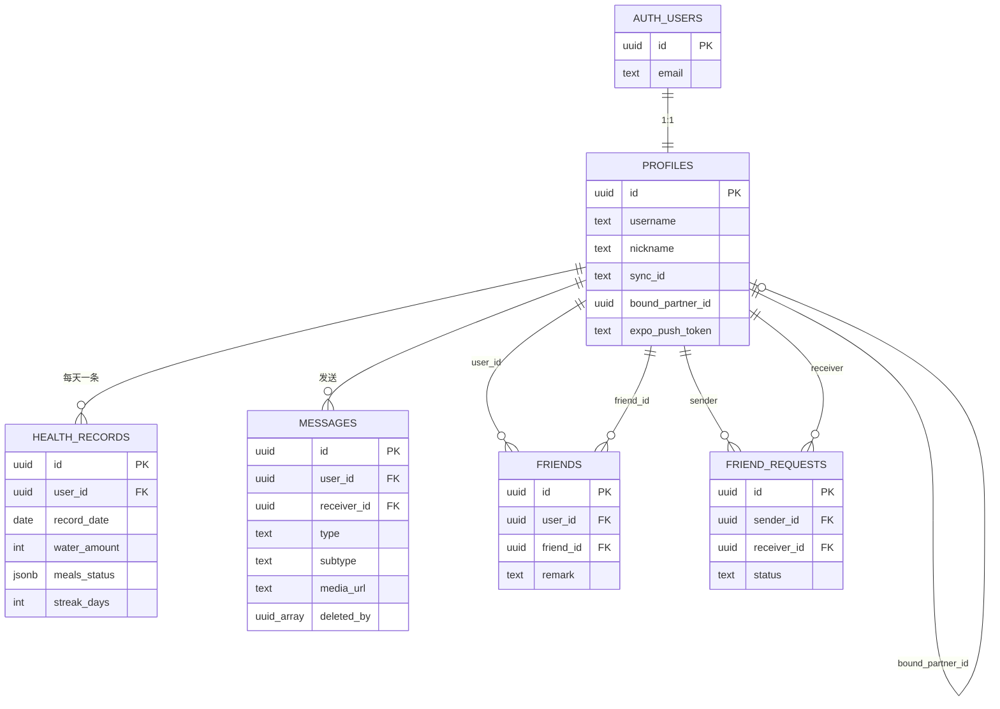

# 代码地图：Sync 现在长什么样

> 这份文档只做一件事：把当前仓库的代码结构摊开给你看。用了什么、怎么分层、路由怎么走、数据怎么流。
>
> 它不评价好坏，也不列待办。想了解「哪些功能还没做完」，看根目录 [`README.md`](../../README.md:176) 的诚实清单；想了解数据库表结构，看 [`docs/DB_SCHEMA_REFERENCE.md`](../DB_SCHEMA_REFERENCE.md:1)。
>
> **和 `specs/` 里其他文档的区别**：那些是重构前写的目标态，这份是照着当前代码写的现状。两者对不上时，以这份为准。
>
> 路径都相对仓库根目录。行号以写作时的代码为准，后续改动可能漂移。

[English](CODEBASE_MAP.en.md) · 中文（当前页）

---

## 目录

1. 项目概览
2. 技术栈
3. 目录分层
4. 路由结构
5. 业务模块
6. 横切能力
7. 数据模型
8. 数据层设计
9. 实时同步
10. 聊天子系统
11. 附录：关键文件索引

---

## 1. 项目概览

Sync 是一个双人向的移动应用，核心场景是「两个人一起过日子」：一起打卡喝水吃饭、一起看电影、互相发消息、看对方状态。

技术上是一个 Expo + Supabase 的单体 React Native 应用，没有自建后端。服务端能力全部由 Supabase 提供：Postgres 存数据、Auth 管登录、Storage 存媒体、Realtime 推实时事件、Edge Functions 跑服务端逻辑。

代码规模：`src/app/` 42 个页面文件，`src/hooks/` 27 个 hook，`src/components/` 32 个组件（含 `ui/` 8 个），`supabase/migrations/` 19 个迁移。

---

## 2. 技术栈

### 2.1 运行时与框架

| 层 | 选型 | 版本 |
|---|---|---|
| 运行时 | Expo SDK | 58.0.21 |
| RN | react-native | 0.88.1 |
| React | react | 19.3.0 |
| 路由 | expo-router | 58.0.28 |
| 语言 | JavaScript | — |
| 包管理 | npm | — |

仓库里没有 `ios/` 和 `android/` 目录，走的是 CNG（Continuous Native Generation）：原生工程在构建时由 `app.json` 和 config plugins 生成。任何需要改原生行为的需求都通过 config plugin 实现，不手改原生目录。

### 2.2 后端

| 能力 | 用法 | 关键文件 |
|---|---|---|
| Auth | 邮箱密码登录，session 存 SecureStore | [`src/services/supabase.js`](../../src/services/supabase.js:48) |
| Postgres | 7 张业务表 + RLS | [`docs/DB_SCHEMA_REFERENCE.md`](../DB_SCHEMA_REFERENCE.md:32) |
| Storage | 私有桶 `chat_media`，签名 URL 访问 | [`src/hooks/chat/useSignedMediaUrl.js`](../../src/hooks/chat/useSignedMediaUrl.js:177) |
| Realtime | `postgres_changes` + `broadcast` + `presence` | [`src/hooks/chat/useChatMessages.js`](../../src/hooks/chat/useChatMessages.js:58) |
| Edge Functions | Deno，只有一个 `send-push` | [`supabase/functions/send-push/index.ts`](../../supabase/functions/send-push/index.ts:95) |

### 2.3 客户端能力模块

全部是 Expo 官方模块，没有引入第三方原生库（WebView 和几个 UI 基础库除外）：

- **媒体**：`expo-video`（放映厅 + 聊天视频）、`expo-audio`（录音 + 语音播放）、`expo-image-picker`、`expo-media-library`
- **存储**：`expo-file-system`（沙箱媒体缓存）、`expo-secure-store`（session）、`@react-native-async-storage/async-storage`（业务缓存）
- **系统**：`expo-notifications`、`expo-haptics`、`expo-brightness`、`expo-screen-orientation`、`expo-location`
- **Web**：`react-native-webview`
- **动画**：`react-native-reanimated` 4.7.1、`react-native-gesture-handler` 3.3.0、`lottie-react-native`
- **列表**：`@shopify/flash-list` 2.3.2

### 2.4 工程化

- **Lint**：ESLint 9 flat config + `eslint-config-expo`
- **类型检查**：`npx tsc --noEmit` 可用，源码是 JS，实际只做推断级检查
- **CI**：`.github/` 下的 GitHub Actions，跑 lint
- **构建**：EAS Build，`app.json` 里 `runtimeVersion: "2.1"` 支持 OTA
- **依赖锁定**：`package.json` 的 `overrides` 强制 `minimatch@11.0.3` 和 `glob@14.0.3`

---

## 3. 目录分层

### 3.1 顶层结构

```
my-app/
├── src/                    # 全部业务源码
├── supabase/               # 后端资产
│   ├── functions/send-push # 唯一的 Edge Function
│   └── migrations/         # 19 个 SQL 迁移
├── docs/                   # 文档（中英双语 + specs/ 设计文档）
├── assets/                 # 图标、启动图
├── certs/                  # 证书说明（实际证书被 gitignore）
├── .github/                # CI
├── app.json                # Expo 配置（CNG 的唯一真相源）
├── eas.json                # 构建 profile
├── eslint.config.js
└── package.json
```

### 3.2 `src/` 的五层

这是整个项目的组织约定，[`docs/specs/SYNC_APP_ARCHITECTURE_DIAGRAMS.md`](SYNC_APP_ARCHITECTURE_DIAGRAMS.md:279) 的图 4 画的就是这个：

```
第 1 层  路由层        src/app/           每个文件是一个屏幕
第 2 层  业务组件层    src/components/    有业务语义的复合组件
第 3 层  UI 原子层     src/components/ui/ 无业务语义的纯展示组件
第 4 层  数据 Hook 层  src/hooks/         所有状态与副作用
第 5 层  服务层        src/services/      对 supabase / 文件系统 / 推送的封装
横切层                src/constants/ src/context/ src/scripts/
```

依赖方向是单向的：1 → 2 → 3，1 → 4 → 5。约定是「第 1～3 层不直接 `import { supabase }`」，所有数据访问都收敛到 hook 层。

### 3.3 各目录职责

| 目录 | 文件数 | 职责 | 备注 |
|---|---|---|---|
| `src/app/` | 42 | 路由与屏幕 | 见第 4 章 |
| `src/components/` | 32 | 业务组件 | 顶层 10 个，`chat/` 1 个，`home/` 4 个，`space/` 5 个，`settings/` 2 个，`browser/` 2 个，`ui/` 8 个 |
| `src/components/ui/` | 8 | UI 原子 | AppleCard / AppleButton / AppleListRow / AppleSectionHeader / ProgressRing / Skeleton / EmptyState，统一从 `index.js` 导出 |
| `src/hooks/` | 27 | 数据与副作用 | 顶层 7 个（跨域），`chat/` 8 个，`health/` 6 个，`browser/` 5 个，`profile/` 1 个 |
| `src/services/` | 3 | 服务封装 | `supabase.js` `pushService.js` `mediaCache.js` |
| `src/constants/` | 9 | 常量 | `colors` `theme` `motion` `haptics` `limits` `settings` `security` `features` `browser/` |
| `src/context/` | 1 | 全局 Context | 只有 `ThemeContext.js` |
| `src/scripts/` | 9 | 注入 WebView 的 JS 字符串 | 广告拦截、嗅探、桌面 UA 伪装 |
| `src/types/` | 1 | TS 迁移契约 | 只有 README，规划了 6 个未来文件 |

### 3.4 设计说明

**hook 层的两级划分。** `src/hooks/` 顶层放跨域 Provider 级 hook（`useAuth` `useHealthData` `useCinema` `useAppSettings` `usePushNotifications` `useSyncRoom` `useAccountSwitcher`），子目录放域内 hook。这样页面 import 时能一眼看出依赖的是全局能力还是局部能力。

**`src/scripts/` 的定位。** 它产出的是字符串（注入 WebView 的 JS），不是可 import 的模块。这些脚本按功能拆成 9 个文件，最后在 [`src/scripts/browser/index.js`](../../src/scripts/browser/index.js:23) 里按顺序拼装成一段 `beforeLoad` 脚本。

**`src/context/` 只放主题。** Auth、Health、Cinema 三个全局状态都以 Provider hook 的形式放在 `src/hooks/` 里，`context/` 只保留纯 UI 相关的主题 Context。这是刻意的划分：主题是渲染层的事，业务状态是数据层的事。

---

## 4. 路由结构

### 4.1 路由模型

Expo Router 的文件式路由，根目录是 `src/app/`。三层可见性规则（[`docs/specs/SYNC_APP_ARCHITECTURE_DIAGRAMS.md`](SYNC_APP_ARCHITECTURE_DIAGRAMS.md:160) 图 2）：

- `(tabs)/` 分组 → 显示底部 Tab 栏
- 根级文件（`settings.js` `auth.js` `chat_room.js` 等）→ 全屏推入，无 Tab 栏
- 模块目录（`chat/` `settings/` `browser/` `health/` 等）→ 全屏推入，无 Tab 栏

### 4.2 完整路由树

```
src/app/
├── _layout.js                    根布局：Provider 树 + Stack + 鉴权守卫
├── (tabs)/
│   ├── _layout.js                底部 Tab 布局（自定义 CustomTabBar）
│   ├── index.js                  首页（健康打卡）
│   ├── space.js                  空间页（四个入口卡片）
│   ├── chat.js                   聊天列表
│   └── profile.js                我的
├── auth.js                       登录 / 注册（modal，slide_from_bottom）
├── settings.js                   设置总入口
├── account_info.js               账号资料编辑
├── bind_partner.js               健康搭子绑定
├── invite_friend.js              邀请好友
├── chat_room.js                  聊天室（单聊）
├── contact_profile.js            联系人资料页
├── cinema.js                     放映厅（沉浸式全屏）
├── health/
│   └── index.js                  健康详情
├── chat/
│   ├── contacts.js               通讯录
│   ├── search.js                 搜人加好友
│   ├── chat_search.js            聊天记录搜索
│   ├── chat_settings.js          单聊设置
│   ├── chat_background.js        聊天背景
│   ├── favorites.js              收藏
│   ├── complaint.js              投诉
│   ├── friend_settings.js        好友设置
│   ├── friend_permission.js      好友权限
│   ├── location.js               发送位置
│   └── moments.js                好友朋友圈
├── settings/
│   ├── accounts.js               多账号
│   ├── appearance.js             外观
│   ├── chat.js                   聊天设置
│   ├── download.js               下载设置
│   ├── health.js                 健康设置
│   ├── more.js                   更多
│   ├── notifications.js          通知设置
│   ├── privacy.js                隐私
│   ├── privacy-policy.js         隐私政策
│   ├── security.js               安全
│   └── storage.js                存储管理
├── browser/
│   ├── index.js                  内置浏览器
│   ├── history.js                浏览历史
│   └── bookmarks.js              书签
├── private/
│   └── index.js                  私密空间
└── moments/
    └── index.js                  朋友圈
```

### 4.3 根布局与鉴权守卫

[`src/app/_layout.js`](../../src/app/_layout.js:15) 的 `RootNavigation` 做三件事：

1. **Provider 嵌套**：`ThemeProvider > AuthProvider > HealthProvider > CinemaProvider > RootNavigation`。顺序有讲究——Theme 最外层（所有 UI 都要用），Auth 次之（Health 和 Cinema 都依赖 user），Health 和 Cinema 是业务 Provider。
2. **鉴权守卫**：`PUBLIC_ROUTES = new Set(['auth'])`，非公开路由且未登录时 `router.replace('/auth')`。守卫期间（`isAuthLoading || !isInitialized`）直接 `return null`，避免闪屏。
3. **Stack 配置**：`(tabs)` 用 `fade`，`auth` 用 `modal + slide_from_bottom`，其余默认。`FloatingPlayer` 挂在 Stack 外面，所以能跨页面悬浮。

### 4.4 路由约定

- **`chat_room.js` 放在根级**：它是聊天模块的主入口，需要从多个地方（聊天列表、通知点击、联系人资料页）跳转，放在根级可以减少路径层级。
- **`settings.js` 与 `settings/` 并存**：前者是设置总入口，后者是子页面目录。Expo Router 允许这种结构（冲突的是 `settings.js` 和 `settings/index.js`）。
- **`private/` 和 `moments/` 是预留路由**：目录和页面已建好，功能待接。

---

## 5. 业务模块

按用户可感知的功能切分，一共 7 个模块。

### 5.1 健康打卡

**入口**：`(tabs)/index.js` 首页 + `health/index.js` 详情 + `settings/health.js` 设置

**能力**：每日三餐打卡、饮水量记录（可调上限）、连续打卡天数（streak）、座右铭、三餐文案自定义、伴侣进度查看、打卡后给对方推送。

**关键文件**：
- [`src/hooks/useHealthData.js`](../../src/hooks/useHealthData.js:20) — 编排层
- [`src/hooks/health/useHealthStorage.js`](../../src/hooks/health/useHealthStorage.js:36) — 本地持久化 + 跨天重置
- [`src/hooks/health/useHealthCloud.js`](../../src/hooks/health/useHealthCloud.js:20) — 云端同步 + 伴侣订阅
- [`src/hooks/health/useStreak.js`](../../src/hooks/health/useStreak.js:31) — 连续天数计算
- [`src/hooks/health/useTimeSync.js`](../../src/hooks/health/useTimeSync.js:16) — 服务器时间校准

### 5.2 聊天

**入口**：`(tabs)/chat.js` 列表 + `chat_room.js` 单聊 + `chat/contacts.js` 通讯录

**能力**：文字、图片、视频、语音、位置、收藏消息、撤回、删除（单边软删）、置顶、免打扰、隐藏、聊天背景、消息搜索、投诉。

**关键文件**：
- [`src/hooks/chat/useChatList.js`](../../src/hooks/chat/useChatList.js:96) — 会话列表
- [`src/hooks/chat/useChatMessages.js`](../../src/hooks/chat/useChatMessages.js:58) — 消息流
- [`src/components/ChatRoomInner.js`](../../src/components/ChatRoomInner.js:84) — 聊天室 UI 编排
- [`src/hooks/chat/useMediaUpload.js`](../../src/hooks/chat/useMediaUpload.js:194) — 媒体上传
- [`src/hooks/chat/useAudioRecorder.js`](../../src/hooks/chat/useAudioRecorder.js:31) — 录音
- [`src/hooks/chat/useSignedMediaUrl.js`](../../src/hooks/chat/useSignedMediaUrl.js:177) — 签名 URL 缓存

详见第 10 章。

### 5.3 放映厅

**入口**：`cinema.js` + `space/CinemaCard.js`

**能力**：两人同步看视频。一方播放/暂停/拖进度，另一方跟随。带弹幕。

**实现**：`expo-video` 的 `useVideoPlayer` + Supabase Realtime broadcast 传指令。

**关键文件**：
- [`src/hooks/useCinema.js`](../../src/hooks/useCinema.js:12) — CinemaProvider
- [`src/hooks/useSyncRoom.js`](../../src/hooks/useSyncRoom.js:46) — 房间广播 + 弹幕
- [`src/app/cinema.js`](../../src/app/cinema.js:34) — 沉浸式播放页
- [`src/components/FloatingPlayer.js`](../../src/components/FloatingPlayer.js:26) — 跨页面悬浮小窗

### 5.4 内置浏览器

**入口**：`browser/index.js` + `space/BrowserCard.js`

**能力**：WebView 浏览器，带广告拦截、媒体嗅探（抓 m3u8/mp4）、桌面 UA 伪装、书签、历史。

**关键文件**：
- [`src/app/browser/index.js`](../../src/app/browser/index.js:35) — 主页面
- [`src/hooks/browser/useBrowserNavigation.js`](../../src/hooks/browser/useBrowserNavigation.js:22) — 导航状态
- [`src/hooks/browser/useBrowserSniffer.js`](../../src/hooks/browser/useBrowserSniffer.js:48) — 媒体嗅探
- [`src/hooks/browser/useAdBlocker.js`](../../src/hooks/browser/useAdBlocker.js:23) — 广告拦截
- [`src/scripts/browser/index.js`](../../src/scripts/browser/index.js:23) — 注入脚本拼装

### 5.5 社交关系

**入口**：`chat/contacts.js` `chat/search.js` `contact_profile.js` `chat/friend_settings.js` `bind_partner.js`

**能力**：搜人、加好友、处理好友请求、改备注、删好友、绑定/解绑健康搭子。

**数据**：`friends` 表（双向存两行）+ `friend_requests` 表 + `profiles.bound_partner_id` 字段。

### 5.6 设置

**入口**：`settings.js` + `settings/` 下 11 个子页

**能力**：外观（主题）、通知、隐私、聊天、下载、健康、存储、多账号、安全、更多、隐私政策。

设置项统一由 [`src/hooks/useAppSettings.js`](../../src/hooks/useAppSettings.js:50) 管理，存 AsyncStorage `@app_settings`。这个 hook 只负责读写存储，具体哪些设置被业务代码消费，见各模块自己的实现。

### 5.7 预留模块

`private/index.js`（私密空间）、`moments/index.js`（朋友圈）已建好路由和页面骨架。数据库侧 `moments` 表已建好且有 RLS 策略。

---

## 6. 横切能力

这些能力不属于某个业务模块，而是被多个模块共用。

### 6.1 主题系统

[`src/context/ThemeContext.js`](../../src/context/ThemeContext.js:29) 提供 `ThemeProvider` 和 `useAppTheme`。

- 三种模式：`system` / `light` / `dark`，存 AsyncStorage `@app_theme_mode`
- 调色板来自 [`src/constants/colors.js`](../../src/constants/colors.js:1) 的 `SYSTEM_COLORS`
- 除了颜色，还下发 `radiusCard` `radiusList` `padding` `typography`（来自 `theme.js` 的 `SIZES` 和 `TYPOGRAPHY`）
- `useAppTheme` 在 Provider 外调用会直接 throw

### 6.2 动效与触感

- [`src/constants/motion.js`](../../src/constants/motion.js:4)：`DURATION`（instant 120 / fast 200 / normal 280 / slow 400 / skeleton 1200）、`SPRING`（default / bouncy / gentle / snap 四套参数）、`EASING`、`SCALE`、`STAGGER`
- [`src/constants/haptics.js`](../../src/constants/haptics.js:9)：`haptic` 对象封装了 success / warning / error / light / medium / heavy / selection

所有动画时长和弹簧参数都从这里取，不在组件里写魔法数字。

### 6.3 全局设置

[`src/hooks/useAppSettings.js`](../../src/hooks/useAppSettings.js:50) 管 12 个开关，存 AsyncStorage `@app_settings`。`updateSetting` 会校验 key 是否在 `DEFAULT_SETTINGS` 里，防止写入脏数据。`resetSettings` 恢复默认。

### 6.4 推送通知

三层结构：

1. **客户端注册**：[`src/hooks/usePushNotifications.js`](../../src/hooks/usePushNotifications.js:27) 拿 Expo Push Token，写进 `profiles.expo_push_token`。有 `registeredUserIdRef` 去重，token 非空才写。
2. **客户端触发**：[`src/services/pushService.js`](../../src/services/pushService.js:18) 调 Edge Function `send-push`。
3. **服务端发送**：[`supabase/functions/send-push/index.ts`](../../supabase/functions/send-push/index.ts:95) 校验 JWT、校验关系（必须是伴侣或好友）、白名单化 payload、调 Expo Push API。

payload 只允许 `type` / `targetId` / `targetName` 三个字段，`targetName` 由服务端查库填充，`DeviceNotRegistered` 错误会清掉失效 token。

### 6.5 本地存储与缓存

分三类，各有各的存储介质：

| 类型 | 介质 | 例子 |
|---|---|---|
| 认证 session | SecureStore | `sb-<host>-auth-token` |
| 业务缓存 | AsyncStorage | 聊天列表、消息、健康数据、设置、书签 |
| 媒体文件 | FileSystem 沙箱 | `documentDirectory/chat_media/{audio,image,video,thumb}/` |

[`src/services/mediaCache.js`](../../src/services/mediaCache.js:97) 管媒体文件，有索引 `@media_file_index`，支持 `persistMedia` / `resolveLocalMedia` / `downloadToSandbox` / `getMediaCacheSize` / `clearMediaCache`。

### 6.6 安全与隐私

[`src/constants/security.js`](../../src/constants/security.js:61) 定义了设备侧的安全策略常量：

- `STORAGE_KEYS`：所有存储 key 的清单
- `DEVICE_SECURITY_POLICY`：`privateMediaOnly: true`、`clearSessionOnSignOut: true`、`wipeLocalDataOnDelete: true`、`endToEndEncryption: false`、`minTlsVersion: 'TLS 1.2'`
- `DEVICE_DATA_PROTECTION_NOTES`：5 条设备侧防护说明

`endToEndEncryption: false` 是明确标注：这个 App 没有端到端加密，消息在服务端是明文，靠 RLS 限制读取范围。`profiles.public_key` 字段为未来可能的加密方案预留。

[`src/app/settings/security.js`](../../src/app/settings/security.js:84) 的 `clearCurrentUserLocalState` 是注销账号时的本地清理逻辑，按 `USER_SCOPED_KEY_PREFIXES` / `USER_SCOPED_CHAT_CACHE_PREFIXES` / `GLOBAL_KEY_PREFIXES` 三类扫描，跳过全局 key，只清当前用户的。

### 6.7 时间校准

[`src/hooks/health/useTimeSync.js`](../../src/hooks/health/useTimeSync.js:16) 调 `supabase.rpc('get_server_time')` 拿服务器时间，算 offset，`getNow()` 返回校准后的时间。目的是让「今天」的判定不受设备时间影响。失败时保留旧 offset，不阻塞。

### 6.8 多账号

[`src/hooks/useAccountSwitcher.js`](../../src/hooks/useAccountSwitcher.js:125) 存最近 5 个账号到 `@app_known_accounts`，邮箱用 djb2 哈希 + 掩码（`maskEmail`）存储，头像颜色由哈希决定。切换账号走的是「退出登录 + 重新登录」流程。

---

## 7. 数据模型

### 7.1 表清单

线上实际存在的业务表（以 [`docs/DB_SCHEMA_REFERENCE.md`](../DB_SCHEMA_REFERENCE.md:32) 为准）：

| 表 | 列数 | 用途 | RLS |
|---|---|---|---|
| `profiles` | 11 | 用户资料，1:1 对应 auth.users | 已启用 |
| `messages` | 12 | 聊天消息 | 已启用 |
| `friends` | 9 | 好友关系（双向两行） | 已启用 |
| `friend_requests` | 5 | 好友请求 | 已启用 |
| `health_records` | 6 | 每日健康打卡 | 已启用 |
| `complaints` | — | 投诉 | 已启用 |
| `moments` | — | 朋友圈 | 已启用 |

`chat_media` 不是表，是 Storage 桶。

### 7.2 核心表字段

**`profiles`**（11 列）
```
id                    uuid PK, FK → auth.users.id
username              text
nickname              text
avatar_url            text
sync_id               text            唯一同步号
motto                 text            座右铭
bound_partner_id      uuid            健康搭子
expo_push_token       text            推送 token
public_key            text            预留
last_id_modified_at   timestamptz     sync_id 改频限制用
created_at            timestamptz
```

**`messages`**（12 列）
```
id             uuid PK
user_id        uuid            发送者
receiver_id    uuid            接收者（单聊）
text           text
media_url      text            相对路径
thumbnail_url  text
type           text            text / image / video / audio / location / ...
subtype        text            SYNC_SYSTEM / SYNC_CINEMA_ENDED 等
duration       int             语音/视频时长
is_read        bool
group_id       uuid            预留
deleted_by     uuid[]          单边软删
created_at     timestamptz
```

**`health_records`**（6 列）
```
id            uuid PK
user_id       uuid
record_date   date            与 user_id 组成唯一键
water_amount  int
max_water     int
meals_status  jsonb           {breakfast,lunch,dinner} 布尔
streak_days   int
```

**`friends`**（9 列）
```
id          uuid PK
user_id     uuid
friend_id   uuid
remark      text
is_muted    bool
is_pinned   bool
is_hidden   bool
created_at  timestamptz
```

### 7.3 关系图



### 7.4 设计取舍

**好友关系存两行。** `friends` 表里 A 和 B 是两条记录（A→B 一条，B→A 一条），不是一条双向记录。好处是「改备注」天然是单边的（我改我的那条，不影响对方），删好友也能单边删。代价是所有查询都得写 `.or('user_id.eq.X,friend_id.eq.X')`，删除时要删两行。[`src/hooks/chat/useFriendActions.js`](../../src/hooks/chat/useFriendActions.js:15) 的 `deleteFriend` 就是双向删的。

**健康搭子存单向字段。** `profiles.bound_partner_id` 只存「我绑了谁」，不保证对方也绑了我。查询伴侣时先查自己的 `bound_partner_id`，如果为空还要反向查「谁绑了我」（`whoBoundMe`）。[`src/hooks/useHealthData.js`](../../src/hooks/useHealthData.js:135) 的 `loadAllData` 里这两步都有。这个设计比双向表简单，代价是每次都要两次查询。

**消息删除用数组软删。** migration 19 把 `delete_conversation` 从物理删除改成了往 `messages.deleted_by` 数组里 append 当前用户 id。查询时用 PostgREST 的 `.not('deleted_by', 'cs', '{uid}')` 过滤。好处是单边删除不影响对方，且可审计。

**媒体存相对路径。** `messages.media_url` 存的是 `chat_media/xxx.jpg` 这种相对路径，不是完整 URL。因为桶是私有的，每次读都要现签 URL。渲染每条媒体消息都要异步签 URL，所以有了 [`src/hooks/chat/useSignedMediaUrl.js`](../../src/hooks/chat/useSignedMediaUrl.js:177) 那套 500 条 LRU 缓存。

### 7.5 RLS 策略

所有 7 张表都启用了 RLS。策略设计遵循「只能看自己的数据」原则：

- `profiles`：所有人可读公开列（username / nickname / avatar_url / sync_id / motto），只有本人可写
- `messages`：只能读自己发的或发给自己的，只能写自己发的
- `health_records`：只能读自己的，伴侣可读（通过 `bound_partner_id` 关联）
- `friends` / `friend_requests`：只能读涉及自己的行
- `complaints`：只能插入，不能读
- `moments`：好友可读，本人可写

Realtime publication 采用白名单模式（migration 16），只把需要实时推送的表加入。这样 `postgres_changes` 推送的字段范围就和列级权限保持一致。

---

## 8. 数据层设计

### 8.1 三层数据源

```
┌─────────────────────────────────────────────┐
│  内存（React state / ref）                   │  最快，页面级
├─────────────────────────────────────────────┤
│  本地持久化                                   │
│    AsyncStorage  → 业务缓存（JSON）           │  快，跨启动
│    FileSystem    → 媒体文件（二进制）          │
│    SecureStore   → 认证 session               │
├─────────────────────────────────────────────┤
│  云端 Supabase                                │  慢，跨设备
│    Postgres / Storage / Realtime              │
└─────────────────────────────────────────────┘
```

所有数据 hook 都遵循同一个模式：**Cache-First**。先读本地，立刻渲染，再异步拉云端，拉到后覆盖并回写本地。失败时保留本地数据，不清空。

### 8.2 健康数据链路

以 [`src/hooks/useHealthData.js`](../../src/hooks/useHealthData.js:20) 为中心，它组合了 5 个子 hook：

```
useHealthData (编排)
├── useTimeSync        服务器时间校准 → getDateStr()
├── useHealthStorage   本地读写 + 跨天重置
├── useHealthCloud     云端 upsert + 伴侣订阅
├── useStreak          连续天数计算
└── useProfileCache    用户资料缓存
```

**启动流程**（`loadAllData`，[`src/hooks/useHealthData.js`](../../src/hooks/useHealthData.js:135)）：

```
calibrate()                    校准服务器时间
  ↓
getDateStr()                   拿到「今天」的日期字符串
  ↓
loadLocal()                    读 AsyncStorage，含跨天重置
  ↓
查 profiles.bound_partner_id   拿伴侣 id
  ↓ 若为空
反向查谁绑了我（whoBoundMe）
  ↓
fetchMyRecord()                拉自己的云端记录
  ↓
hydrateFromCloud()             仅当用户还没操作过（userInteractedRef）
  ↓
fetchPartnerRecord()           拉伴侣记录（Cache-First）
  ↓
applyPartnerRecord()           写入 state
```

`userInteractedRef` 这个守卫的作用是：如果用户在云端数据回来之前就点了打卡，`hydrateFromCloud` 会跳过，避免把用户刚点的操作覆盖掉。

**写入流程**（`confirmCheck`）：

```
setMeals()                     本地 state
  ↓
Haptics.success()              触感反馈
  ↓
syncToCloud()                  1500ms 防抖后 upsert
  ↓
sendPushNotification()         给伴侣推送
  ↓
messages.insert(subtype='SYNC_SYSTEM')   在聊天里留一条系统消息
```

**饮水量的双重防抖**：`handleAddWater` 改 state 后，500ms 防抖触发 `scheduleWaterSync`，然后 `useHealthCloud` 内部还有 1500ms 防抖才真正 upsert。两层防抖叠起来，连续点加号只会产生一次网络请求。

**AppState 监听**：`active` 时如果跨天了就重新 `loadAllData`，`background` 时立刻 `flushNow()` 把待同步数据推上去。

### 8.3 缓存 key 约定

| 前缀 | 用途 | 例子 |
|---|---|---|
| `@app_` | 全局设置 | `@app_settings` `@app_theme_mode` `@app_known_accounts` |
| `@chatMessages_` | 消息缓存（带 userId 隔离） | `@chatMessages_<uid>_<targetId>` |
| `@deletedMsgIds_` | 已删消息 id 列表 | `@deletedMsgIds_<uid>_<targetId>` |
| `@partner_health_` | 伴侣健康缓存 | `@partner_health_<pid>_<date>` |
| `@user_profile_cache` | 自己的资料缓存 | — |
| `@media_file_index` | 媒体文件索引 | — |
| `@browser_bookmarks` | 书签 | — |
| `sync_chat_prefs_v1_` | 聊天偏好 | `sync_chat_prefs_v1_<uid>` |
| `sync_chat_favorites_v1_` | 收藏 | `sync_chat_favorites_v1_<uid>` |
| `@sync_device_id` | 放映厅设备 id | — |

带 userId 的 key 是刻意的：同一台设备换账号登录时，不同账号的缓存不能串。`@chatMessages_<uid>_<targetId>` 这种双 id 结构保证了这一点。

### 8.4 数据层约定

- **读**：先本地后云端，云端失败不清本地
- **写**：先改 state，再防抖同步云端，云端失败保留本地并标记待重试
- **删**：先删本地并记入删除列表，再删云端，云端失败不影响本地表现
- **跨天**：由 `useHealthStorage` 的 `load()` 统一处理，检测到日期变化就重置当日数据

---

## 9. 实时同步

项目里有三套独立的实时机制，用途不同。

### 9.1 聊天消息实时（postgres_changes）

[`src/hooks/chat/useChatMessages.js`](../../src/hooks/chat/useChatMessages.js:58) 订阅 `messages` 表的 INSERT 和 UPDATE：

- **INSERT**：过滤 `receiver_id=eq.<me>`，再做一次 `isRelevant` 判断（防止订阅到不相关消息），检查 `deleted_by` 是否包含自己，然后触发 `autoDownloadMediaInBackground` + 触感反馈。
- **UPDATE**：检查 `deleted_by` 是否包含自己，包含则从列表移除（对方删了会话，我这边也要消失）。

频道名带时间戳和随机数（`chat_${sortedIds}_${Date.now()}_${random}`），避免重连时频道名冲突。

### 9.2 会话列表实时（postgres_changes + 防抖）

[`src/hooks/chat/useChatList.js`](../../src/hooks/chat/useChatList.js:96) 订阅两个频道：

- `chat_list_realtime_<uid>_<ts>`：监听 `messages` 的 INSERT/UPDATE，更新未读数
- `relation_realtime_<uid>_<ts>`：监听 `friends` 和 `friend_requests`，400ms 防抖后 `scheduleRefresh` → `fetchAll`

关系变更用防抖是因为加好友会同时改两张表（`friends` 插两行 + `friend_requests` 改状态），不防抖会触发 3 次全量刷新。

### 9.3 放映厅同步（broadcast + presence）

**传输层**：[`src/hooks/useSyncRoom.js`](../../src/hooks/useSyncRoom.js:46) 用 Supabase Realtime 的 broadcast（`ack: false`，不要求确认，降低延迟）+ presence（`key: deviceId`，用来判断对方在不在）。

**设备 id**：`getOrCreateDeviceId` 用 `Crypto.randomUUID()` 生成，存 `@sync_device_id`。presence 用它做 key，这样能区分「对方」和「自己」。

**指令类型**：`PLAY` / `PAUSE` / `FORCE_SYNC` / `AUTO_SYNC`，外加 `url` 变更（换片）。

**同步算法**（[`src/hooks/useCinema.js`](../../src/hooks/useCinema.js:12)）：

```
每 500ms 轮询一次本地播放位置
  ↓
如果 |本地 - 远端| > SYNC_THRESHOLD (2.5s)
  ↓
且不在 seek 锁定期内（3000ms）
  ↓
且距上次强制同步 > 2000ms
  ↓
执行 seek 对齐
```

几个关键 ref：

- `isHandlingRemote`：正在处理远端指令时，不把自己的状态广播出去（防止回声）
- `seekLockTimer`：seek 后 3 秒内不接受新的同步指令（防止抖动）
- `lastForceSyncTime`：AUTO_SYNC 限流，2 秒内只同步一次
- `silenceTimer`：1200ms 内没有新指令就认为对方停止操作

**换片流程**（`loadUrl`）：iOS 上要先 pause → 等 50ms → `replaceAsync` → 等 1000ms → play；Android 上直接 `replace` → 等 800ms → play。这个平台差异是实测出来的。

**关闭流程**（`closePlayer`）：pause + `replace(null)`，然后把对应的 `cinema_invite` 消息的 subtype 改成 `SYNC_CINEMA_ENDED`。先精确匹配消息 id，匹配不到就按 user 找最新一条兜底。

### 9.4 弹幕

[`src/hooks/useSyncRoom.js`](../../src/hooks/useSyncRoom.js:112) 的 `emitDanmaku` 走同一个 broadcast 频道，`MAX_DANMAKU_COUNT = 100`，内存态，退出房间即清空。

---

## 10. 聊天子系统

聊天是代码量最大的模块，单独拆一章。

### 10.1 分层

```
chat_room.js (路由)
  └── ChatRoomInner.js (UI 编排)
        ├── useChatMessages      消息流 + 实时
        ├── useMediaUpload       图片/视频上传
        ├── useAudioRecorder     录音
        ├── useChatPrefs         置顶/免打扰/隐藏/背景
        ├── useChatFavorites     收藏
        ├── useSignedMediaUrl    签名 URL
        └── MessageBubble / ChatInputBar / InteractiveMediaViewer (展示)
```

### 10.2 消息发送流程

**文字**（`handleSendText`）：

```
乐观插入本地消息（localOnly: true, status: 'sending'）
  ↓
supabase.from('messages').insert()
  ↓ 成功
patchMessage(id, {localOnly: false, status: 'sent'})
  ↓ 失败
patchMessage(id, {status: 'failed'})
```

**媒体**（`useMediaUpload`）：

```
ImagePicker 选图
  ↓
检查大小（MAX_MEDIA_BYTES = 50MB）
  ↓
uploadToSupabase() 上传到 chat_media 桶
  ↓
createSignedMediaUrl() 拿签名 URL（用于本地预览）
  ↓
saveAndSend() 乐观插入
  ↓
insert 到 messages 表（存相对路径）
  ↓
sendPushNotification()
```

**语音**（`useAudioRecorder`）：

```
录音（HIGH_QUALITY + isMeteringEnabled）
  ↓
200ms 定时器更新时长
  ↓
停止 → 上传 → insert（带 duration）
  ↓
sendPushNotification(targetId, '', '[语音消息]')
```

### 10.3 消息重发

`handleResendMessage` 处理 `status: 'failed'` 的消息。如果是媒体消息，会重新上传 `file://` 本地文件（因为原文件可能已被清理），拿到新路径后 upsert。语音消息会带上 `duration`。

### 10.4 消息删除

三层删除，语义不同：

| 操作 | 范围 | 实现 |
|---|---|---|
| 撤回 | 单条，双方可见 | `revokeMessage`，改 text 为「已撤回」 |
| 删除单条 | 单条，仅自己 | `deleteMessage`，加进 `CACHE_DEL_KEY` + 云端删自己的 |
| 删除会话 | 整个会话，仅自己 | migration 19 的 `delete_conversation` RPC，append `deleted_by` |

`deleteMessage` 会先把消息 id 写进 `@deletedMsgIds_<uid>_<targetId>`，这样即使云端删除失败，本地也不会再显示。

### 10.5 媒体缓存

[`src/services/mediaCache.js`](../../src/services/mediaCache.js:97) 把媒体文件存到沙箱：

```
documentDirectory/chat_media/
├── audio/
├── image/
├── video/
└── thumb/
```

索引存 `@media_file_index`。`persistMedia(uri, msgId, kind)` 把临时文件复制到对应目录，`resolveLocalMedia(msgId, kind)` 查索引拿本地路径。这样离线也能看历史图片。

### 10.6 签名 URL 缓存

[`src/hooks/chat/useSignedMediaUrl.js`](../../src/hooks/chat/useSignedMediaUrl.js:177) 的设计：

- `SIGNED_URL_TTL` 7 天，`REFRESH_AHEAD_MS` 提前 1 天刷新
- `MAX_CACHE_ENTRIES` 500 条 LRU
- `inflight` Map 做并发去重（同一路径同时多次请求只签一次）
- `toStoragePath` 把各种形态的输入（本地 URI / 相对路径 / 完整 URL）统一成存储路径

---

## 11. 附录：关键文件索引

### 11.1 入口与配置

| 文件 | 作用 |
|---|---|
| [`src/app/_layout.js`](../../src/app/_layout.js:15) | 根布局、Provider 树、鉴权守卫 |
| [`src/app/(tabs)/_layout.js`](../../src/app/(tabs)/_layout.js:6) | 底部 Tab 布局 |
| [`src/services/supabase.js`](../../src/services/supabase.js:48) | Supabase 客户端 + SecureStore 适配器 |
| [`app.json`](../../app.json:1) | Expo 配置（CNG 唯一真相源） |
| [`package.json`](../../package.json:1) | 依赖与脚本 |

### 11.2 核心 Hook

| 文件 | 职责 |
|---|---|
| [`src/hooks/useHealthData.js`](../../src/hooks/useHealthData.js:20) | 健康数据编排（Provider） |
| [`src/hooks/chat/useChatList.js`](../../src/hooks/chat/useChatList.js:96) | 会话列表 |
| [`src/hooks/chat/useChatMessages.js`](../../src/hooks/chat/useChatMessages.js:58) | 消息流 |
| [`src/hooks/useCinema.js`](../../src/hooks/useCinema.js:12) | 放映厅同步（Provider） |
| [`src/hooks/health/useHealthCloud.js`](../../src/hooks/health/useHealthCloud.js:20) | 健康云端同步 |
| [`src/hooks/health/useHealthStorage.js`](../../src/hooks/health/useHealthStorage.js:36) | 健康本地存储 |
| [`src/hooks/useSyncRoom.js`](../../src/hooks/useSyncRoom.js:46) | 房间广播 + 弹幕 |
| [`src/hooks/chat/useSignedMediaUrl.js`](../../src/hooks/chat/useSignedMediaUrl.js:177) | 签名 URL 缓存 |

### 11.3 服务层

| 文件 | 职责 |
|---|---|
| [`src/services/supabase.js`](../../src/services/supabase.js:48) | 客户端单例 + 认证存储 |
| [`src/services/pushService.js`](../../src/services/pushService.js:18) | 推送触发 |
| [`src/services/mediaCache.js`](../../src/services/mediaCache.js:97) | 媒体文件沙箱缓存 |
| [`supabase/functions/send-push/index.ts`](../../supabase/functions/send-push/index.ts:95) | 推送 Edge Function |

### 11.4 数据库迁移

| 迁移 | 作用 |
|---|---|
| 01 | messages 加 subtype |
| 02 | 媒体改相对路径 + 收紧 RLS |
| 03 | chat_media 桶私有化 |
| 04 | sync_id 改频限制触发器 |
| 05 | 双向解绑伴侣 RPC |
| 06 | 核心表启用 RLS 基线 |
| 07 | 补齐 5 张核心表 |
| 08 | 核心表 RLS 策略 |
| 09 | 补齐缺失 RPC |
| 10 | 修复注册时 sync_id 为空 |
| 11 | 补齐 7 张表 GRANT |
| 12 | 开启 Realtime publication |
| 13 | 全部表加入 Realtime |
| 14 | 加固 unbind_partner |
| 15 | 收紧 profiles 敏感列读取 |
| 16 | Realtime 白名单 |
| 17 | 修复 chat_media 签名读取策略 |
| 18 | 会话删除 RPC |
| 19 | 会话软删除（仅删我方视角） |

### 11.5 相关文档

| 文档 | 内容 |
|---|---|
| [`docs/DB_SCHEMA_REFERENCE.md`](../DB_SCHEMA_REFERENCE.md:1) | 线上数据库真实结构 + RLS 策略清单 |
| [`docs/specs/SYNC_APP_ARCHITECTURE_DIAGRAMS.md`](SYNC_APP_ARCHITECTURE_DIAGRAMS.md:1) | 18 张 Mermaid 架构图 |
| [`docs/specs/SYNC_APP_REFACTOR_EXECUTION_SPEC.md`](SYNC_APP_REFACTOR_EXECUTION_SPEC.md:1) | 重构执行规格（PART1/2/3） |
| [`README.md`](../../README.md:1) | 项目说明 + 功能状态清单 |
| [`src/types/README.md`](../../src/types/README.md:1) | TS 迁移契约 |
| [`src/constants/security.js`](../../src/constants/security.js:61) | 设备侧安全策略常量 |