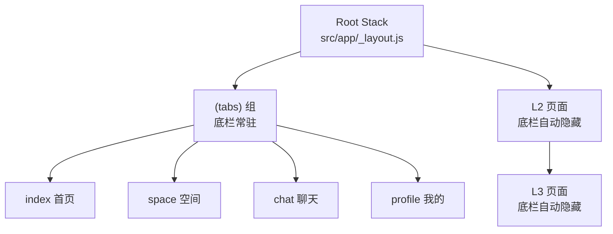
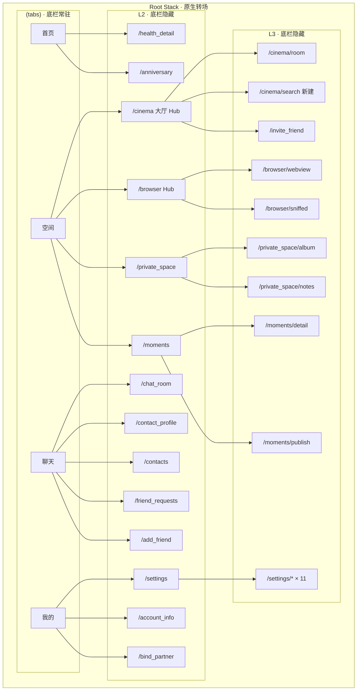
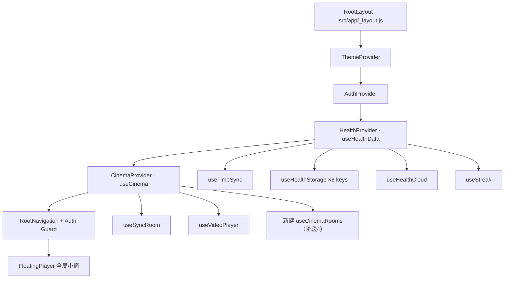
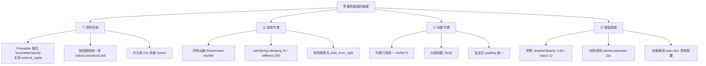

# Sync App 页面重构与 UI 架构 —— 最终执行书（第 1 部分：总纲）

> **文档版本**：v1.0（定稿）
> **生成日期**：2026-10-30
> **适用项目**：`/Users/TCL/my-app`（Expo SDK 58 / React Native 0.88.1 / React 19.3.0）
> **文档拆分**：
> - **本文件（第 1 部分）**：全局约束、需求决策、架构总览、视觉守则、动效规范、路由总表、数据层、TS 前瞻、风险矩阵
> - **[`SYNC_APP_REFACTOR_EXECUTION_SPEC_PART2.md`](SYNC_APP_REFACTOR_EXECUTION_SPEC_PART2.md)**：阶段 1-7 逐阶段执行细则
>
> **使用方式**：未来每个任务在独立聊天窗口中执行时，先读本文件 §0-§5 建立全局认知，再读 PART2 对应阶段章节。

---

## 目录

- [§0 全局约束（必读）](#0-全局约束必读)
- [§1 需求决策总表](#1-需求决策总表)
- [§2 架构总览](#2-架构总览)
- [§3 视觉守则（苹果风微调边界）](#3-视觉守则苹果风微调边界)
- [§4 动效与触感规范](#4-动效与触感规范)
- [§5 完整路由总表](#5-完整路由总表)
- [§6 数据层复用清单](#6-数据层复用清单)
- [§7 TS 转型 / 双后端 / 商业化前瞻预留](#7-ts-转型--双后端--商业化前瞻预留)
- [§8 风险矩阵](#8-风险矩阵)
- [§9 文件索引与附录](#9-文件索引与附录)

**阶段执行细则（另两份文档）**：

- [`SYNC_APP_REFACTOR_EXECUTION_SPEC_PART2.md`](SYNC_APP_REFACTOR_EXECUTION_SPEC_PART2.md)：§10 阶段总览 / §11 阶段 1 地基 / §12 阶段 2 首页 / §13 阶段 3 空间+设置
- [`SYNC_APP_REFACTOR_EXECUTION_SPEC_PART3.md`](SYNC_APP_REFACTOR_EXECUTION_SPEC_PART3.md)：§14 阶段 4 聊天 / §15 阶段 5 放映厅+浏览器 / §16 阶段 6 私密+朋友圈 / §17 阶段 7 收口 / §18 附录 / §19 文档索引

---

## §0 全局约束（必读）

### 0.1 硬性要求（用户明确指定）

| 编号 | 要求 | 落地方式 |
|---|---|---|
| **H1** | 流畅度必须对标苹果 | 全部动画走 Reanimated worklet（UI 线程）；长列表用 FlashList；页面转场用原生 Stack |
| **H2** | 动态动效必须精致 | 统一 spring 参数（见 §4）；按压反馈、Tab 弹跳、Popover 锚点展开 |
| **H3** | 主题颜色、UI、UX 不修改原有 | 色值/尺寸/主题 API **零改动**；微调仅限「控件形态/动效节奏/间距节奏/层级质感」四维度 |
| **H4** | 现有页面也可微调为苹果设计风格 | 见 §3 逐页面微调清单 |

### 0.2 绝对红线（任何阶段都不得违反）

```text
不得修改 src/constants/colors.js 的任何色值
不得修改 src/constants/theme.js 的 SIZES / TYPOGRAPHY
不得修改 src/context/ThemeContext.js 的对外 API
不得修改品牌主色 #FF2D55 / #FF375F 的使用语义
不得手动创建/编辑 ios/ 或 android/ 目录（CNG 生成）
不得使用 npm/yarn/pnpm/bun add 安装依赖（必须 npx expo install）
```

### 0.3 每个阶段的完成定义（DoD）

任何阶段结束前必须全部满足：

```bash
npx expo lint           # 必须 0 error
npx tsc --noEmit        # 必须 0 error
git diff src/constants/ # 必须为空（色值/尺寸零改动）
```

- [ ] 该阶段所有新增/修改文件已通过 lint + typecheck
- [ ] 该阶段验收清单（PART2 各章节末尾）全部勾选
- [ ] 无新增 `console.error` / 未捕获 Promise
- [ ] 平板（iPad）与手机双端手动验证通过

### 0.4 技术栈现状（已核实）

| 项 | 版本 | 说明 |
|---|---|---|
| expo | 58.0.21 | SDK 58 |
| react-native | 0.88.1 | |
| react | 19.3.0 | |
| expo-router | 58.0.28 | 文件即路由 |
| react-native-reanimated | 4.7.1 | 已装，worklet 可用 |
| react-native-gesture-handler | 3.3.0 | 已装 |
| react-native-worklets | 0.13.0 | 已装 |
| expo-haptics | 58.0.7 | 已装 |
| expo-linear-gradient | 58.0.3 | 已装（骨架屏用） |
| lottie-react-native | 7.5.0 | 已装 |
| react-native-svg | 15.16.0 | 已装（双环进度用） |
| expo-blur | 58.0.5 | 已装（毛玻璃） |
| expo-image | 58.0.18 | 已装（相册懒加载） |
| @react-native-async-storage/async-storage | 2.2.0 | 已装（**非 MMKV**） |
| @supabase/supabase-js | 2.118.0 | 已装 |
| typescript | 6.0.3 | 已装（devDep，未开 strict） |
| @shopify/flash-list | — | **需新增**（唯一新增依赖） |

**tsconfig 现状**：
```json
{ "compilerOptions": {}, "extends": "expo/tsconfig.base", "exclude": ["supabase/functions"] }
```
空 compilerOptions，未开 strict，未开 typedRoutes。

### 0.5 唯一新增依赖

```bash
npx expo install @shopify/flash-list
```

> 其余（reanimated / gesture-handler / worklets / haptics / linear-gradient / lottie / svg / blur / image）**均已安装**，无需新增。

---

## §1 需求决策总表

| 编号 | 问题 | 决策 | 落地要点 |
|---|---|---|---|
| Q1 | 首页搭子卡无搭子时 | **B** | 渲染「邀请搭子」引导卡 → `/bind_partner` |
| Q2 | 健康总览卡双环指标 | **B** | 左环=我（三餐+饮水合并），右环=搭子；无搭子退化单环 |
| Q3 | 小组件网格 | **D** | 2×2 四宫格：纪念日 / 快捷打卡 / 今日格言 / 连续天数 |
| Q4 | 聊天 Popover 通讯录与添加好友 | **A** | 分开两个 L2 页（后续效果不佳再转 B 合并） |
| Q5 | 私密空间与朋友圈 | **私密空间真功能 + 朋友圈视排期** | 见 PART2 §11 |
| Q6 | 设置占位页呈现 | **C** | 列表保留原 value 文案（「1.2 GB」「关怀模式」），点进去占位页 |
| Q7 | 放映厅房间列表 | **A+B 合并** | 房间公开/私人；公开房可被搜索 → 新增 `/cinema/search` |
| Q8 | 执行顺序 | **D 最推荐** | 见 §2.3 |
| P1 | 动画技术栈 | **A** | 全面改用 Reanimated worklet |
| P2 | 页面转场 | **A** | 启用 Expo Router 原生 Stack 转场 |
| P3 | 列表性能 | **A** | 引入 `@shopify/flash-list` |
| P4 | 触感反馈 | **A** | 全面接入 expo-haptics 分级 |
| V1 | 视觉一致性 | **允许苹果风微调（含现有页面）** | 见 §3 |
| V2 | 新卡片视觉风格 | **A** | 沿用现有 `cinemaButton` 卡片风格 |
| V3 | 骨架屏 shimmer 颜色 | **A** | `palette.card → palette.separator` 渐变 |
| I1 | 卡片按压反馈 | **A** | scale 0.97 |
| I2 | Popover 弹出方式 | **A** | 从按钮位置缩放展开（苹果式） |
| I3 | 底栏 Tab 图标动效 | **A** | 弹跳/缩放 |
| S1 | 新增依赖 | **A** | 允许（仅 flash-list） |
| S2 | 平板适配 | **A** | 本期必须保证 |

---

## §2 架构总览

### 2.1 三层路由模型

| 层级 | 定义 | 底栏 | 返回箭头 | 路由位置 |
|---|---|---|---|---|
| **L1 一级页** | 4 个 Tab 根页 | 常驻 | 无 | `src/app/(tabs)/` |
| **L2 二级页** | 从 L1 push 进入 | 隐藏 | 有 | `src/app/` 根目录 |
| **L3 三级页** | 从 L2 再 push 进入 | 隐藏 | 有 | `src/app/<模块>/` 子目录 |

**核心机制**：底栏是 [`src/app/(tabs)/_layout.js`](src/app/(tabs)/_layout.js:6) 中 `<Tabs>` 的一部分。任何位于 `(tabs)` 目录**之外**的路由，天然不渲染底栏——**无需任何手动隐藏逻辑**。



### 2.2 全局路由架构图



### 2.3 执行顺序（Q8-D 最推荐）

排序原则：**风险递增 + 依赖前置 + 每阶段可独立验收**。


| 阶段 | 内容 | 风险 | 工期 | 依赖 | 详见 |
|---|---|---|---|---|---|
| 1 | 底栏删滑出 + Reanimated + Tab 弹跳 + haptics | 低 | 1d | 无 | PART2 §1 |
| 2 | 设置拆 12 L3 + 行样式苹果风 | 低 | 2d | 阶段 1 | PART2 §2 |
| 3 | 首页三卡 + 双环 + 四宫格 + 按压反馈 | 中 | 2.5d | 阶段 1 | PART2 §3 |
| 4 | 空间 4 卡 + cinema/browser 拆分 + 公开房搜索 | 中 | 3.5d | 阶段 1、2 | PART2 §4 |
| 5 | 聊天纯 IM 化 + FlashList + Popover | 高 | 3.5d | 阶段 1 | PART2 §5 |
| 6 | 私密空间真功能 + 朋友圈（视排期） | 高 | 4-10d | 阶段 4、5 | PART2 §6 |
| 7 | 全局打磨收口 | 低 | 1.5d | 全部 | PART2 §7 |

**总工期**：18-24 个工作日（朋友圈降级则 18-19 天）。

### 2.4 Provider 树（数据层，不改动）



---

## §3 视觉守则（苹果风微调边界）

### 3.1 绝对不可改（红线）

| 项 | 文件 | 说明 |
|---|---|---|
| 17 个色值 key | [`src/constants/colors.js`](src/constants/colors.js:1) | `primary: #FF2D55/#FF375F`、`card: rgba(255,255,255,0.75)`、`cardBorder`、`dockBackground`、`checkRing`、`checkBg` 等**一个不改** |
| `SIZES` | [`src/constants/theme.js`](src/constants/theme.js:1) | `radiusCard: 24`、`radiusList: 16`、`padding: 20` **不改** |
| `TYPOGRAPHY` | [`src/constants/theme.js`](src/constants/theme.js:8) | `largeTitle: { fontSize: 26, fontWeight: '700', letterSpacing: 0.5 }` **不改** |
| `ThemeContext` API | [`src/context/ThemeContext.js`](src/context/ThemeContext.js:90) | `themeMode`/`setThemeMode`/`isDark`/`colors`/`isThemeLoaded` **不改** |
| 品牌主色语义 | 全局 | 粉色主色 `#FF2D55` 的使用场景不改（打卡、成功态、强调） |

### 3.2 允许微调（苹果风四维度）



### 3.3 逐页面微调清单

#### Tab 1 首页（重写 + 苹果风）

| 元素 | 现状 | 微调后 |
|---|---|---|
| 卡片容器 | `cinemaButton` 风格 | 沿用，加 `Pressable` + `scale 0.97` 按压反馈 |
| 双环进度 | 无 | `react-native-svg` 画环，`strokeLinecap: 'round'`，`withTiming` 描边 |
| 四宫格 | 无 | 2×2，每格 `radiusCard 24`，图标 + 标题 + 副标题 |
| 打卡按钮 | 无 | iOS 风格胶囊按钮，`Haptics.notificationAsync(Success)` |

#### Tab 2 空间（4 卡 + 苹果风）

| 元素 | 微调 |
|---|---|
| 4 张 HubCard | 沿用 `cinemaButton` 样式，加按压 `scale 0.97` + `Haptics.impactAsync(Light)` |
| 卡片间距 | 统一 `padding: 20`（`SIZES.padding`） |
| 图标 | 保持 `@expo/vector-icons`，尺寸统一 28 |

#### Tab 3 聊天（纯 IM 化 + 苹果风）

| 元素 | 现状 | 微调后 |
|---|---|---|
| 会话列表 | `FlatList` | **FlashList**，`estimatedItemSize: 72` |
| 会话行 | 现有样式 | 行高 72，头像 48，`Pressable` 高亮 `palette.separator` |
| 右上角 + | 无 | `Pressable` 圆形按钮 32×32，`Haptics.impactAsync(Light)` |
| Popover | 无 | 锚点缩放展开，`withSpring({ damping: 18 })` |
| 长按菜单 | 现有 Modal | 保留，加 `Haptics.impactAsync(Medium)` |
| 删除项 | `activeTab`/`headerBackBtn`/`edgeSwipeResponder`/`floatingDockPill` | 全部删除 |

#### Tab 4 我的（保持 + 微调）

| 元素 | 微调 |
|---|---|
| 头像卡 | 保持，加按压 `scale 0.98` |
| 设置行 | 保持，行高统一 56，箭头用 `chevron-forward` |
| 退出登录 | 保持，`Haptics.notificationAsync(Warning)` |

#### 设置页（拆 L3 + 苹果风）

| 元素 | 微调 |
|---|---|
| 分组卡片 | 沿用 `radiusList 16`，组间距 32 |
| SettingRow | 行高 56，`Pressable` 高亮，右侧 value 用 `textSecondary` |
| 占位页 | 居中插画 + 「功能开发中」+ 说明，返回箭头 `chevron-back` |
| 主题选择 | iOS 风格 ActionSheet（`Alert` 保留，或改 `ActionSheetIOS`） |

#### 聊天室（保持 + 微调）

| 元素 | 微调 |
|---|---|
| 消息列表 | `FlatList` → **FlashList**（inverted），`estimatedItemSize: 64` |
| 气泡 | 保持现有 `MessageBubble` 样式，圆角 `radiusList` |
| 输入栏 | 保持 `ChatInputBar`，键盘避让不动 |
| 发送按钮 | `Haptics.impactAsync(Light)` |

#### 放映厅（拆分 + 苹果风）

| 元素 | 微调 |
|---|---|
| 大厅房间卡 | 沿用卡片风格，加「公开/私人」标签（`palette.primary` 描边） |
| 搜索大厅 | 搜索框 iOS 风格（`radiusList`，`palette.card` 背景） |
| 播放器控制 | 保持沉浸式，控制条淡入淡出 `withTiming(200)` |
| 弹幕 | 保持现有动画 |

#### 浏览器（拆分 + 苹果风）

| 元素 | 微调 |
|---|---|
| 地址栏 | iOS Safari 风格（`radiusList`，`palette.card`） |
| 底部工具栏 | 保持现有 4 按钮，加 `Haptics.selectionAsync()` |
| 嗅探结果 | 保持 `SniffedMediaModal`，卡片加按压反馈 |

#### 私密空间 / 朋友圈（新建 + 苹果风）

| 元素 | 微调 |
|---|---|
| 相册网格 | 3 列，间距 2，`expo-image` 懒加载 |
| 朋友圈流 | FlashList，卡片 `radiusCard 24` |
| 发布页 | iOS 风格表单，图片选择器 `expo-image-picker` |

---

## §4 动效与触感规范

### 4.1 统一动效参数表

| 场景 | Reanimated 参数 |
|---|---|
| 卡片按压 | `withSpring({ damping: 20, stiffness: 300 })`，scale 1→0.97 |
| 按钮点击 | `withSpring({ damping: 15, stiffness: 250 })`，scale 1→0.95→1 |
| Tab 图标 | `withSequence(withSpring(1.15), withSpring(1))` |
| Popover | `withSpring({ damping: 18, stiffness: 220 })`，scale 0.85→1 + opacity 0→1 |
| 页面 push | 原生 `slide_from_right`（iOS 默认） |
| Modal | 原生 `presentation: 'modal'` |
| 骨架屏 | `withRepeat(withTiming(1, { duration: 1200 }), -1)` |
| 列表项入场 | `withDelay(index * 30, withTiming(1, { duration: 250 }))` |
| 双环描边 | `withTiming(progress, { duration: 800, easing: Easing.out(Easing.cubic) })` |

### 4.2 触感反馈全页面映射

| 页面 | 操作 | Haptics API |
|---|---|---|
| 首页 | 卡片点击 | `impactAsync(Light)` |
| 首页 | 打卡成功 | `notificationAsync(Success)` |
| 空间 | HubCard 点击 | `impactAsync(Light)` |
| 聊天 | 会话点击 | `impactAsync(Light)` |
| 聊天 | 长按 | `impactAsync(Medium)` |
| 聊天 | Popover 展开 | `selectionAsync()` |
| 我的 | 设置行点击 | `selectionAsync()` |
| 我的 | 退出登录 | `notificationAsync(Warning)` |
| 设置 | 主题切换 | `selectionAsync()` |
| 聊天室 | 发送消息 | `impactAsync(Light)` |
| 放映厅 | 播放/暂停 | `impactAsync(Light)` |
| 浏览器 | 工具栏按钮 | `selectionAsync()` |
| 全局 | 操作失败 | `notificationAsync(Error)` |

### 4.3 共享 UI 组件清单（阶段 7 统一收口，部分阶段提前建）

| 组件 | 路径 | 职责 | 首次需要 |
|---|---|---|---|
| `PressableScale` | `src/components/ui/PressableScale.js` | 统一按压 scale 反馈 + haptics | 阶段 3 |
| `Skeleton` | `src/components/ui/Skeleton.js` | shimmer 骨架屏（LinearGradient + withRepeat） | 阶段 7 |
| `Popover` | `src/components/ui/Popover.js` | 锚点缩放展开弹层 | 阶段 5 |
| `SettingRow` | `src/components/ui/SettingRow.js` | 从 `settings.js` 抽出复用 | 阶段 2 |
| `PlaceholderPage` | `src/components/ui/PlaceholderPage.js` | 占位页统一模板 | 阶段 2 |
| `PremiumBadge` | `src/components/ui/PremiumBadge.js` | 商业化预留（本期不显示） | 阶段 7 |

---

## §5 完整路由总表

### 5.1 L1（4 个，不变）

| 路由 | 文件 |
|---|---|
| `/` | `src/app/(tabs)/index.js` |
| `/space` | `src/app/(tabs)/space.js` |
| `/chat` | `src/app/(tabs)/chat.js` |
| `/profile` | `src/app/(tabs)/profile.js` |

### 5.2 L2（14 个）

| 路由 | 状态 | 来源 | 阶段 |
|---|---|---|---|
| `/health_detail` | 新建 | 原 `index.js` 迁移 | 3 |
| `/anniversary` | 新建 | 新建占位 | 3 |
| `/cinema` | 拆分 | `cinema.js` 拆分（大厅） | 4 |
| `/browser` | 拆分 | `browser.js` 拆分（Hub） | 4 |
| `/private_space` | 新建 | 新建 | 6 |
| `/moments` | 新建 | 新建 | 6 |
| `/chat_room` | 已有 | 已有 | — |
| `/contact_profile` | 已有 | 已有 | — |
| `/contacts` | 新建 | 迁移 `renderContactsView` | 5 |
| `/friend_requests` | 新建 | 新建 | 5 |
| `/add_friend` | 新建 | 迁移搜索逻辑 | 5 |
| `/settings` | 拆分 | `settings.js` → `settings/index.js` | 2 |
| `/account_info` | 已有 | 已有 | — |
| `/bind_partner` | 已有 | 已有 | — |

### 5.3 L3（21 个）

| 模块 | 路由 | 状态 | 阶段 |
|---|---|---|---|
| 放映厅 | `/cinema/room` | 拆分 拆分 | 4 |
| 放映厅 | `/cinema/search` | 新建 公开房搜索 | 4 |
| 浏览器 | `/browser/webview` | 拆分 拆分 | 4 |
| 浏览器 | `/browser/sniffed` | 拆分 拆分 | 4 |
| 私密空间 | `/private_space/album` | 新建 | 6 |
| 私密空间 | `/private_space/notes` | 新建 | 6 |
| 朋友圈 | `/moments/detail` | 新建 | 6 |
| 朋友圈 | `/moments/publish` | 新建 | 6 |
| 设置 | `/settings/privacy` | 拆分 迁移 | 2 |
| 设置 | `/settings/security` | 拆分 迁移 | 2 |
| 设置 | `/settings/theme` | 拆分 迁移 | 2 |
| 设置 | `/settings/health` | 拆分 迁移 | 2 |
| 设置 | `/settings/notifications` | 新建 占位 | 2 |
| 设置 | `/settings/friend_permissions` | 新建 占位 | 2 |
| 设置 | `/settings/storage` | 新建 占位 | 2 |
| 设置 | `/settings/more` | 新建 占位 | 2 |
| 设置 | `/settings/chat` | 新建 占位 | 2 |
| 设置 | `/settings/downloads` | 新建 占位 | 2 |
| 设置 | `/settings/switch_account` | 新建 占位 | 2 |
| 健康 | `/health_detail/meal/:type` | 新建 可选 | 3 |
| 邀请 | `/invite_friend` | 已有（L3 定位） | — |

---

## §6 数据层复用清单

### 6.1 健康数据（首页核心）

[`src/hooks/useHealthData.js`](src/hooks/useHealthData.js:15) 的 `HealthProvider` 已暴露全部所需 API：

```js
{
  isInitialized, isDoneToday, selectedMeal, mealsStatus,
  waterAmount, maxWater, streakDays, motto, mealGuides,
  partnerData, partnerId,
  openMeal, closeMeal, confirmCheck, undoCheck,
  handleAddWater, handleMinusWater, setWaterDirect,
  updateMaxWater, updateMotto, updateMealGuide, resetToday
}
```

| 用途 | API |
|---|---|
| 卡片 A 搭子状态卡 | `partnerId`、`partnerData` |
| 卡片 B 健康总览卡 | `mealsStatus`、`waterAmount`、`maxWater`、`partnerData` |
| 四宫格快捷打卡 | `isDoneToday`、`confirmCheck` |
| 四宫格今日格言 | `motto`、`updateMotto` |
| 四宫格连续天数 | `streakDays` |
| `/health_detail` 全量 | 全部 API |

**云端同步**：[`useHealthCloud`](src/hooks/health/useHealthCloud.js:27) 的 `commit`（`onConflict: 'user_id, record_date'`）、1500ms 防抖、`partner_health_channel` 订阅——全部保留。

**本地存储**：[`useHealthStorage`](src/hooks/health/useHealthStorage.js:36) 的 8 个 AsyncStorage key + 跨天重置——全部保留。

> 注意：**MMKV 说明**：备忘录提到 MMKV，但 `package.json` 中**未安装** `react-native-mmkv`，当前用的是 AsyncStorage 2.2.0。**本期不引入**，AsyncStorage 已满足离线缓存需求。

### 6.2 聊天数据

| Hook | 关键能力 |
|---|---|
| [`useChatMessages`](src/hooks/chat/useChatMessages.js:52) | `CACHE_LIMIT=300`、`FETCH_LIMIT=50`、realtime `filter: receiver_id=eq.${user.id}` |
| [`useMediaUpload`](src/hooks/chat/useMediaUpload.js:143) | 50MB 上限、`chat_media` bucket、7 天签名 URL |
| [`useSignedMediaUrl`](src/hooks/chat/useSignedMediaUrl.js:161) | LRU 500 缓存 + inflight 去重 |
| [`useAudioRecorder`](src/hooks/chat/useAudioRecorder.js:1) | 录音 + Groq Whisper 转写 |

### 6.3 放映厅数据

| Hook | 关键能力 |
|---|---|
| [`useCinema`](src/hooks/useCinema.js:12) | 全局 `useVideoPlayer`、`SYNC_THRESHOLD=2.5`、500ms 轮询、`mixWithOthers` 音频 |
| [`useSyncRoom`](src/hooks/useSyncRoom.js:46) | `broadcast`+`presence`、`sync_command`/`danmaku`、`MAX_DANMAKU_COUNT=100` |
| `useCinemaRooms`（新建 阶段 4） | `cinema_rooms` 表 CRUD + 搜索 + realtime |

### 6.4 浏览器数据（5 个领域 Hook 已拆分，直接复用）

| Hook | 职责 |
|---|---|
| [`useBrowserHistory`](src/hooks/browser/useBrowserHistory.js:24) | 书签 + 历史（`@browser_bookmarks`/`@browser_history`） |
| [`useBrowserSniffer`](src/hooks/browser/useBrowserSniffer.js:32) | 媒体嗅探（`FILTER_OPTIONS`、`EMPTY_SNIFF_TIP`） |
| [`useAdBlocker`](src/hooks/browser/useAdBlocker.js:1) | 广告拦截 |
| [`useBrowserProgress`](src/hooks/browser/useBrowserProgress.js:1) | 加载进度 |
| [`useBrowserNavigation`](src/hooks/browser/useBrowserNavigation.js:22) | 前进/后退/关闭/`goCinema`/`handleSubmitUrl` |

---

## §7 TS 转型 / 双后端 / 商业化前瞻预留

> 用户明确：**本次一个都不做，但未来全面转 TS**。因此本次重构必须做到「**写 JS 但结构上 TS-ready**」，未来迁移时**只加类型不改结构**。

### 7.1 目录结构预留（现在建空目录 + README，不写实现）

```text
src/
├── types/                    ←  现在建目录，放 README.md 说明未来契约
│   ├── README.md
│   ├── user.ts               ← 未来：User / SyncId / PartnerStatus
│   ├── health.ts             ← 未来：WaterRecord / MealCheck
│   ├── social.ts             ← 未来：Moment / Comment / Like
│   └── media.ts              ← 未来：SniffedMedia / RoomState / SyncSignal
├── app/                      ← 保持 .js，未来批量改 .tsx
├── components/               ← 保持 .js，未来批量改 .tsx
├── hooks/                    ← 保持 .js，未来批量改 .ts
└── constants/                ← 保持 .js
```

**本次只做**：新建 `src/types/` 目录 + `README.md` 说明未来契约规划。**不写任何 .ts 文件**，避免与现有 JS 混编引发编译问题。

### 7.2 代码层面的 TS-ready 约定（现在写 JS 时就遵守）

| 约定 | 现在怎么做 | 未来收益 |
|---|---|---|
| **Props 显式解构 + 默认值** | `function Card({ title, subtitle = '', onPress })` | 未来直接加 `interface CardProps` |
| **Hook 返回值用对象** | `return { data, loading, error }` | 未来加返回类型注解 |
| **常量用数组/对象字面量** | `export const THEME_MODES = ['system','light','dark']`（保持数组，未来加 `as const`） | 未来自动变字面量联合类型 |
| **路由参数集中声明** | 每个页面顶部注释 `// params: { roomId: string }` | 未来改 `useLocalSearchParams<{ roomId: string }>()` |
| **Supabase 查询集中** | 全部走 `src/services/supabase.js` + 各领域 hook | 未来 `supabase gen types` 后直接绑定表类型 |
| **不写隐式 any** | 禁止 `let x;` 后随意赋值；对象先定形状 | 未来开 `strict: true` 零报错 |
| **事件回调命名统一** | `onXxx` 为外部回调，`handleXxx` 为内部实现 | 未来 props 类型一目了然 |
| **样式常量外提** | 魔法数字提为 `const CARD_RADIUS = 20` | 未来变 `const` 断言或 token 类型 |

### 7.3 双后端（Supabase + Firebase）兼容预留

> 推送链路已经落在 Firebase 上：客户端用 `expo-notifications` 取 Expo Push Token，Expo Push Service 在底层转发到 **FCM（Android）/ APNs（iOS）**，Firebase 配置文件 `google-services.json` / `GoogleService-Info.plist` 由 EAS Secret 注入（见 [`app.json`](app.json:59)）。本节讨论的是**数据访问层**的隔离——Firebase 只承担推送，不承担数据库，所以 `supabase.from(...)` 的收敛规则依然成立。

**核心原则：UI 层永远不直接 `import { supabase }`。**

```text
UI (src/app/**)  →  hooks (src/hooks/**)  →  services (src/services/**)  →  supabase / firebase
```

| 预留动作 | 现在怎么做 | 未来收益 |
|---|---|---|
| **数据访问单点** | 所有 `supabase.from(...)` 只允许出现在 `src/hooks/**` 与 `src/services/**`；`src/app/**` 与 `src/components/**` 禁止直接调用 | 未来数据层若换后端（Firestore / 其他）只改 hooks/services |
| **服务层命名中立** | 新增文件用 `src/services/<domain>Service.js`（如 `partnerService.js`），不叫 `supabasePartner.js` | 未来内部可切换实现 |
| **推送抽象** | 现有 [`pushService.js`](src/services/pushService.js:1) 保持为唯一推送出口；新页面一律调它，不直接调 Expo Push | 换推送通道（FCM 直连 / 其他厂商）只改此文件 + `send-push` 边缘函数 |
| **实时订阅封装** | Realtime 订阅写在 hook 内（如 [`useChatMessages`](src/hooks/chat/useChatMessages.js:52)），页面只消费状态 | 未来换 Firestore onSnapshot 只改 hook |
| **鉴权抽象** | 页面只用 [`useAuth`](src/hooks/useAuth.js:7) 暴露的 `user` / `signOut`，不直接调 `supabase.auth` | 未来接 Firebase Auth 只改 AuthProvider |
| **环境变量集中** | 密钥只从 `src/services/supabase.js` 读取 `process.env.EXPO_PUBLIC_*` | 新增后端配置同处管理 |

**本次落地检查项（阶段 7 收口时执行）**：

```bash
# 1. 确认 UI 层没有直接调用 supabase
grep -rn "supabase\." src/app src/components --include=*.js
# 期望输出：0 行（若有，迁移到对应 hook）

# 2. 确认推送只走 pushService
grep -rn "expo-notifications\|getExpoPushTokenAsync" src/app src/components --include=*.js
# 期望输出：0 行
```

### 7.4 商业化（Freemium）钩子预留

> 未来规划：免费版 + 会员版（解锁私密空间容量、朋友圈、放映厅高清、去广告等）。本次**不实现任何付费逻辑**，只预留「**能力开关**」的位置，避免未来大改。

| 预留点 | 现在怎么做 | 未来接入方式 |
|---|---|---|
| **能力开关常量** | 新建 `src/constants/features.js`，导出 `FEATURES` 对象，全部默认 `true` | 未来由远程配置 / 订阅状态覆盖 |
| **会员状态占位** | `useAuth` 返回值预留 `isPremium`（本次恒为 `false`，不参与任何判断） | 未来接 RevenueCat / IAP |
| **受限入口标记** | 私密空间、朋友圈、放映厅高清等入口组件加 `premium` 属性（本次不生效，仅透传） | 未来渲染锁标 / 引导页 |
| **配额常量** | 容量上限（如私密相册张数、朋友圈条数）提为 `src/constants/limits.js` 常量 | 未来按会员等级动态取值 |
| **去广告开关** | 浏览器广告拦截逻辑读 `FEATURES.adFree`（本次恒 `true`） | 未来免费版置 `false` |

**`src/constants/features.js` 建议内容（本次即建）**：

```js
// 能力开关：本次全部开启，未来由订阅状态 / 远程配置覆盖
export const FEATURES = {
  privateSpace: true,   // 私密空间
  moments: true,        // 朋友圈
  cinemaHD: true,       // 放映厅高清
  adFree: true,         // 浏览器去广告
  searchHall: true,     // 放映厅搜索大厅
};
```

**红线**：本次**不得**在任何 UI 中显示「会员 / 升级 / 付费」字样，也不得因 `FEATURES` 为 `false` 而隐藏功能（因为本次全为 `true`）。

---

## §8 风险矩阵

| # | 风险 | 触发阶段 | 影响 | 概率 | 应对措施 |
|---|---|---|---|---|---|
| R1 | **改动色值 / 尺寸导致视觉回归** | 全部 | 高（违反红线） | 中 | 所有颜色只从 `useAppTheme().colors` 取；禁止硬编码 hex；阶段 7 全量 grep `#[0-9A-Fa-f]{6}` 审查 |
| R2 | **动效掉帧（< 60fps）** | 3/4/5 | 高（违反硬性要求） | 中 | 只用 Reanimated worklet；禁止在动画中 `setState`；长列表必须 FlashList；真机（非模拟器）验收 |
| R3 | **`(tabs)` 外新增路由误显示底栏** | 2/3 | 中 | 低 | 新页面一律放 `src/app/` 根或 `src/app/<module>/`，**绝不**放 `(tabs)/`；验收时逐页检查 |
| R4 | **设置页拆分后丢失原有项** | 3 | 高（用户明确要求全保留） | 中 | 拆分前先列清单（见 §3.3 设置页），逐项打勾；拆分后与原 [`settings.js`](src/app/settings.js:46) 逐条比对 |
| R5 | **聊天页 IM 化后破坏现有消息流** | 4 | 高 | 中 | 只改「列表层 + 入口」，`ChatRoomInner` / `MessageBubble` / `useChatMessages` 不动；回归测试收发文字/图片/语音 |
| R6 | **FlashList 与现有 ScrollView 嵌套冲突** | 4/5 | 中 | 中 | FlashList 只用于最外层列表；内部不再套 ScrollView；`estimatedItemSize` 必填 |
| R7 | **私密空间 / 朋友圈 RLS 配置错误导致越权** | 6 | 高（安全） | 中 | 严格按 §6 的 SQL 建表；每条策略都用两个账号实测（A 不能读 B） |
| R8 | **放映厅公开房间被恶意刷屏** | 6 | 中 | 中 | 公开房间写入加频率限制（`created_at` 去重）；举报入口预留 |
| R9 | **TS 预留目录被误写 .ts 文件** | 7 | 中 | 低 | `src/types/` 只放 `README.md`；CI 检查该目录无 `.ts` |
| R10 | **新增依赖导致 Expo 版本不兼容** | 1 | 中 | 低 | 唯一新增 `@shopify/flash-list`，必须用 `npx expo install`；装完跑 `npx expo-doctor` |
| R11 | **深色模式遗漏（新页面只写浅色）** | 全部 | 中 | 高 | 所有新页面必须用 `useAppTheme()`；验收时切换系统深色模式逐页检查 |
| R12 | **触感反馈在 Android 无效果** | 全部 | 低 | 高 | `expo-haptics` 在 Android 为 no-op，属预期；不因此加判断分支 |

---

## §9 文件索引与附录

### 9.1 本次将新建的文件（全量清单）

| 文件 | 阶段 | 说明 |
|---|---|---|
| `src/constants/features.js` | 1 | 商业化能力开关（§7.4） |
| `src/constants/limits.js` | 1 | 配额常量（§7.4） |
| `src/constants/motion.js` | 1 | 统一动效参数（§4.1） |
| `src/constants/haptics.js` | 1 | 触感映射封装（§4.2） |
| `src/types/README.md` | 1 | TS 转型契约说明（§7.1） |
| `src/components/ui/AppleCard.js` | 1 | 苹果风卡片容器 |
| `src/components/ui/AppleButton.js` | 1 | 苹果风按钮（含按压缩放 + 触感） |
| `src/components/ui/AppleListRow.js` | 1 | 苹果风列表行 |
| `src/components/ui/AppleSectionHeader.js` | 1 | 分组标题 |
| `src/components/ui/ProgressRing.js` | 1 | 双环进度（react-native-svg） |
| `src/components/ui/Skeleton.js` | 1 | 骨架屏（linear-gradient 微光） |
| `src/components/ui/EmptyState.js` | 1 | 空状态 |
| `src/components/home/PartnerStatusCard.js` | 2 | 首页搭子状态卡（Q1-B） |
| `src/components/home/WaterCard.js` | 2 | 首页饮水卡（复用 WaterProgress） |
| `src/components/home/MealGrid.js` | 2 | 首页 2×2 餐食格（Q3-D） |
| `src/components/home/StreakCard.js` | 2 | 连续打卡卡 |
| `src/components/space/SpaceCard.js` | 3 | 空间四卡通用组件 |
| `src/components/space/PrivateSpaceCard.js` | 3 | 私密空间入口卡 |
| `src/components/space/MomentsCard.js` | 3 | 朋友圈入口卡 |
| `src/components/space/CinemaCard.js` | 3 | 放映厅入口卡 |
| `src/components/space/BrowserCard.js` | 3 | 浏览器入口卡 |
| `src/app/settings/index.js` | 3 | 设置主页（L3） |
| `src/app/settings/account.js` | 3 | 账号设置 |
| `src/app/settings/privacy.js` | 3 | 隐私设置 |
| `src/app/settings/security.js` | 3 | 安全设置 |
| `src/app/settings/appearance.js` | 3 | 外观（主题）设置 |
| `src/app/settings/about.js` | 3 | 关于 |
| `src/app/cinema/index.js` | 5 | 放映厅大厅（L3） |
| `src/app/cinema/room/[roomId].js` | 5 | 放映厅房间（L3） |
| `src/app/cinema/search.js` | 5 | 放映厅搜索大厅（Q7 合并） |
| `src/app/browser/index.js` | 5 | 浏览器主页（L3） |
| `src/app/browser/history.js` | 5 | 浏览历史 |
| `src/app/browser/bookmarks.js` | 5 | 书签 |
| `src/app/private/index.js` | 6 | 私密空间主页（L3） |
| `src/app/private/album.js` | 6 | 私密相册 |
| `src/app/private/notes.js` | 6 | 私密笔记 |
| `src/app/moments/index.js` | 6 | 朋友圈列表（L3） |
| `src/app/moments/publish.js` | 6 | 发布朋友圈 |
| `src/app/moments/[momentId].js` | 6 | 朋友圈详情 |
| `supabase/migrations/2026xxxx_cinema_rooms.sql` | 5 | 放映厅房间表 + RLS |
| `supabase/migrations/2026xxxx_private_space.sql` | 6 | 私密空间表 + RLS |
| `supabase/migrations/2026xxxx_moments.sql` | 6 | 朋友圈表 + RLS |

### 9.2 本次将修改的文件（全量清单）

| 文件 | 阶段 | 改动摘要 |
|---|---|---|
| [`src/app/(tabs)/index.js`](src/app/(tabs)/index.js:15) | 2 | 首页重写（搭子卡 + 饮水 + 2×2 餐食 + 打卡） |
| [`src/app/(tabs)/space.js`](src/app/(tabs)/space.js:12) | 3 | 4 卡布局 + 苹果风 |
| [`src/app/(tabs)/chat.js`](src/app/(tabs)/chat.js:35) | 4 | 纯 IM 化（消息/联系人分段，去掉搜索加友到独立页） |
| [`src/app/(tabs)/profile.js`](src/app/(tabs)/profile.js:18) | 3 | 保持结构 + 苹果风微调 |
| [`src/app/settings.js`](src/app/settings.js:46) | 3 | **改为重定向**到 `src/app/settings/index.js`（保留旧路径兼容） |
| [`src/app/cinema.js`](src/app/cinema.js:33) | 5 | **改为重定向**到 `src/app/cinema/index.js` |
| [`src/app/browser.js`](src/app/browser.js:32) | 5 | **改为重定向**到 `src/app/browser/index.js` |
| [`src/app/(tabs)/_layout.js`](src/app/(tabs)/_layout.js:6) | 1 | 仅确认无改动（底栏由 CustomTabBar 控制） |
| [`src/components/CustomTabBar.js`](src/components/CustomTabBar.js:13) | 1 | 苹果风微调（图标动效 + 触感），不改色值 |
| [`src/components/WaterProgress.js`](src/components/WaterProgress.js:41) | 2 | 苹果风微调（水位动画曲线） |
| [`src/components/MealListItem.js`](src/components/MealListItem.js:6) | 2 | 苹果风微调（按压反馈） |
| [`src/components/MealDetailSheet.js`](src/components/MealDetailSheet.js:6) | 2 | 苹果风微调（Sheet 弹簧曲线） |
| [`src/components/ChatRoomInner.js`](src/components/ChatRoomInner.js:33) | 4 | 苹果风微调（气泡入场动效），逻辑不动 |
| [`src/components/MessageBubble.js`](src/components/MessageBubble.js:1) | 4 | 苹果风微调（长按菜单触感） |
| [`src/components/ChatInputBar.js`](src/components/ChatInputBar.js:1) | 4 | 苹果风微调（面板弹出曲线） |
| [`src/components/FloatingPlayer.js`](src/components/FloatingPlayer.js:25) | 5 | 苹果风微调（吸附弹簧） |
| [`src/components/browser/BrowserMenuModal.js`](src/components/browser/BrowserMenuModal.js:1) | 5 | 苹果风微调 |
| [`src/components/browser/SniffedMediaModal.js`](src/components/browser/SniffedMediaModal.js:91) | 5 | 苹果风微调 |
| [`src/app/account_info.js`](src/app/account_info.js:50) | 3 | 苹果风微调 |
| [`src/app/bind_partner.js`](src/app/bind_partner.js:22) | 2 | 苹果风微调 |
| [`src/app/invite_friend.js`](src/app/invite_friend.js:23) | 4 | 苹果风微调 |
| [`src/app/contact_profile.js`](src/app/contact_profile.js:11) | 4 | 苹果风微调 |
| [`src/app/chat_room.js`](src/app/chat_room.js:32) | 4 | 苹果风微调 |
| [`src/app/auth.js`](src/app/auth.js:1) | 1 | 苹果风微调 |
| [`src/app/_layout.js`](src/app/_layout.js:15) | 1 | 新增 Provider（若有）/ 确认无改动 |
| [`package.json`](package.json:1) | 1 | 新增 `@shopify/flash-list` |

### 9.3 本次绝对不动的文件（红线）

| 文件 | 原因 |
|---|---|
| [`src/constants/colors.js`](src/constants/colors.js:1) | 最高指令：色值不可改 |
| [`src/constants/theme.js`](src/constants/theme.js:1) | SIZES / TYPOGRAPHY 不可改 |
| [`src/context/ThemeContext.js`](src/context/ThemeContext.js:29) | 主题控制权不可改（只可读） |
| [`src/services/supabase.js`](src/services/supabase.js:1) | 客户端单点，不改 |
| [`src/hooks/useAuth.js`](src/hooks/useAuth.js:7) | 仅可加 `isPremium` 占位（可选） |
| [`src/hooks/useHealthData.js`](src/hooks/useHealthData.js:15) | 数据层不动，只消费 |
| [`src/hooks/useCinema.js`](src/hooks/useCinema.js:12) | 数据层不动，只消费 |
| [`src/hooks/chat/useChatMessages.js`](src/hooks/chat/useChatMessages.js:52) | 数据层不动，只消费 |
| [`src/hooks/chat/useMediaUpload.js`](src/hooks/chat/useMediaUpload.js:143) | 数据层不动，只消费 |
| [`src/hooks/chat/useSignedMediaUrl.js`](src/hooks/chat/useSignedMediaUrl.js:161) | 数据层不动，只消费 |
| [`src/hooks/browser/*`](src/hooks/browser/useBrowserHistory.js:24) | 5 个领域 hook 已拆分，直接复用 |
| [`src/scripts/browser/*`](src/scripts/browser/index.js:1) | 注入脚本不动 |
| [`supabase/functions/send-push/index.ts`](supabase/functions/send-push/index.ts:1) | 边缘函数不动 |

### 9.4 阶段验收命令（每阶段结束必跑）

```bash
npx tsc --noEmit        # 类型检查（当前 JS 项目应 0 报错）
npx expo lint           # 代码规范
npx expo-doctor         # 依赖健康度
```

### 9.5 文档交叉引用

| 文档 | 内容 |
|---|---|
| **本文件（第 1 部分）** | 全局约束、需求决策、架构总览、视觉守则、动效规范、路由总表、数据层、TS/双后端/商业化前瞻、风险矩阵、文件索引 |
| [`SYNC_APP_REFACTOR_EXECUTION_SPEC_PART2.md`](SYNC_APP_REFACTOR_EXECUTION_SPEC_PART2.md) | 阶段 1-7 逐阶段执行细则（文件级改动、代码片段、验收清单） |

---

> **第 1 部分结束。** 阶段执行细则见 [`SYNC_APP_REFACTOR_EXECUTION_SPEC_PART2.md`](SYNC_APP_REFACTOR_EXECUTION_SPEC_PART2.md)。
