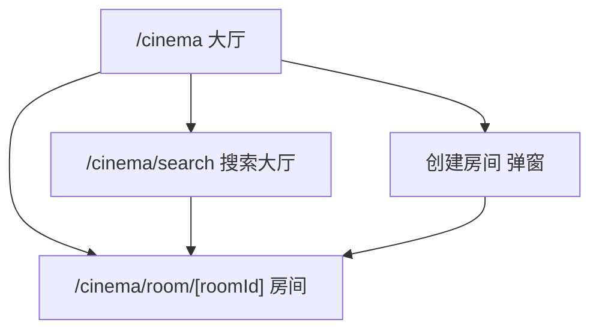
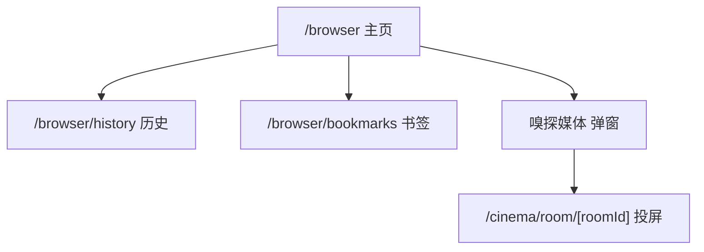
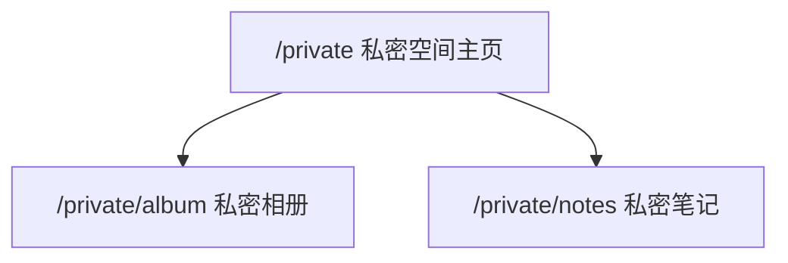
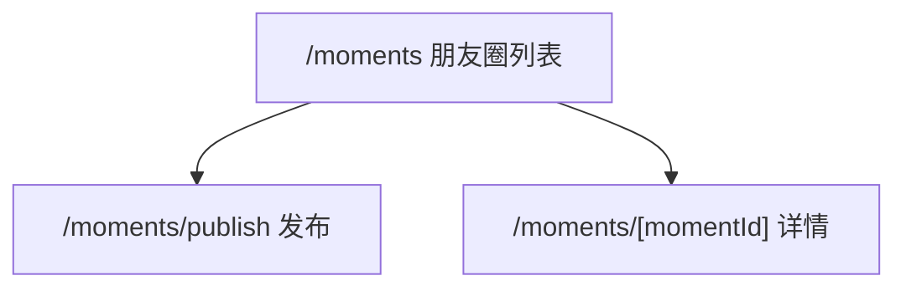

# Sync App 页面重构与 UI 架构 —— 最终执行书（第 3 部分：阶段 4-7 细则）

> **文档拆分**：
> - [`SYNC_APP_REFACTOR_EXECUTION_SPEC.md`](SYNC_APP_REFACTOR_EXECUTION_SPEC.md)（第 1 部分）：全局约束、需求决策、架构总览、视觉守则、动效规范、路由总表、数据层、TS/双后端/商业化前瞻、风险矩阵、文件索引
> - [`SYNC_APP_REFACTOR_EXECUTION_SPEC_PART2.md`](SYNC_APP_REFACTOR_EXECUTION_SPEC_PART2.md)（第 2 部分）：阶段 1-3 逐阶段执行细则
> - **本文件（第 3 部分）**：阶段 4-7 逐阶段执行细则

---

## 目录

- [§14 阶段 4：聊天页纯 IM 化](#14-阶段-4聊天页纯-im-化)
- [§15 阶段 5：放映厅拆分 + 搜索大厅 + 浏览器拆分](#15-阶段-5放映厅拆分--搜索大厅--浏览器拆分)
- [§16 阶段 6：私密空间 + 朋友圈](#16-阶段-6私密空间--朋友圈)
- [§17 阶段 7：全局收口](#17-阶段-7全局收口)

---

## §14 阶段 4：聊天页纯 IM 化

> **目标**：把 [`src/app/(tabs)/chat.js`](src/app/(tabs)/chat.js:35) 从「消息 + 联系人 + 搜索加友」三合一，改为**纯 IM 消息列表**；联系人独立成页；搜索加友独立成页（Q4-A）。
> **红线**：`ChatRoomInner` / `MessageBubble` / `ChatInputBar` / `useChatMessages` / `useMediaUpload` / `useSignedMediaUrl` **逻辑一律不动**，只做动效/触感微调。

### 14.1 聊天页改造前后对比

| 项 | 改造前（[`chat.js`](src/app/(tabs)/chat.js:35)） | 改造后 |
|---|---|---|
| 顶部 | 分段控件「消息 / 联系人」 | 仅「消息」标题 + 右上角「+」 |
| 列表 | 消息 + 联系人混排 | 仅消息会话列表（FlashList） |
| 搜索加友 | 页内 `handleSearchAdd`（224-279 行） | 移到 `/chat/search` 独立页 |
| 联系人 | 页内 `renderContactsView`（424-464 行） | 移到 `/chat/contacts` 独立页 |
| 长按菜单 | `handleLongPress`（351-357 行） | 保留，加触感 |
| 左滑删除 | `PanResponder`（64-84 行） | 保留，加触感 |

### 14.2 新建 `src/app/chat/index.js`（消息列表）

```js
import { useCallback, useEffect, useState } from 'react';
import { StyleSheet, Text, View } from 'react-native';
import { router } from 'expo-router';
import { FlashList } from '@shopify/flash-list';
import { useAppTheme } from '../../context/ThemeContext';
import { useAuth } from '../../hooks/useAuth';
import { supabase } from '../../services/supabase';
import { haptic } from '../../constants/haptics';
import EmptyState from '../../components/ui/EmptyState';
import Skeleton from '../../components/ui/Skeleton';

// params: 无
// 纯 IM 消息列表：只显示会话，联系人与加友在独立页
export default function ChatListScreen() {
  const { colors } = useAppTheme();
  const { user } = useAuth();
  const [conversations, setConversations] = useState([]);
  const [loading, setLoading] = useState(true);

  // 数据获取逻辑：从原 chat.js 的 fetchFriendsAndData（94-167 行）迁移
  // 只保留「会话列表」部分，联系人部分移到 /chat/contacts
  useEffect(() => {
    // ... 迁移原逻辑 ...
  }, [user]);

  const renderItem = useCallback(({ item }) => {
    // 复用原 chat.js 的会话行渲染（含未读角标、最后消息预览）
    // 点击 → router.push(`/chat_room?targetId=${item.id}&targetName=${...}`)
    return null; // 执行时填充
  }, []);

  if (loading) {
    return (
      <View style={[styles.root, { backgroundColor: colors.background }]}>
        {[0, 1, 2, 3, 4].map((i) => (
          <Skeleton key={i} height={64} radius={12} style={styles.skeleton} />
        ))}
      </View>
    );
  }

  return (
    <View style={[styles.root, { backgroundColor: colors.background }]}>
      <FlashList
        data={conversations}
        renderItem={renderItem}
        keyExtractor={(item) => String(item.id)}
        estimatedItemSize={72}
        ListEmptyComponent={
          <EmptyState
            icon=""
            title="还没有会话"
            subtitle="去联系人里找好友聊聊吧"
          />
        }
        contentContainerStyle={styles.listContent}
      />
    </View>
  );
}

const styles = StyleSheet.create({
  root: { flex: 1 },
  listContent: { paddingBottom: 100 },
  skeleton: { marginHorizontal: 16, marginTop: 12 },
});
```

### 14.3 新建 `src/app/chat/contacts.js`（联系人）

从原 [`chat.js`](src/app/(tabs)/chat.js:424) 的 `renderContactsView` 迁移，改用 `FlashList`。

```js
// params: 无
// 联系人列表：好友 + 待处理请求
// 数据来源：原 chat.js 的 friends / requests 状态
// 点击 → /contact_profile 或 /chat_room
// 右上角「+」→ /chat/search
```

### 14.4 新建 `src/app/chat/search.js`（搜索加友）

从原 [`chat.js`](src/app/(tabs)/chat.js:224) 的 `handleSearchAdd`（224-279 行）与 `handleSearchChange`（282-292 行）迁移。

```js
// params: 无
// 搜索加友：输入 Sync ID → 查找用户 → 发送好友请求
// 逻辑原样迁移，只改 UI 为苹果风（AppleCard + AppleButton）
```

### 14.5 改造 `src/app/(tabs)/chat.js`

**方案**：删除原文件，改为重定向到 `/chat`。

```js
import { Redirect } from 'expo-router';

// tab 页重定向到 L3 聊天列表
export default function ChatTabRedirect() {
  return <Redirect href="/chat" />;
}
```

> 注意：**更优方案**：直接把 `src/app/(tabs)/chat.js` 的内容替换为「消息列表」实现（即把 14.2 的代码放进 tab 页），联系人/搜索仍放 L3。这样 tab 切换无重定向闪烁。
> **推荐**：采用此方案。即 `(tabs)/chat.js` = 消息列表；`src/app/chat/contacts.js` + `src/app/chat/search.js` = L3 子页。

### 14.6 微调 `src/components/ChatRoomInner.js`

| 改动 | 说明 |
|---|---|
| 消息气泡入场 | 新消息 `SPRING.default` 从下方 8px 淡入 |
| 长按菜单 | `haptic.medium()` |
| 复制成功 | `haptic.success()` |
| 保存到相册成功 | `haptic.success()` |
| 接受/拒绝搭子邀请 | `haptic.success()` / `haptic.warning()` |
| **逻辑** | **一律不动** |

### 14.7 微调 `src/components/MessageBubble.js`

| 改动 | 说明 |
|---|---|
| 长按 | `haptic.medium()` |
| 语音播放 | `haptic.light()` |
| 色值 | 不改 |

### 14.8 微调 `src/components/ChatInputBar.js`

| 改动 | 说明 |
|---|---|
| 面板弹出 | `SPRING.bouncy` |
| 录音开始/结束 | `haptic.medium()` / `haptic.success()` |
| 发送 | `haptic.light()` |
| 逻辑 | 不动 |

### 14.9 微调 `src/app/chat_room.js` / `contact_profile.js` / `invite_friend.js`

仅动效 + 触感 + 苹果风容器，逻辑不动。

### 14.10 阶段 4 验收清单

- [ ] 聊天 tab 显示纯消息列表（无联系人混排）
- [ ] 右上角「+」进入 `/chat/search`，搜索 Sync ID 加友正常
- [ ] 联系人入口进入 `/chat/contacts`，好友列表正常
- [ ] 点击会话进入 `/chat_room`，收发文字/图片/语音正常
- [ ] 长按消息菜单正常，复制/保存正常
- [ ] 左滑删除会话正常
- [ ] 未读角标正常
- [ ] 消息列表用 FlashList，滚动流畅（真机 60fps）
- [ ] 深色模式检查
- [ ] `npx tsc --noEmit` / `npx expo lint` 通过

---

## §15 阶段 5：放映厅拆分 + 搜索大厅 + 浏览器拆分

> **目标**：
> 1. [`src/app/cinema.js`](src/app/cinema.js:33) 拆为 L3：大厅 `/cinema` + 房间 `/cinema/room/[roomId]` + 搜索 `/cinema/search`
> 2. 新增 `cinema_rooms` 表（公开/私人 + 搜索大厅，Q7 合并方案）
> 3. [`src/app/browser.js`](src/app/browser.js:32) 拆为 L3：主页 `/browser` + 历史 `/browser/history` + 书签 `/browser/bookmarks`

### 15.1 放映厅路由结构



### 15.2 SQL：`cinema_rooms` 表

新建 `supabase/migrations/20261030_cinema_rooms.sql`：

```sql
-- 放映厅房间表：支持公开/私人 + 搜索大厅
create table if not exists public.cinema_rooms (
  id uuid primary key default gen_random_uuid(),
  host_id uuid not null references auth.users(id) on delete cascade,
  title text not null check (char_length(title) between 1 and 30),
  video_url text,
  visibility text not null default 'private' check (visibility in ('public', 'private')),
  password text,                          -- 私人房间可选密码
  member_count int not null default 1,
  is_playing boolean not null default false,
  current_time numeric not null default 0,
  created_at timestamptz not null default now(),
  updated_at timestamptz not null default now()
);

create index if not exists idx_cinema_rooms_visibility on public.cinema_rooms(visibility, created_at desc);
create index if not exists idx_cinema_rooms_host on public.cinema_rooms(host_id);

alter table public.cinema_rooms enable row level security;

-- 公开房间：所有人可读
create policy "public rooms readable by all"
  on public.cinema_rooms for select
  using (visibility = 'public');

-- 私人房间：仅房主可读
create policy "private rooms readable by host"
  on public.cinema_rooms for select
  using (visibility = 'private' and host_id = auth.uid());

-- 创建：只能以自己的身份创建
create policy "users can create own rooms"
  on public.cinema_rooms for insert
  with check (host_id = auth.uid());

-- 更新/删除：仅房主
create policy "host can update own rooms"
  on public.cinema_rooms for update
  using (host_id = auth.uid());

create policy "host can delete own rooms"
  on public.cinema_rooms for delete
  using (host_id = auth.uid());

-- updated_at 自动更新
create or replace function public.touch_cinema_rooms()
returns trigger language plpgsql as $$
begin
  new.updated_at = now();
  return new;
end $$;

drop trigger if exists trg_touch_cinema_rooms on public.cinema_rooms;
create trigger trg_touch_cinema_rooms
  before update on public.cinema_rooms
  for each row execute function public.touch_cinema_rooms();
```

### 15.3 新建 `src/app/cinema/index.js`（大厅）

```js
import { useCallback, useEffect, useState } from 'react';
import { StyleSheet, Text, View } from 'react-native';
import { router } from 'expo-router';
import { FlashList } from '@shopify/flash-list';
import { useAppTheme } from '../../context/ThemeContext';
import { useAuth } from '../../hooks/useAuth';
import { supabase } from '../../services/supabase';
import AppleButton from '../../components/ui/AppleButton';
import AppleCard from '../../components/ui/AppleCard';
import EmptyState from '../../components/ui/EmptyState';
import { haptic } from '../../constants/haptics';

// params: 无
// 放映厅大厅：我的房间 + 最近公开房间
export default function CinemaLobby() {
  const { colors } = useAppTheme();
  const { user } = useAuth();
  const [rooms, setRooms] = useState([]);

  const fetchRooms = useCallback(async () => {
    const { data } = await supabase
      .from('cinema_rooms')
      .select('*')
      .order('created_at', { ascending: false })
      .limit(50);
    setRooms(data || []);
  }, []);

  useEffect(() => { fetchRooms(); }, [fetchRooms]);

  const renderItem = useCallback(({ item }) => (
    <AppleCard
      style={styles.roomCard}
      onPress={() => {
        haptic.medium();
        router.push(`/cinema/room/${item.id}`);
      }}
    >
      <Text style={[styles.roomTitle, { color: colors.textPrimary }]}>
        {item.title}
      </Text>
      <Text style={[styles.roomMeta, { color: colors.textSecondary }]}>
        {item.visibility === 'public' ? '公开' : '私人'} · {item.member_count} 人
      </Text>
    </AppleCard>
  ), [colors]);

  return (
    <View style={[styles.root, { backgroundColor: colors.background }]}>
      <View style={styles.actions}>
        <AppleButton
          title="创建房间"
          size="sm"
          onPress={() => router.push('/cinema/create')}
        />
        <AppleButton
          title="搜索大厅"
          variant="outline"
          size="sm"
          onPress={() => router.push('/cinema/search')}
        />
      </View>
      <FlashList
        data={rooms}
        renderItem={renderItem}
        keyExtractor={(i) => i.id}
        estimatedItemSize={88}
        ListEmptyComponent={<EmptyState icon="" title="还没有房间" subtitle="创建一个，邀请好友一起看" />}
        contentContainerStyle={styles.list}
      />
    </View>
  );
}

const styles = StyleSheet.create({
  root: { flex: 1 },
  actions: { flexDirection: 'row', gap: 12, padding: 16 },
  list: { paddingBottom: 100 },
  roomCard: { marginHorizontal: 16, marginBottom: 10 },
  roomTitle: { fontSize: 16, fontWeight: '600' },
  roomMeta: { fontSize: 13, marginTop: 4 },
});
```

### 15.4 新建 `src/app/cinema/room/[roomId].js`（房间）

从原 [`cinema.js`](src/app/cinema.js:33) 迁移播放器逻辑（`PanResponder`、弹幕、进度条、沉浸式 UI），**逻辑不动**，只改容器为 L3 页面。

```js
import { useLocalSearchParams } from 'expo-router';

// params: { roomId: string }
// 迁移原 cinema.js 的播放器全部逻辑：
// - useCinema() 消费（不改）
// - useSyncRoom(roomId) 消费（不改）
// - 弹幕发送 handleSendDanmaku（279-283 行）
// - 沉浸式 UI showUI/hideUI（119-131 行）
// - 进度条 PanResponder（154-194 行）
// - 音量/亮度 PanResponder（198-276 行）
export default function CinemaRoom() {
  const { roomId } = useLocalSearchParams();
  // ... 原 cinema.js 逻辑 ...
}
```

### 15.5 新建 `src/app/cinema/search.js`（搜索大厅）

```js
// params: 无
// 搜索公开房间：输入关键词 → 查 cinema_rooms where visibility='public' and title ilike %kw%
// 点击结果 → /cinema/room/[roomId]
// 用 FlashList 渲染结果
```

### 15.6 新建 `src/app/cinema/create.js`（创建房间）

```js
// params: 无
// 表单：标题（≤30字）+ 视频 URL + 可见性（公开/私人）+ 私人密码（可选）
// 提交 → insert cinema_rooms → router.replace(`/cinema/room/${id}`)
// 校验失败 haptic.error()，成功 haptic.success()
```

### 15.7 改造 `src/app/cinema.js`

**删除** `src/app/cinema.js`（与 `src/app/cinema/index.js` 冲突）。所有 `router.push('/cinema')` 路径不变。

### 15.8 浏览器路由结构



### 15.9 新建 `src/app/browser/index.js`

从原 [`browser.js`](src/app/browser.js:32) 迁移 WebView 主体逻辑，**5 个领域 hook 原样复用**：

| Hook | 复用方式 |
|---|---|
| [`useBrowserHistory`](src/hooks/browser/useBrowserHistory.js:24) | 原样 |
| [`useBrowserSniffer`](src/hooks/browser/useBrowserSniffer.js:32) | 原样 |
| [`useAdBlocker`](src/hooks/browser/useAdBlocker.js:1) | 原样 |
| [`useBrowserProgress`](src/hooks/browser/useBrowserProgress.js:1) | 原样 |
| [`useBrowserNavigation`](src/hooks/browser/useBrowserNavigation.js:22) | 原样 |

### 15.10 新建 `src/app/browser/history.js` / `bookmarks.js`

从原 [`browser.js`](src/app/browser.js:32) 的历史/书签弹窗内容迁移为独立页，用 `FlashList` 渲染。

### 15.11 改造 `src/app/browser.js`

**删除** `src/app/browser.js`（与 `src/app/browser/index.js` 冲突）。

### 15.12 微调 `src/components/FloatingPlayer.js`

| 改动 | 说明 |
|---|---|
| 吸附弹簧 | `SPRING.snap` |
| 吸附完成 | `haptic.light()` |
| 最大化 | `haptic.medium()` |
| 逻辑 | 不动 |

### 15.13 微调 `src/components/browser/*`

`BrowserMenuModal` / `SniffedMediaModal` 仅改弹出曲线（`SPRING.bouncy`）+ 触感，逻辑不动。

### 15.14 阶段 5 验收清单

- [ ] `cinema_rooms` 迁移执行成功，RLS 生效
- [ ] 两个账号实测：A 的私人房间 B 看不到；A 的公开房间 B 能看到
- [ ] `/cinema` 大厅显示房间列表
- [ ] 创建公开房间 → 另一账号在 `/cinema/search` 能搜到
- [ ] 创建私人房间 → 另一账号搜不到
- [ ] 进入房间播放正常，弹幕同步正常，进度同步正常
- [ ] 沉浸式 UI 显示/隐藏正常
- [ ] `/browser` WebView 正常，广告拦截正常，嗅探正常
- [ ] 历史/书签独立页正常
- [ ] 嗅探媒体投屏到放映厅正常
- [ ] FloatingPlayer 吸附正常
- [ ] 深色模式检查
- [ ] `npx tsc --noEmit` / `npx expo lint` 通过

---

## §16 阶段 6：私密空间 + 朋友圈

> **目标**：新建两个完整功能模块（Q5-C 真实功能）。
> **工作量**：私密空间 3-4 天，朋友圈 4-6 天。若时间紧，朋友圈可降级为占位页（Q5-A 兜底）。

### 16.1 私密空间路由



### 16.2 SQL：私密空间表

新建 `supabase/migrations/20261030_private_space.sql`：

```sql
-- 私密相册
create table if not exists public.private_album (
  id uuid primary key default gen_random_uuid(),
  owner_id uuid not null references auth.users(id) on delete cascade,
  storage_path text not null,
  caption text,
  created_at timestamptz not null default now()
);

create index if not exists idx_private_album_owner on public.private_album(owner_id, created_at desc);

alter table public.private_album enable row level security;

-- 仅本人可读写
create policy "owner select own album"
  on public.private_album for select using (owner_id = auth.uid());
create policy "owner insert own album"
  on public.private_album for insert with check (owner_id = auth.uid());
create policy "owner delete own album"
  on public.private_album for delete using (owner_id = auth.uid());

-- 私密笔记
create table if not exists public.private_notes (
  id uuid primary key default gen_random_uuid(),
  owner_id uuid not null references auth.users(id) on delete cascade,
  title text,
  content text,
  created_at timestamptz not null default now(),
  updated_at timestamptz not null default now()
);

create index if not exists idx_private_notes_owner on public.private_notes(owner_id, updated_at desc);

alter table public.private_notes enable row level security;

create policy "owner select own notes"
  on public.private_notes for select using (owner_id = auth.uid());
create policy "owner insert own notes"
  on public.private_notes for insert with check (owner_id = auth.uid());
create policy "owner update own notes"
  on public.private_notes for update using (owner_id = auth.uid());
create policy "owner delete own notes"
  on public.private_notes for delete using (owner_id = auth.uid());
```

**Storage bucket**（在 Supabase Dashboard 手动建）：

```text
bucket: private-album
public: false
RLS: (storage.foldername(name))[1] = auth.uid()::text
```

### 16.3 新建 `src/app/private/index.js`

```js
// params: 无
// 私密空间主页：两个入口卡（相册 / 笔记）+ 统计（张数 / 条数）
// 进入前可选生物识别（expo-local-authentication，若未安装则跳过）
```

### 16.4 新建 `src/app/private/album.js`

```js
// params: 无
// 私密相册：FlashList 网格（3 列）+ 上传 + 删除
// 图片走 signed URL（复用 useSignedMediaUrl 思路）
// 配额检查：LIMITS.privateAlbumMax
```

### 16.5 新建 `src/app/private/notes.js`

```js
// params: 无
// 私密笔记：FlashList 列表 + 新建/编辑/删除
// 配额检查：LIMITS.privateNotesMax
```

### 16.6 朋友圈路由



### 16.7 SQL：朋友圈表

新建 `supabase/migrations/20261030_moments.sql`：

```sql
create table if not exists public.moments (
  id uuid primary key default gen_random_uuid(),
  author_id uuid not null references auth.users(id) on delete cascade,
  content text,
  images text[] default '{}',
  visibility text not null default 'friends' check (visibility in ('friends', 'private')),
  like_count int not null default 0,
  comment_count int not null default 0,
  created_at timestamptz not null default now()
);

create index if not exists idx_moments_author on public.moments(author_id, created_at desc);
create index if not exists idx_moments_created on public.moments(created_at desc);

alter table public.moments enable row level security;

-- 好友可见（假设已有 friendships 表，按实际表名调整）
create policy "friends can read moments"
  on public.moments for select
  using (
    visibility = 'private' and author_id = auth.uid()
    or visibility = 'friends' and (
      author_id = auth.uid()
      or exists (
        select 1 from public.friendships f
        where f.status = 'accepted'
          and ((f.user_id = auth.uid() and f.friend_id = moments.author_id)
            or (f.friend_id = auth.uid() and f.user_id = moments.author_id))
      )
    )
  );

create policy "users insert own moments"
  on public.moments for insert with check (author_id = auth.uid());
create policy "users delete own moments"
  on public.moments for delete using (author_id = auth.uid());

-- 点赞表
create table if not exists public.moment_likes (
  moment_id uuid not null references public.moments(id) on delete cascade,
  user_id uuid not null references auth.users(id) on delete cascade,
  created_at timestamptz not null default now(),
  primary key (moment_id, user_id)
);

alter table public.moment_likes enable row level security;
create policy "likes readable by all authed"
  on public.moment_likes for select using (auth.uid() is not null);
create policy "users insert own likes"
  on public.moment_likes for insert with check (user_id = auth.uid());
create policy "users delete own likes"
  on public.moment_likes for delete using (user_id = auth.uid());

-- 评论表
create table if not exists public.moment_comments (
  id uuid primary key default gen_random_uuid(),
  moment_id uuid not null references public.moments(id) on delete cascade,
  author_id uuid not null references auth.users(id) on delete cascade,
  content text not null,
  created_at timestamptz not null default now()
);

alter table public.moment_comments enable row level security;
create policy "comments readable by all authed"
  on public.moment_comments for select using (auth.uid() is not null);
create policy "users insert own comments"
  on public.moment_comments for insert with check (author_id = auth.uid());
create policy "users delete own comments"
  on public.moment_comments for delete using (author_id = auth.uid());
```

> 注意：`friendships` 表名需按项目实际表名调整（执行前先查 Supabase 现有表）。

### 16.8 新建 `src/app/moments/index.js` / `publish.js` / `[momentId].js`

| 文件 | 内容 |
|---|---|
| `index.js` | FlashList 朋友圈流（作者头像 + 内容 + 九宫格图 + 点赞/评论） |
| `publish.js` | 发布表单（文字 + 最多 9 图 + 可见性），配额 `LIMITS.momentsDailyMax` |
| `[momentId].js` | 详情 + 评论列表 + 评论输入 |

### 16.9 阶段 6 验收清单

- [ ] `private_album` / `private_notes` / `moments` / `moment_likes` / `moment_comments` 迁移执行成功
- [ ] 两个账号实测：A 的私密相册 B 完全不可见（含直接 API 调用）
- [ ] 私密相册上传/删除正常，配额生效
- [ ] 私密笔记增删改正常，配额生效
- [ ] 朋友圈发布（文字/图片/可见性）正常
- [ ] 朋友圈列表加载正常，点赞/评论正常
- [ ] 好友可见性正确（非好友看不到）
- [ ] 深色模式检查
- [ ] `npx tsc --noEmit` / `npx expo lint` 通过

---

## §17 阶段 7：全局收口

> **目标**：全项目动效统一、触感统一、红线审查、性能验收。

### 17.1 红线审查（必跑）

```bash
# 1. 色值硬编码审查（应只剩 colors.js 与必要的 #FFFFFF 文字色）
grep -rn "#[0-9A-Fa-f]\{6\}" src --include=*.js | grep -v "src/constants/colors.js"

# 2. UI 层直接调用 supabase（应为 0）
grep -rn "supabase\." src/app src/components --include=*.js

# 3. 直接调用 expo-haptics（应只剩 constants/haptics.js）
grep -rn "expo-haptics" src --include=*.js

# 4. 直接调用 expo-notifications（应只剩 services/pushService.js）
grep -rn "expo-notifications" src --include=*.js

# 5. 动画魔法数字（duration: 后跟裸数字，应尽量为 0）
grep -rn "duration: [0-9]" src --include=*.js

# 6. src/types 目录不得有 .ts 文件
find src/types -name "*.ts" -o -name "*.tsx"
```

### 17.2 动效统一审查

| 检查项 | 标准 |
|---|---|
| 所有 `Animated.timing` 的 `duration` | 来自 `DURATION.*` |
| 所有 `Animated.spring` 的参数 | 来自 `SPRING.*` |
| 所有按压缩放 | `SCALE.pressIn` / `SCALE.pressOut` |
| 所有列表入场 | `STAGGER.list` / `STAGGER.grid` |
| 长列表 | 必须 `FlashList` + `estimatedItemSize` |
| 动画中 `setState` | 禁止（用 `useSharedValue`） |

### 17.3 触感统一审查

| 交互 | 触感 |
|---|---|
| Tab 切换 | `haptic.light()` |
| 卡片点击 | `haptic.light()` |
| 按钮点击 | `haptic.medium()` |
| 长按菜单 | `haptic.medium()` |
| 删除/危险 | `haptic.heavy()` |
| 打卡/发送/保存成功 | `haptic.success()` |
| 校验失败 | `haptic.error()` |
| 需二次确认 | `haptic.warning()` |
| 分段控件/滚轮 | `haptic.selection()` |

### 17.4 性能验收（真机）

| 指标 | 标准 |
|---|---|
| 首页滚动 | 60fps（DevTools Perf Monitor 无掉帧） |
| 聊天列表滚动 | 60fps |
| 朋友圈列表滚动 | 60fps |
| 页面转场 | 无卡顿 |
| 动画 | 无掉帧（Reanimated worklet） |
| 冷启动 | 无明显延迟增加 |
| 内存 | 无明显泄漏（反复进出页面 20 次） |

### 17.5 深色模式全量走查

逐页切换系统深色模式，检查：

- [ ] 背景色正确（`colors.background`）
- [ ] 卡片背景正确（`colors.card`）
- [ ] 文字对比度足够（`colors.textPrimary` / `textSecondary`）
- [ ] 分隔线可见（`colors.separator`）
- [ ] 主色正确（`colors.primary`）
- [ ] 无白底黑字 / 黑底黑字

### 17.6 最终验收命令

```bash
npx tsc --noEmit
npx expo lint
npx expo-doctor
```

三条全绿 → 重构完成。

### 17.7 阶段 7 验收清单

- [ ] §17.1 六条审查命令全部符合预期
- [ ] §17.2 动效统一审查通过
- [ ] §17.3 触感统一审查通过
- [ ] §17.4 性能验收全部达标
- [ ] §17.5 深色模式全量走查通过
- [ ] §17.6 三条命令全绿
- [ ] iOS 真机 + Android 真机完整走查
- [ ] 所有页面底栏显示/隐藏正确（L1 有，L2/L3 无）

---

## §18 附录：跨阶段注意事项

### 18.1 路由冲突处理

Expo Router 中 `src/app/xxx.js` 与 `src/app/xxx/index.js` **不能共存**。拆分时必须**删除**旧文件：

| 旧文件 | 新目录 | 操作 |
|---|---|---|
| `src/app/settings.js` | `src/app/settings/` | 删除旧文件 |
| `src/app/cinema.js` | `src/app/cinema/` | 删除旧文件 |
| `src/app/browser.js` | `src/app/browser/` | 删除旧文件 |

### 18.2 底栏显示规则

| 层级 | 路径 | 底栏 |
|---|---|---|
| L1 | `src/app/(tabs)/*` | 显示 |
| L2 | `src/app/*.js` | 不显示 |
| L3 | `src/app/<module>/*` | 不显示 |

**无需任何代码**，由 `(tabs)` 分组自动决定。

### 18.3 数据层零改动清单

以下文件**任何阶段都不得修改逻辑**（只允许被消费）：

- [`src/hooks/useHealthData.js`](src/hooks/useHealthData.js:15)
- [`src/hooks/useCinema.js`](src/hooks/useCinema.js:12)
- [`src/hooks/useSyncRoom.js`](src/hooks/useSyncRoom.js:46)
- [`src/hooks/useAuth.js`](src/hooks/useAuth.js:7)
- [`src/hooks/usePushNotifications.js`](src/hooks/usePushNotifications.js:1)
- [`src/hooks/health/useHealthCloud.js`](src/hooks/health/useHealthCloud.js:27)
- [`src/hooks/health/useHealthStorage.js`](src/hooks/health/useHealthStorage.js:36)
- [`src/hooks/health/useStreak.js`](src/hooks/health/useStreak.js:31)
- [`src/hooks/health/useTimeSync.js`](src/hooks/health/useTimeSync.js:16)
- [`src/hooks/chat/useChatMessages.js`](src/hooks/chat/useChatMessages.js:52)
- [`src/hooks/chat/useMediaUpload.js`](src/hooks/chat/useMediaUpload.js:143)
- [`src/hooks/chat/useSignedMediaUrl.js`](src/hooks/chat/useSignedMediaUrl.js:161)
- [`src/hooks/chat/useAudioRecorder.js`](src/hooks/chat/useAudioRecorder.js:1)
- [`src/hooks/browser/useBrowserHistory.js`](src/hooks/browser/useBrowserHistory.js:24)
- [`src/hooks/browser/useBrowserSniffer.js`](src/hooks/browser/useBrowserSniffer.js:32)
- [`src/hooks/browser/useAdBlocker.js`](src/hooks/browser/useAdBlocker.js:1)
- [`src/hooks/browser/useBrowserProgress.js`](src/hooks/browser/useBrowserProgress.js:1)
- [`src/hooks/browser/useBrowserNavigation.js`](src/hooks/browser/useBrowserNavigation.js:22)
- [`src/hooks/browser/useBrowserFullscreen.js`](src/hooks/browser/useBrowserFullscreen.js:1)
- [`src/services/supabase.js`](src/services/supabase.js:1)
- [`src/services/pushService.js`](src/services/pushService.js:1)
- [`src/scripts/browser/*`](src/scripts/browser/index.js:1)
- [`supabase/functions/send-push/index.ts`](supabase/functions/send-push/index.ts:1)

### 18.4 绝对不可改的三个文件（最高指令）

| 文件 | 原因 |
|---|---|
| [`src/constants/colors.js`](src/constants/colors.js:1) | 色值不可改（主色 `#FF2D55` / `#FF375F` 与液态玻璃配色原样保留） |
| [`src/constants/theme.js`](src/constants/theme.js:1) | `SIZES` / `TYPOGRAPHY` 不可改 |
| [`src/context/ThemeContext.js`](src/context/ThemeContext.js:29) | 主题控制权不可改，只可读 `useAppTheme()` |

### 18.5 每个任务的独立执行模板（供未来聊天窗口使用）

未来在**新聊天窗口**处理单个任务时，按以下模板发起：

```text
请阅读以下三份文档：
- SYNC_APP_REFACTOR_EXECUTION_SPEC.md（第 1 部分：总纲）
- SYNC_APP_REFACTOR_EXECUTION_SPEC_PART2.md（第 2 部分：阶段 1-3）
- SYNC_APP_REFACTOR_EXECUTION_SPEC_PART3.md（第 3 部分：阶段 4-7）

本次只执行【阶段 X：<阶段名>】。
严格遵守：
1. 不改 src/constants/colors.js / theme.js / ThemeContext.js
2. 所有颜色来自 useAppTheme().colors
3. 所有动效参数来自 constants/motion.js
4. 所有触感来自 constants/haptics.js
5. 数据层 hook 只消费不修改
6. 完成后跑 npx tsc --noEmit && npx expo lint
```

### 18.6 阶段间交付物对照

| 阶段 | 交付物 | 可独立验收 |
|---|---|---|
| 1 | 常量 4 个 + UI 组件 7 个 + types/README + flash-list | 是 |
| 2 | 首页 4 个组件 + index.js 重写 + 3 个组件微调 | 是 |
| 3 | 空间 5 个组件 + space.js 重写 + settings/ 6 页 + profile 微调 | 是 |
| 4 | chat 列表 + contacts + search + 4 个组件微调 | 是 |
| 5 | cinema/ 4 页 + browser/ 3 页 + 3 个 SQL/迁移 + 3 个组件微调 | 是 |
| 6 | private/ 3 页 + moments/ 3 页 + 2 个 SQL/迁移 | 是 |
| 7 | 审查报告 + 性能验收记录 | 是 |

### 18.7 常见坑位速查

| 坑 | 说明 | 解决 |
|---|---|---|
| `settings.js` 与 `settings/index.js` 冲突 | Expo Router 报重复路由 | 删除 `settings.js` |
| FlashList 嵌套 ScrollView | 滚动失效 / 警告 | FlashList 只做最外层 |
| `estimatedItemSize` 缺失 | FlashList 报错 | 必填，按行高估 |
| Reanimated 动画里 `setState` | 掉帧 | 改 `useSharedValue` + `useAnimatedStyle` |
| 深色模式漏写 | 白底黑字 | 所有颜色走 `useAppTheme()` |
| 新页面放错目录 | 底栏意外显示 | L2/L3 不放 `(tabs)/` |
| `expo-haptics` 直接 import | 触感分散 | 统一走 `constants/haptics.js` |
| 硬编码 hex | 违反红线 | 走 `colors.*`；仅 `#FFFFFF` 文字色可例外 |
| SQL RLS 漏写 | 数据越权 | 每张表必须 `enable row level security` + 至少一条 policy |
| 迁移文件命名 | Supabase 顺序执行 | `YYYYMMDD_描述.sql` |

---

## §19 文档索引

| 文档 | 内容 | 行数量级 |
|---|---|---|
| [`SYNC_APP_REFACTOR_EXECUTION_SPEC.md`](SYNC_APP_REFACTOR_EXECUTION_SPEC.md) | 第 1 部分：全局约束、20 项需求决策、架构总览、视觉守则、动效规范、路由总表（L1×4 / L2×14 / L3×21）、数据层复用、TS/双后端/商业化前瞻、风险矩阵 R1-R12、文件索引 | ~900 行 |
| [`SYNC_APP_REFACTOR_EXECUTION_SPEC_PART2.md`](SYNC_APP_REFACTOR_EXECUTION_SPEC_PART2.md) | 第 2 部分：阶段总览与依赖、阶段 1 地基（常量 + 7 个 UI 组件完整代码）、阶段 2 首页重写（4 个组件完整代码）、阶段 3 空间页 + 设置页拆分 + 我的页 | ~1300 行 |
| **本文件** | 第 3 部分：阶段 4 聊天 IM 化、阶段 5 放映厅 + 搜索大厅 + 浏览器拆分（含 SQL）、阶段 6 私密空间 + 朋友圈（含 SQL）、阶段 7 全局收口、附录（路由冲突 / 底栏规则 / 零改动清单 / 执行模板 / 坑位速查） | ~900 行 |

---

> **全部文档结束。** 三份文档合计覆盖：20 项需求决策、7 个执行阶段、21-29 天工作量、5 张 SQL 迁移、约 45 个新建文件、约 25 个修改文件、12 项风险应对。
