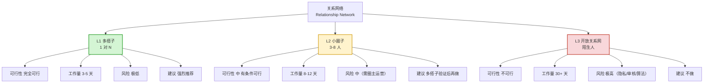
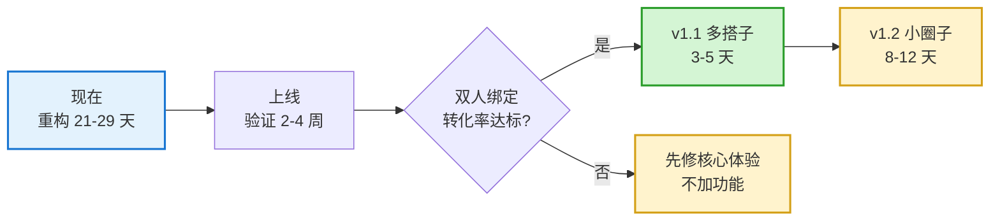
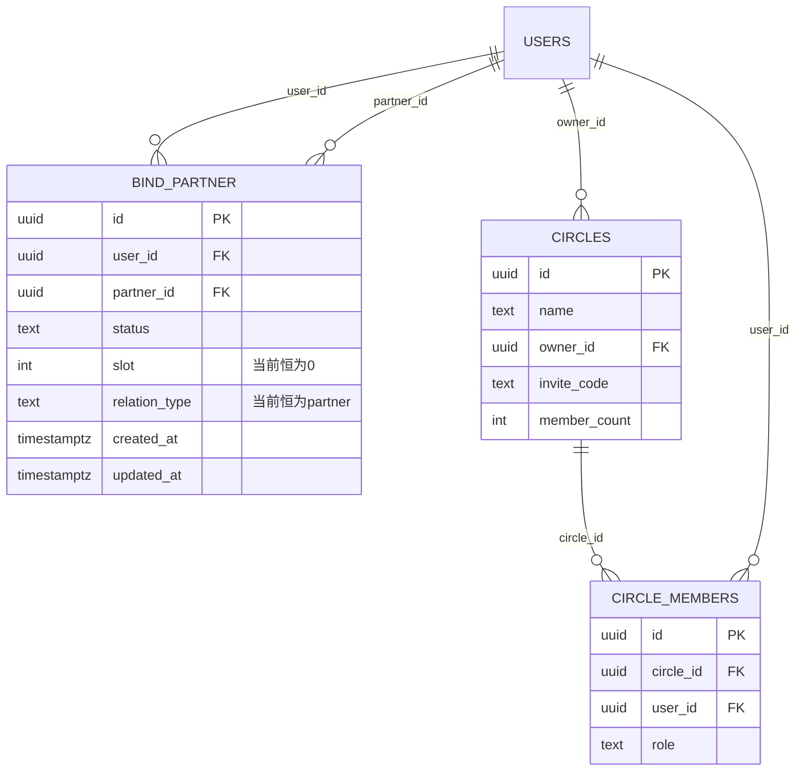
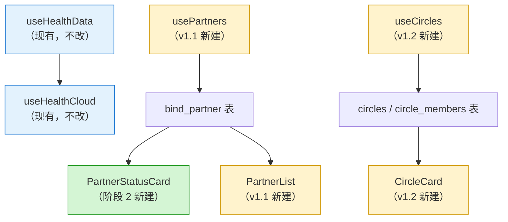
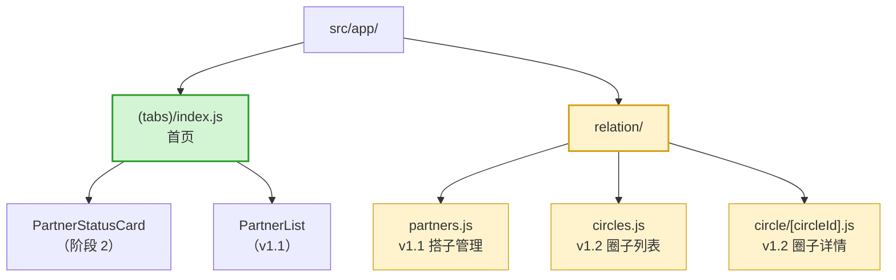
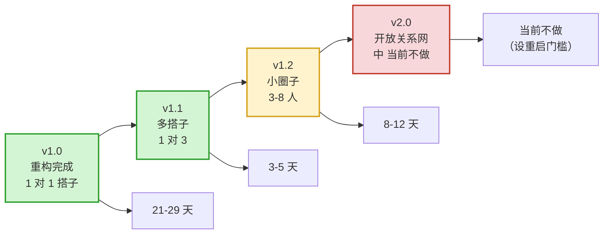

# Sync App —— 关系网络接口预留书（未来扩展，现在不实现）

> **文档性质**：前瞻性接口预留说明。**本文档中所有代码均为"未来实现"，当前重构阶段一行都不执行。**
> **唯一现在要做的**：在阶段 2 建 `bind_partner` 表时，按 §3.1 的最终版 SQL 建表（多一个 `slot` 字段，零额外成本）。
> **配套文档**：
> - [`SYNC_APP_REFACTOR_EXECUTION_SPEC.md`](SYNC_APP_REFACTOR_EXECUTION_SPEC.md)（总纲）
> - [`SYNC_APP_REFACTOR_EXECUTION_SPEC_PART2.md`](SYNC_APP_REFACTOR_EXECUTION_SPEC_PART2.md)（阶段 1-3）
> - [`SYNC_APP_REFACTOR_EXECUTION_SPEC_PART3.md`](SYNC_APP_REFACTOR_EXECUTION_SPEC_PART3.md)（阶段 4-7）
> - [`SYNC_APP_ARCHITECTURE_DIAGRAMS.md`](SYNC_APP_ARCHITECTURE_DIAGRAMS.md)（18 张架构图）

---

## 目录

- [§0 文档定位与使用方式](#0-文档定位与使用方式)
- [§1 关系网络三层模型与可行性结论](#1-关系网络三层模型与可行性结论)
- [§2 为什么现在只预留、不实现](#2-为什么现在只预留不实现)
- [§3 数据层接口预留（SQL）](#3-数据层接口预留sql)
- [§4 常量层接口预留（JS）](#4-常量层接口预留js)
- [§5 Hook 层接口预留（JS）](#5-hook-层接口预留js)
- [§6 组件层接口预留（JS）](#6-组件层接口预留js)
- [§7 路由层接口预留](#7-路由层接口预留)
- [§8 未来实现路线图（v1.1 / v1.2 / v2.0）](#8-未来实现路线图v11--v12--v20)
- [§9 迁移检查清单](#9-迁移检查清单)
- [§10 风险与红线](#10-风险与红线)

---

## §0 文档定位与使用方式

### 0.1 这份文档解决什么问题

用户未来可能把产品从「**1 对 1 双人健康搭子**」扩展为「**关系网络**」。本文档回答三个问题：

1. **哪些接口现在就要留？**（答案：极少，只有 1 个 SQL 字段）
2. **未来怎么加？**（答案：加字段 + 加列表渲染，不改架构）
3. **哪些当前不做？**（答案：开放陌生人关系网——当前阶段不做，但保留重启门槛，见 §8.4）

### 0.2 使用方式

| 场景 | 怎么用这份文档 |
|---|---|
| **现在（重构阶段）** | 只读 §3.1，建表时带上 `slot` 字段。其余全部跳过。 |
| **上线后验证期** | 读 §1、§8，判断是否进入 v1.1 |
| **决定做多搭子时** | 读 §3-§7，按顺序执行 |
| **决定做小圈子时** | 读 §8.2、§10 |
| **有人提议做陌生人社交** | 读 §1.3、§8.4、§10.1，对照 5 条重启门槛评估；门槛未满足则暂缓 |

### 0.3 与主执行书的关系

本文档是**附录性质**，不改变主执行书的任何阶段划分。主执行书 7 个阶段（21-29 天）**完全不受影响**。

---

## §1 关系网络三层模型与可行性结论

### 1.1 三层模型



### 1.2 结论表

| 层级 | 形态 | 可行性 | 工作量 | 前置条件 | 建议 |
|---|---|---|---|---|---|
| **L1 多搭子** | 1 个用户 ↔ 2-3 个搭子 | 完全可行 | 3-5 天 | 重构完成 + 双人绑定验证通过 | **强烈推荐** |
| **L2 小圈子** | 3-8 人小组（家庭/健身小队） | 有条件可行 | 8-12 天 | 多搭子数据良好 + 有圈主运营能力 | 谨慎推进 |
| **L3 开放关系网** | 陌生人可互相关注/查看 | 当前阶段不可行 | 30+ 天 | 需要审核团队 + 算法 + 合规 | **当前不做**（保留重启门槛，见 §8.4） |

### 1.3 L3 在当前阶段不可行的原因（核心论证）

| 维度 | 问题 |
|---|---|
| **隐私** | 健康数据（喝水/吃饭/打卡）是极度隐私信息。99% 的人不愿意让陌生人看到自己"今天没喝水"。 |
| **冷启动** | 陌生人社交需要"先有内容再有用户"，而健康数据天然不适合公开。 |
| **审核成本** | 开放关系网必须有内容审核、举报处理、封禁体系，这是 10 人团队的工作量。 |
| **合规** | 健康数据在 GDPR / 个人信息保护法下属"敏感个人信息"，开放共享需要单独同意 + 影响评估。 |
| **竞争** | 陌生人社交赛道已被微信/小红书/抖音占满，无差异化空间。 |

**核心洞察**：

> **真正的网络效应不在「认识更多人」，而在「和同一个人有更多共同场景」。**
>
> 一个用户和同一个搭子，同时用「健康打卡 + 一起看片 + 私密相册 + 朋友圈」，
> 其粘性远高于「认识 100 个只能看健康数据的陌生人」。

---

## §2 当前只预留、不实现的原因

### 2.1 顺序论证



### 2.2 返工成本对比

| 顺序 | 工作量 | 返工风险 | 说明 |
|---|---|---|---|
| **先重构 → 后多搭子** | 21-29 天 + 3-5 天 | **无** | 多搭子是增量，直接叠加 |
| **先多搭子 → 后重构** | 3-5 天 + 21-29 天 + **重写多搭子** | **高** | 重构会重写整个首页，多搭子 UI 被推翻 |

**关键原因**：重构阶段 2 会**完全重写** [`src/app/(tabs)/index.js`](../../src/app/(tabs)/index.js)，并新建 [`PartnerStatusCard`](SYNC_APP_REFACTOR_EXECUTION_SPEC_PART2.md)。现在做的多搭子 UI 到时候会被整体推翻。

### 2.3 预留 vs 实现的边界

| 项目 | 现在（重构阶段） | 未来（v1.1） |
|---|---|---|
| `bind_partner` 表 | 建表时带 `slot` 字段 | 改 unique 约束 |
| `FEATURES.multiPartner` | 写 `false` | 改 `true` |
| `LIMITS.partnerMax` | 写 `1` | 改 `3` |
| `usePartners()` Hook | 不写 | 新建 |
| `PartnerList` 组件 | 不写 | 新建 |
| 多搭子路由 | 不建 | 新建 |

**原则**：**只留"数据形状"和"开关"，不留"实现"。**

---

## §3 数据层接口预留（SQL）

### 3.1 `bind_partner` 表 —— 最终版（阶段 2 建表时直接用这个）

> 注意：**这是本文档唯一需要在重构阶段执行的内容。**
> 相比主执行书，只多了 `slot` 字段和 `updated_at` 字段，其余完全一致。

```sql
-- ============================================================
-- bind_partner：健康搭子绑定关系
-- 阶段 2 建表时直接使用此版本（含未来多搭子预留字段）
-- ============================================================
create table if not exists public.bind_partner (
  id uuid primary key default gen_random_uuid(),

  -- 发起方
  user_id uuid not null references auth.users(id) on delete cascade,
  -- 接收方
  partner_id uuid not null references auth.users(id) on delete cascade,

  -- 绑定状态
  status text not null default 'pending'
    check (status in ('pending', 'active', 'rejected', 'unbound')),

  -- 【未来预留】搭子槽位：0 = 主搭子，1/2 = 副搭子
  -- 当前阶段所有记录恒为 0，不影响任何逻辑
  slot int not null default 0 check (slot >= 0 and slot <= 2),

  -- 【未来预留】关系类型：partner = 健康搭子，circle = 小圈子成员
  -- 当前阶段所有记录恒为 'partner'
  relation_type text not null default 'partner'
    check (relation_type in ('partner', 'circle')),

  created_at timestamptz not null default now(),
  updated_at timestamptz not null default now(),

  -- 当前阶段：一个用户对一个搭子只能有一条记录
  -- 未来多搭子：改为 unique(user_id, slot)
  unique (user_id, partner_id)
);

-- 索引
create index if not exists idx_bind_partner_user
  on public.bind_partner (user_id, status);
create index if not exists idx_bind_partner_partner
  on public.bind_partner (partner_id, status);

-- updated_at 自动更新
create or replace function public.touch_bind_partner_updated_at()
returns trigger
language plpgsql
as $$
begin
  new.updated_at = now();
  return new;
end;
$$;

drop trigger if exists trg_bind_partner_updated_at on public.bind_partner;
create trigger trg_bind_partner_updated_at
  before update on public.bind_partner
  for each row execute function public.touch_bind_partner_updated_at();

-- ============================================================
-- RLS：只有关系双方可见
-- ============================================================
alter table public.bind_partner enable row level security;

drop policy if exists "bind_partner_select_own" on public.bind_partner;
create policy "bind_partner_select_own"
  on public.bind_partner for select
  using (auth.uid() = user_id or auth.uid() = partner_id);

drop policy if exists "bind_partner_insert_own" on public.bind_partner;
create policy "bind_partner_insert_own"
  on public.bind_partner for insert
  with check (auth.uid() = user_id);

drop policy if exists "bind_partner_update_involved" on public.bind_partner;
create policy "bind_partner_update_involved"
  on public.bind_partner for update
  using (auth.uid() = user_id or auth.uid() = partner_id);

drop policy if exists "bind_partner_delete_own" on public.bind_partner;
create policy "bind_partner_delete_own"
  on public.bind_partner for delete
  using (auth.uid() = user_id or auth.uid() = partner_id);
```

### 3.2 未来迁移脚本（v1.1 多搭子，现在不执行）

```sql
-- ============================================================
-- 【未来 v1.1】启用多搭子
-- 执行时机：双人绑定验证通过后
-- ============================================================

-- 1. 删除旧的唯一约束
alter table public.bind_partner
  drop constraint if exists bind_partner_user_id_partner_id_key;

-- 2. 新建按槽位的唯一约束
alter table public.bind_partner
  add constraint bind_partner_user_slot_key unique (user_id, slot);

-- 3. 新建按搭子的唯一约束（防止同一搭子被重复绑定到多个槽位）
alter table public.bind_partner
  add constraint bind_partner_user_partner_key unique (user_id, partner_id);

-- 4. 回填：现有 active 记录保持 slot = 0（默认值已满足，无需操作）

-- 5. 校验
select user_id, count(*) as partner_count
from public.bind_partner
where status = 'active'
group by user_id
having count(*) > 1;
```

### 3.3 未来迁移脚本（v1.2 小圈子，现在不执行）

```sql
-- ============================================================
-- 【未来 v1.2】小圈子
-- 执行时机：多搭子数据良好 + 有圈主运营能力
-- ============================================================

create table if not exists public.circles (
  id uuid primary key default gen_random_uuid(),
  name text not null check (char_length(name) between 1 and 20),
  owner_id uuid not null references auth.users(id) on delete cascade,
  avatar_url text,
  invite_code text not null unique,
  member_count int not null default 1 check (member_count between 1 and 8),
  created_at timestamptz not null default now(),
  updated_at timestamptz not null default now()
);

create table if not exists public.circle_members (
  id uuid primary key default gen_random_uuid(),
  circle_id uuid not null references public.circles(id) on delete cascade,
  user_id uuid not null references auth.users(id) on delete cascade,
  role text not null default 'member' check (role in ('owner', 'member')),
  joined_at timestamptz not null default now(),
  unique (circle_id, user_id)
);

create index if not exists idx_circle_members_user
  on public.circle_members (user_id);

alter table public.circles enable row level security;
alter table public.circle_members enable row level security;

-- 圈子：成员可见
create policy "circles_select_member"
  on public.circles for select
  using (
    exists (
      select 1 from public.circle_members m
      where m.circle_id = circles.id and m.user_id = auth.uid()
    )
  );

-- 圈子：圈主可改
create policy "circles_update_owner"
  on public.circles for update
  using (auth.uid() = owner_id);

-- 成员：同圈可见
create policy "circle_members_select_same_circle"
  on public.circle_members for select
  using (
    exists (
      select 1 from public.circle_members m
      where m.circle_id = circle_members.circle_id and m.user_id = auth.uid()
    )
  );

-- 成员：圈主可增删
create policy "circle_members_manage_owner"
  on public.circle_members for all
  using (
    exists (
      select 1 from public.circles c
      where c.id = circle_members.circle_id and c.owner_id = auth.uid()
    )
  );
```

### 3.4 数据模型演进图



> 虚线部分（`circles` / `circle_members`）为 v1.2 才创建，当前不存在。

---

## §4 常量层接口预留（JS）

### 4.1 `src/constants/features.js` —— 阶段 1 建文件时直接写这个版本

```js
// src/constants/features.js
// 功能开关：用于灰度发布与商业化分层
// 当前阶段所有关系网络相关开关均为 false / 1

export const FEATURES = {
  // ===== 当前阶段已启用 =====
  privateSpace: true,
  moments: true,
  cinemaHD: true,
  adFree: true,
  searchHall: true,

  // ===== 【未来预留】关系网络 =====
  // v1.1 多搭子：改为 true 时启用多搭子 UI
  multiPartner: false,
  // v1.2 小圈子：改为 true 时启用圈子入口
  circles: false,
  // v2.0 开放关系网：永久 false（见文档 §1.3）
  openNetwork: false,
};

// 便捷判断（未来可用）
export const isFeatureOn = (key) => FEATURES[key] === true;
```

### 4.2 `src/constants/limits.js` —— 阶段 1 建文件时直接写这个版本

```js
// src/constants/limits.js
// 数量上限：用于 UI 校验与后端约束对齐

export const LIMITS = {
  // ===== 当前阶段 =====
  privateAlbumMax: 500,
  privateNotesMax: 200,
  momentsDailyMax: 10,
  momentImagesMax: 9,
  cinemaRoomTitleMax: 30,
  danmakuMaxLength: 50,

  // ===== 【未来预留】关系网络 =====
  // v1.1 多搭子：改为 3 时启用多搭子
  partnerMax: 1,
  // v1.2 小圈子：改为 8 时启用圈子
  circleMemberMax: 1,
  // 圈子名称长度
  circleNameMax: 20,
};
```

### 4.3 常量演进对照表

| 常量 | 当前值 | v1.1 值 | v1.2 值 | 说明 |
|---|---|---|---|---|
| `FEATURES.multiPartner` | `false` | `true` | `true` | 多搭子开关 |
| `FEATURES.circles` | `false` | `false` | `true` | 小圈子开关 |
| `FEATURES.openNetwork` | `false` | `false` | `false` | 永久关闭 |
| `LIMITS.partnerMax` | `1` | `3` | `3` | 搭子数量上限 |
| `LIMITS.circleMemberMax` | `1` | `1` | `8` | 圈子人数上限 |

---

## §5 Hook 层接口预留（JS）

> 注意：**以下代码全部为未来实现，当前阶段不创建这些文件。**

### 5.1 `src/hooks/relation/usePartners.js`（v1.1 新建）

```js
// src/hooks/relation/usePartners.js
// 【未来 v1.1】多搭子数据 Hook
// 当前阶段不存在此文件

import { useState, useEffect, useCallback, useMemo } from 'react';
import { supabase } from '../../services/supabase';
import { LIMITS } from '../../constants/limits';

/**
 * 获取当前用户的所有搭子
 * @param {object} user - 当前登录用户
 * @returns {{
 *   partners: Array<{id, partnerId, partnerName, slot, status}>,
 *   loading: boolean,
 *   canAddMore: boolean,
 *   refresh: () => Promise<void>,
 *   addPartner: (partnerId: string) => Promise<{error: any}>,
 *   removePartner: (partnerId: string) => Promise<{error: any}>,
 * }}
 */
export function usePartners(user) {
  const [partners, setPartners] = useState([]);
  const [loading, setLoading] = useState(true);

  const refresh = useCallback(async () => {
    if (!user?.id) {
      setPartners([]);
      setLoading(false);
      return;
    }
    setLoading(true);
    const { data, error } = await supabase
      .from('bind_partner')
      .select('id, partner_id, slot, status, created_at')
      .eq('user_id', user.id)
      .eq('status', 'active')
      .order('slot', { ascending: true });

    if (!error && data) {
      setPartners(
        data.map((row) => ({
          id: row.id,
          partnerId: row.partner_id,
          slot: row.slot,
          status: row.status,
        }))
      );
    }
    setLoading(false);
  }, [user?.id]);

  useEffect(() => {
    refresh();
  }, [refresh]);

  const canAddMore = partners.length < LIMITS.partnerMax;

  const addPartner = useCallback(
    async (partnerId) => {
      if (!canAddMore) {
        return { error: new Error('已达到搭子数量上限') };
      }
      const usedSlots = new Set(partners.map((p) => p.slot));
      let nextSlot = 0;
      while (usedSlots.has(nextSlot)) nextSlot += 1;

      const { error } = await supabase.from('bind_partner').insert({
        user_id: user.id,
        partner_id: partnerId,
        status: 'pending',
        slot: nextSlot,
        relation_type: 'partner',
      });
      if (!error) await refresh();
      return { error };
    },
    [user?.id, canAddMore, partners, refresh]
  );

  const removePartner = useCallback(
    async (partnerId) => {
      const { error } = await supabase
        .from('bind_partner')
        .update({ status: 'unbound' })
        .eq('user_id', user.id)
        .eq('partner_id', partnerId);
      if (!error) await refresh();
      return { error };
    },
    [user?.id, refresh]
  );

  return useMemo(
    () => ({ partners, loading, canAddMore, refresh, addPartner, removePartner }),
    [partners, loading, canAddMore, refresh, addPartner, removePartner]
  );
}
```

### 5.2 `src/hooks/relation/useCircles.js`（v1.2 新建）

```js
// src/hooks/relation/useCircles.js
// 【未来 v1.2】小圈子数据 Hook
// 当前阶段不存在此文件

import { useState, useEffect, useCallback, useMemo } from 'react';
import { supabase } from '../../services/supabase';

/**
 * 获取当前用户加入的所有圈子
 * @param {object} user
 * @returns {{
 *   circles: Array<{id, name, ownerId, memberCount, role}>,
 *   loading: boolean,
 *   refresh: () => Promise<void>,
 *   createCircle: (name: string) => Promise<{data, error}>,
 *   joinCircle: (inviteCode: string) => Promise<{error}>,
 *   leaveCircle: (circleId: string) => Promise<{error}>,
 * }}
 */
export function useCircles(user) {
  const [circles, setCircles] = useState([]);
  const [loading, setLoading] = useState(true);

  const refresh = useCallback(async () => {
    if (!user?.id) {
      setCircles([]);
      setLoading(false);
      return;
    }
    setLoading(true);
    const { data, error } = await supabase
      .from('circle_members')
      .select('role, circles(id, name, owner_id, member_count)')
      .eq('user_id', user.id);

    if (!error && data) {
      setCircles(
        data
          .filter((row) => row.circles)
          .map((row) => ({
            id: row.circles.id,
            name: row.circles.name,
            ownerId: row.circles.owner_id,
            memberCount: row.circles.member_count,
            role: row.role,
          }))
      );
    }
    setLoading(false);
  }, [user?.id]);

  useEffect(() => {
    refresh();
  }, [refresh]);

  const createCircle = useCallback(
    async (name) => {
      const inviteCode = Math.random().toString(36).slice(2, 8).toUpperCase();
      const { data, error } = await supabase
        .from('circles')
        .insert({ name, owner_id: user.id, invite_code: inviteCode })
        .select()
        .single();
      if (!error && data) {
        await supabase.from('circle_members').insert({
          circle_id: data.id,
          user_id: user.id,
          role: 'owner',
        });
        await refresh();
      }
      return { data, error };
    },
    [user?.id, refresh]
  );

  const joinCircle = useCallback(
    async (inviteCode) => {
      const { data: circle, error: findError } = await supabase
        .from('circles')
        .select('id, member_count')
        .eq('invite_code', inviteCode.toUpperCase())
        .single();
      if (findError || !circle) return { error: findError || new Error('圈子不存在') };

      const { error } = await supabase.from('circle_members').insert({
        circle_id: circle.id,
        user_id: user.id,
        role: 'member',
      });
      if (!error) await refresh();
      return { error };
    },
    [user?.id, refresh]
  );

  const leaveCircle = useCallback(
    async (circleId) => {
      const { error } = await supabase
        .from('circle_members')
        .delete()
        .eq('circle_id', circleId)
        .eq('user_id', user.id);
      if (!error) await refresh();
      return { error };
    },
    [user?.id, refresh]
  );

  return useMemo(
    () => ({ circles, loading, refresh, createCircle, joinCircle, leaveCircle }),
    [circles, loading, refresh, createCircle, joinCircle, leaveCircle]
  );
}
```

### 5.3 Hook 与现有代码的关系



> 蓝色 = 现有代码，绿色 = 重构阶段新建，黄色 = 未来新建。

---

## §6 组件层接口预留（JS）

### 6.1 `PartnerStatusCard` 的 Props 设计（阶段 2 建组件时按此设计）

> **这是唯一需要在重构阶段"注意"的组件设计点。**
> 阶段 2 新建 [`PartnerStatusCard`](SYNC_APP_REFACTOR_EXECUTION_SPEC_PART2.md) 时，Props 设计成"接收单个 partner 对象"，而不是"从 context 里读全局单例"。这样未来渲染列表时可以直接复用。

```js
// src/components/home/PartnerStatusCard.js
// 阶段 2 新建时的 Props 签名（关键设计）

/**
 * @param {object} props
 * @param {object|null} props.partner - 搭子数据，null 表示未绑定
 * @param {string} props.partner.id
 * @param {string} props.partner.name
 * @param {string} props.partner.avatarUrl
 * @param {number} props.partner.waterAmount
 * @param {number} props.partner.maxWater
 * @param {boolean} props.partner.isCheckedIn
 * @param {number} [props.index=0] - 列表中的索引（用于 stagger 动画）
 * @param {() => void} [props.onPress]
 * @param {() => void} [props.onInvite] - 未绑定时点击邀请
 */
export default function PartnerStatusCard({
  partner = null,
  index = 0,
  onPress,
  onInvite,
}) {
  // ... 实现见主执行书 PART2 §12.2
}
```

**关键点**：

- 接收 `partner` 对象（而非从 context 读）
- 接收 `index`（为未来列表 stagger 动画预留）
- 未绑定时渲染"邀请卡片"（Q1-B 决策）
- 不硬编码"只有一个搭子"的逻辑

### 6.2 `PartnerList`（v1.1 新建）

```js
// src/components/home/PartnerList.js
// 【未来 v1.1】多搭子列表
// 当前阶段不存在此文件

import { View } from 'react-native';
import Animated, { FadeInDown } from 'react-native-reanimated';
import PartnerStatusCard from './PartnerStatusCard';
import { STAGGER } from '../../constants/motion';

/**
 * @param {object} props
 * @param {Array} props.partners
 * @param {() => void} props.onInvite
 */
export default function PartnerList({ partners = [], onInvite }) {
  return (
    <View>
      {partners.map((partner, index) => (
        <Animated.View
          key={partner.id}
          entering={FadeInDown.delay(index * STAGGER.list).springify()}
        >
          <PartnerStatusCard partner={partner} index={index} />
        </Animated.View>
      ))}
      <PartnerStatusCard partner={null} index={partners.length} onInvite={onInvite} />
    </View>
  );
}
```

### 6.3 `CircleCard`（v1.2 新建）

```js
// src/components/space/CircleCard.js
// 【未来 v1.2】小圈子卡片
// 当前阶段不存在此文件

import { View, Text, Pressable } from 'react-native';
import { useAppTheme } from '../../context/ThemeContext';
import { haptic } from '../../constants/haptics';

/**
 * @param {object} props
 * @param {object} props.circle
 * @param {string} props.circle.id
 * @param {string} props.circle.name
 * @param {number} props.circle.memberCount
 * @param {string} props.circle.role
 * @param {() => void} props.onPress
 */
export default function CircleCard({ circle, onPress }) {
  const { palette, isDark } = useAppTheme();

  const handlePress = () => {
    haptic.light();
    onPress?.();
  };

  return (
    <Pressable onPress={handlePress}>
      <View>
        <Text>{circle.name}</Text>
        <Text>{circle.memberCount} 人</Text>
        {circle.role === 'owner' && <Text>圈主</Text>}
      </View>
    </Pressable>
  );
}
```

### 6.4 组件演进对照表

| 组件 | 阶段 2 | v1.1 | v1.2 |
|---|---|---|---|
| `PartnerStatusCard` | 新建（单卡） | 复用（列表项） | 复用 |
| `PartnerList` | 否 | 新建 | 复用 |
| `CircleCard` | 否 | 否 | 新建 |
| `CircleMemberList` | 否 | 否 | 新建 |

---

## §7 路由层接口预留

### 7.1 未来路由结构



### 7.2 路由预留说明

| 路由 | 层级 | 创建时机 | 说明 |
|---|---|---|---|
| `src/app/relation/partners.js` | L2 | v1.1 | 搭子管理页（增删搭子） |
| `src/app/relation/circles.js` | L2 | v1.2 | 圈子列表页 |
| `src/app/relation/circle/[circleId].js` | L3 | v1.2 | 圈子详情页 |

**当前阶段**：`src/app/relation/` 目录**不创建**。所有关系网络路由均为未来预留。

### 7.3 路由冲突检查（未来执行时必看）

| 检查项 | 规则 |
|---|---|
| `src/app/relation.js` 与 `src/app/relation/index.js` | **不可共存**，二选一 |
| `src/app/relation/circle.js` 与 `src/app/relation/circle/index.js` | **不可共存**，二选一 |
| 底栏显示 | `relation/` 在 `(tabs)` 之外，**自动隐藏底栏**，无需代码 |
| 返回按钮 | L2/L3 页面需自行实现返回（参考 [`settings/index.js`](SYNC_APP_REFACTOR_EXECUTION_SPEC_PART2.md)） |

---

## §8 未来实现路线图（v1.1 / v1.2 / v2.0）

### 8.1 版本演进总览



### 8.2 v1.1 多搭子（3-5 天）

**触发条件**（必须全部满足）：

| 条件 | 阈值 |
|---|---|
| 重构 v1.0 已上线 | 是 |
| 双人绑定转化率 | ≥ 30% |
| 7 日留存 | ≥ 25% |
| 用户主动反馈"想加更多搭子" | ≥ 10 条 |

**执行步骤**：

| 步骤 | 内容 | 工作量 |
|---|---|---|
| 1 | 执行 §3.2 SQL 迁移 | 0.5 天 |
| 2 | 改 `FEATURES.multiPartner = true`、`LIMITS.partnerMax = 3` | 0.1 天 |
| 3 | 新建 `usePartners` Hook（§5.1） | 0.5 天 |
| 4 | 新建 `PartnerList` 组件（§6.2） | 0.5 天 |
| 5 | 首页接入 `PartnerList` 替换单卡 | 0.5 天 |
| 6 | 新建 `relation/partners.js` 管理页 | 1 天 |
| 7 | 邀请流程适配多搭子 | 0.5 天 |
| 8 | 验收 + 真机测试 | 0.5-1 天 |

**验收标准**：

- [ ] 可绑定 3 个搭子，每个独立显示进度
- [ ] 解除绑定后槽位可复用
- [ ] 列表 stagger 动画流畅（60fps）
- [ ] 深色模式正常
- [ ] 触感反馈正确

### 8.3 v1.2 小圈子（8-12 天）

**触发条件**（必须全部满足）：

| 条件 | 阈值 |
|---|---|
| v1.1 多搭子已上线 | 是 |
| 多搭子用户占比 | ≥ 20% |
| 有明确的"家庭/健身小队"使用场景 | 用户访谈确认 |
| 有圈主运营能力（或愿意投入） | 团队确认 |

**执行步骤**：

| 步骤 | 内容 | 工作量 |
|---|---|---|
| 1 | 执行 §3.3 SQL（circles + circle_members） | 1 天 |
| 2 | 改 `FEATURES.circles = true`、`LIMITS.circleMemberMax = 8` | 0.1 天 |
| 3 | 新建 `useCircles` Hook（§5.2） | 1 天 |
| 4 | 新建 `CircleCard` 组件（§6.3） | 0.5 天 |
| 5 | 新建 `relation/circles.js` 列表页 | 1.5 天 |
| 6 | 新建 `relation/circle/[circleId].js` 详情页 | 2 天 |
| 7 | 邀请码生成 + 加入流程 | 1 天 |
| 8 | 圈子内健康数据聚合展示 | 2 天 |
| 9 | 圈主管理（踢人/解散） | 1 天 |
| 10 | 验收 + 真机测试 | 1-2 天 |

**验收标准**：

- [ ] 可创建圈子，生成 6 位邀请码
- [ ] 可通过邀请码加入
- [ ] 圈子内可见所有成员健康进度
- [ ] 圈主可踢人/解散
- [ ] 成员上限 8 人强制生效
- [ ] RLS 正确（非成员不可见）

### 8.4 v2.0 开放关系网（当前不做，保留重启门槛）

**结论**：**当前阶段不做**。理由见 §1.3。

> **说明**：这不是永久否决，而是"条件未满足前不做"的阶段性决策。以下 5 条门槛全部满足时，可重新评估并启动。

**重启门槛（全部满足才可启动）**：

| 门槛 | 要求 |
|---|---|
| 团队规模 | ≥ 10 人（含审核 3 人） |
| 资金 | ≥ 500 万（12 个月） |
| 合规 | 完成个人信息保护影响评估（PIA） |
| 技术 | 内容审核 API + 举报系统 + 封禁体系 + 推荐算法 |
| 产品 | 必须有"非健康数据"的公开内容（否则无人愿意公开） |

---

## §9 迁移检查清单

### 9.1 重构阶段（现在）—— 只需做 3 件事

- [ ] **建表时用 §3.1 的最终版 SQL**（含 `slot` + `relation_type` 字段）
- [ ] **`features.js` 写全 8 个开关**（含 3 个未来开关，值为 `false`）
- [ ] **`limits.js` 写全 9 个上限**（含 3 个未来上限，值为 `1`）
- [ ] **`PartnerStatusCard` Props 设计成接收 `partner` 对象 + `index`**（§6.1）

> 以上 4 项**零额外工作量**，只是"写的时候多写几行"。

### 9.2 v1.1 迁移检查清单

- [ ] 执行 §3.2 SQL 迁移
- [ ] 改 `FEATURES.multiPartner = true`
- [ ] 改 `LIMITS.partnerMax = 3`
- [ ] 新建 `src/hooks/relation/usePartners.js`
- [ ] 新建 `src/components/home/PartnerList.js`
- [ ] 首页接入 `PartnerList`
- [ ] 新建 `src/app/relation/partners.js`
- [ ] 邀请流程适配
- [ ] 真机验收

### 9.3 v1.2 迁移检查清单

- [ ] 执行 §3.3 SQL（新建 2 张表）
- [ ] 改 `FEATURES.circles = true`
- [ ] 改 `LIMITS.circleMemberMax = 8`
- [ ] 新建 `src/hooks/relation/useCircles.js`
- [ ] 新建 `src/components/space/CircleCard.js`
- [ ] 新建 `src/app/relation/circles.js`
- [ ] 新建 `src/app/relation/circle/[circleId].js`
- [ ] 邀请码流程
- [ ] 圈子数据聚合
- [ ] 圈主管理
- [ ] 真机验收

### 9.4 每次迁移后的通用验收命令

```bash
npx tsc --noEmit
npx expo lint
npx expo-doctor
```

---

## §10 风险与红线

### 10.1 绝对红线

| # | 红线 | 原因 |
|---|---|---|
| R1 | **当前阶段不做开放陌生人关系网**（重启需满足 §8.4 的 5 条门槛） | 健康数据隐私 + 合规 + 审核成本（§1.3） |
| R2 | **不改 [`colors.js`](../../src/constants/colors.js) / [`theme.js`](../../src/constants/theme.js) / [`ThemeContext.js`](../../src/context/ThemeContext.js)** | 最高指令，任何阶段不得违反 |
| R3 | **不在重构阶段写任何关系网络实现代码** | 避免返工（§2.2） |
| R4 | **`bind_partner` 的 RLS 必须只允许关系双方可见** | 健康数据隐私 |
| R5 | **圈子成员上限硬编码在 DB check 约束** | 防止前端绕过 |

### 10.2 风险矩阵

| # | 风险 | 概率 | 影响 | 缓解措施 |
|---|---|---|---|---|
| 1 | 多搭子导致首页性能下降 | 中 | 中 | 用 FlashList + stagger 动画限制在 3 个 |
| 2 | 多搭子导致通知轰炸 | 高 | 高 | 通知聚合（"你的 3 个搭子都完成了"） |
| 3 | 圈子变成"僵尸圈" | 高 | 中 | 圈主运营激励 + 7 天无活跃自动提醒 |
| 4 | 圈子数据聚合查询慢 | 中 | 中 | 加索引 + 分页 + 缓存 |
| 5 | 用户误以为健康数据会公开 | 中 | 高 | 首次进入圈子时明确提示"仅圈内可见" |
| 6 | 迁移 SQL 失败导致数据丢失 | 低 | 极高 | 迁移前备份 + 事务包裹 + 先在测试库跑 |

### 10.3 与主执行书的红线一致性

本文档**不新增任何红线**，只是重申主执行书 §0.2 的约束：

- [`colors.js`](../../src/constants/colors.js) 不可改
- [`theme.js`](../../src/constants/theme.js) 不可改
- [`ThemeContext.js`](../../src/context/ThemeContext.js) 不可改
- 主题色 / UI / UX 不可改

---

## §11 一页速查（打印版）

```text
┌─────────────────────────────────────────────────────────────┐
│  关系网络接口预留 —— 一页速查                                │
├─────────────────────────────────────────────────────────────┤
│                                                             │
│  【现在只做 4 件事】                                         │
│  1. bind_partner 建表带 slot + relation_type 字段            │
│  2. features.js 写 multiPartner/circles/openNetwork = false  │
│  3. limits.js 写 partnerMax/circleMemberMax = 1              │
│  4. PartnerStatusCard 接收 partner 对象 + index              │
│                                                             │
│  【三层可行性】                                              │
│  L1 多搭子     3-5 天   强烈推荐                           │
│  L2 小圈子     8-12 天  谨慎推进                           │
│  L3 开放网络   当前不做（门槛见 §8.4）                     │
│                                                             │
│  【顺序】                                                    │
│  重构 21-29 天 → 上线验证 2-4 周 → v1.1 → v1.2              │
│                                                             │
│  【核心洞察】                                                │
│  网络效应不在"认识更多人"                                    │
│  而在"和同一个人有更多共同场景"                              │
│                                                             │
└─────────────────────────────────────────────────────────────┘
```

---

## §12 文档索引

| 文档 | 行数 | 内容 |
|---|---|---|
| [`SYNC_APP_REFACTOR_EXECUTION_SPEC.md`](SYNC_APP_REFACTOR_EXECUTION_SPEC.md) | 774 | 总纲（约束/决策/架构/视觉/动效/路由/数据/前瞻/风险/索引） |
| [`SYNC_APP_REFACTOR_EXECUTION_SPEC_PART2.md`](SYNC_APP_REFACTOR_EXECUTION_SPEC_PART2.md) | 1515 | 阶段 1-3 细则（地基/首页/空间+设置） |
| [`SYNC_APP_REFACTOR_EXECUTION_SPEC_PART3.md`](SYNC_APP_REFACTOR_EXECUTION_SPEC_PART3.md) | 880 | 阶段 4-7 细则（聊天/放映厅/私密+朋友圈/收口） |
| [`SYNC_APP_ARCHITECTURE_DIAGRAMS.md`](SYNC_APP_ARCHITECTURE_DIAGRAMS.md) | 1175 | 18 张架构图 |
| **本文档** | **~1100** | **关系网络接口预留（未来扩展）** |

**总计**：约 5444 行。

---

> **最后提醒**：本文档中 §5、§6.2、§6.3、§7 的所有代码均为**未来实现**，当前重构阶段**一行都不执行**。
> 唯一需要在重构阶段落实的是 §9.1 的 4 项"零成本预留"。
