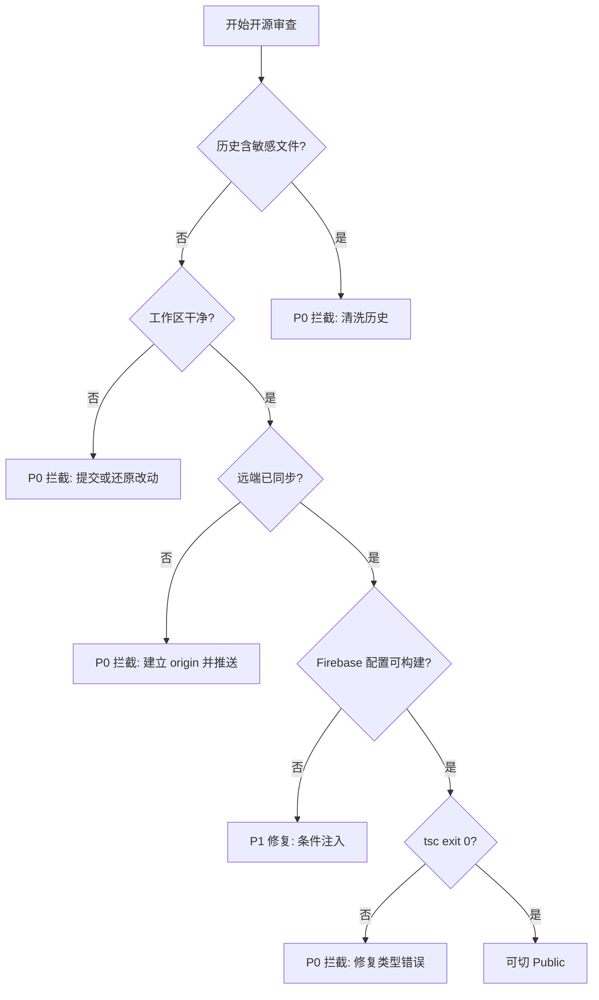

# Sync 开源前 360 度安全与质量审查报告

审查对象：`/Users/TCL/my-app`（分支 `main`，HEAD `00b6d08`）
审查方式：Git 历史/索引/工作区三层取证 + 静态内容扫描 + 编译门禁

---

## 结论

# 【需要拦截修复的风险项】

当前**不具备**开源条件。存在 3 项硬性拦截（P0）与 4 项需修复项（P1），其中 P0-1 与 P0-2 属于「一旦切 Public 立即暴露」的问题。

---

## 一、逐项审查结果

| # | 检查项 | 结果 | 判定 |
| --- | --- | --- | --- |
| 1 | 历史敏感文件与体积 | 历史无命中，体积正常 | 通过 |
| 2 | 环境变量与凭据 | `.env` 未跟踪；无真实密钥 | 通过 |
| 3 | Expo 与应用配置 | `app.json` 引用不存在的 Firebase 文件 | 需修复 |
| 4 | 原生证书与密钥 | 磁盘与索引均无证书文件 | 通过 |
| 5 | Edge Functions | 全部 `Deno.env.get()` | 通过 |
| 6 | 代码与资源合规 | 无本地路径/私有源/敏感注释 | 通过 |
| 7 | 协议与双语链接 | LICENSE 合规，链接 0 断链 | 通过 |
| 8 | Git 与编译门禁 | 工作区脏、无远端、无 upstream；tsc 通过 | 拦截 |

---

## 二、P0 硬性拦截项

### P0-1 工作区不干净，且存在大量未提交改动

`git status --porcelain=v1 -b` 输出 `## main`（无 upstream 标记），并列出：

- 已暂存新增（`A`）：`README.md`、`README.en.md`、`README.zh.md`、`.env.example`、`certs/README.*`、`docs/**`、`supabase/migrations/01~13`、多个 `assets/*.png`
- 未暂存修改（` M`）：`.gitignore`、`LICENSE`、`app.json`、`eas.json`、`package.json`、`src/app/(tabs)/profile.js`、`src/app/account_info.js`、`src/app/bind_partner.js`、`src/app/chat/moments.js`、`src/constants/features.js`、`src/constants/limits.js`、`src/hooks/chat/useChatList.js`、`src/hooks/usePushNotifications.js`、`src/types/README.md`、`certs/README.md`
- 已删除（` D`）：根目录 `DEV_LOG.md`、`TFG_DATA.md`、`SYNC_APP_*.md` 等旧文档，以及 `supabase/migrations/20261029*.sql`、`2026103001_*.sql`、`2026103101_*.sql` 旧迁移

风险：当前 HEAD 与工作区内容不一致。若直接切 Public，公开的是**旧提交**，其中仍包含根目录 `DEV_LOG.md`、`TFG_DATA.md`、旧命名迁移等未清理内容；而新文档、新迁移、`.gitignore` 加固全部不在公开版本里。

### P0-2 仓库没有任何远端，`main` 无 upstream

- `git remote -v` 输出为空
- `git branch -a -vv` 仅 `* main 00b6d08`
- `git rev-list --left-right --count main...origin/main` → `fatal: ambiguous argument 'main...origin/main'`
- `git log @{u}..HEAD` → `fatal: no upstream configured for branch 'main'`

风险：「本地 main 与 origin/main 0 差异」这一门禁**无法成立**，因为 `origin` 根本不存在。同时意味着历史从未推送过，这反而是好消息——**现在做历史清洗成本最低**。

### P0-3 `app.json` 引用了不存在的 Firebase 配置文件

[`app.json`](app.json:59) 与 [`app.json`](app.json:69)：

```json
"ios":     { "googleServicesFile": "./GoogleService-Info.plist" }
"android": { "googleServicesFile": "./google-services.json" }
```

实测 `ls` 结果：两个文件均 `No such file or directory`。

风险：文件本身未泄露（好），但配置指向缺失文件会导致 `eas build` 在干净克隆上直接失败，开源后每个贡献者首次构建都会踩坑。需改为条件注入或明确文档化。

---

## 三、P1 需修复项

### P1-1 `certs/certificate.pem` 缺失，但文档声称已配置

[`certs/README.md`](certs/README.md:18) 声明 `certificate.pem` 应提交，[`certs/README.md`](certs/README.md:72) 声称「在 `app.json` 中配置上述字段（已完成）」。实际：

- `git ls-files certs/` 仅 3 个 README
- `ls certs/certificate.pem` → `No such file or directory`
- [`app.json`](app.json:96) 的 `updates` 块中**没有** `codeSigningCertificate` 字段

即文档与配置不一致，OTA 代码签名实际未启用。

### P1-2 历史中存在一次「暂存 PDF」的悬空提交

`git log --all --name-only` 命中：

```
e09c7fb index on main: 0779d37 暂存 PDF 文件
.env.example
```

这是 `git stash` 产生的悬空提交（`index on main:` 前缀）。当前该提交只含 `.env.example`，**未包含 PDF 本体**，但它是 `--all` 可达对象，说明历史上确实有过 PDF 暂存动作。建议 `git stash clear` 后 `git gc --prune=now` 彻底清除，避免任何残留。

### P1-3 根目录残留旧文档（仅在 HEAD 中）

工作区已 ` D` 删除，但 HEAD 仍跟踪：`DEV_LOG.md`、`TFG_DATA.md`、`SYNC_APP_ARCHITECTURE_DIAGRAMS.md`、`SYNC_APP_REFACTOR_EXECUTION_SPEC.md`（含 PART2/PART3）、`SYNC_APP_RELATION_NETWORK_INTERFACE_RESERVATION.md`。这些已迁移到 `docs/` 与 `docs/specs/`，但未提交删除。

### P1-4 旧命名迁移脚本仍在 HEAD

`supabase/migrations/2026102901_media_path_and_rls.sql` 等 6 个旧文件在工作区已删除但未提交，HEAD 中仍存在，与新的 `01~13` 编号体系并存，会造成重复执行风险。

---

## 四、通过项明细（证据）

### 1. 历史敏感文件与体积 — 通过

- `git log --all --oneline --name-only -- 'security-audit*' 'build_log.txt' '*.pdf' '*.p12' '*.p8' '*.jks' '*.keystore' 'google-services.json' 'GoogleService-Info.plist' '.env'` → **无输出**（除 P1-2 的 stash 索引提交）
- `git ls-files | grep -Ei 'security-audit|build_log|\.pdf$|...'` → 仅 `.env.example`
- 大于 500KB 的 Blob：**0 个**
- `git count-objects -vH`：`in-pack: 932`，`size-pack: 1.24 MiB`，`garbage: 0` — 体积完全正常

### 2. 环境变量与凭据 — 通过

- `git ls-files --error-unmatch .env` → `ENV_NOT_TRACKED`
- `git check-ignore -v .env` → `.gitignore:51:.env`
- 全仓库密钥正则扫描（`service_role` / `sk-` / `gsk_` / `BEGIN PRIVATE KEY` / `AIza` / `eyJhbGciOi` JWT）命中项**全部为**：
  - SQL 中的 `GRANT ... TO service_role`（角色名，非密钥）
  - [`supabase/functions/send-push/index.ts`](supabase/functions/send-push/index.ts:112) 的 `Deno.env.get('SUPABASE_SERVICE_ROLE_KEY')`
  - 文档与注释中的说明文字
- [`src/services/supabase.js`](src/services/supabase.js:7) 与 [`src/services/supabase.js`](src/services/supabase.js:8) 均从 `process.env.EXPO_PUBLIC_*` 读取，无硬编码

### 3. Expo 配置 — 部分通过

- 无 `app.config.js` / `app.config.ts`（`ls` 确认）
- [`app.json`](app.json:58) `bundleIdentifier: com.sync.app`、[`app.json`](app.json:68) `package: com.sync.app` — 通用标识，无个人信息
- 无 Apple Developer Team ID 字段
- [`app.json`](app.json:91) `projectId` 与 [`app.json`](app.json:94) `owner: abcd_abcd9` 属 EAS 公开标识，非凭据
- [`eas.json`](eas.json:1) 全文 24 行，无证书密码、无 Keystore 路径、无敏感环境变量 — 通过

### 4. 原生证书与密钥 — 通过

`find` 扫描 `*.p12 *.p8 *.jks *.keystore *.pem *.key *.mobileprovision google-services.json GoogleService-Info.plist *.pdf security-audit* build_log.txt`（排除 `node_modules`）→ **零命中**。磁盘上不存在任何证书或 Firebase 配置文件。

### 5. Edge Functions — 通过

[`supabase/functions/send-push/index.ts`](supabase/functions/send-push/index.ts:110)、[`supabase/functions/send-push/index.ts`](supabase/functions/send-push/index.ts:111)、[`supabase/functions/send-push/index.ts`](supabase/functions/send-push/index.ts:112) 三个密钥全部 `Deno.env.get(...)`。安全模型完整：JWT 校验 → 服务端解析 sender → 社交关系校验 → 服务端读取 push token → 服务端覆盖 title/body。

### 6. 代码与资源合规 — 通过

- [`package.json`](package.json:22) 依赖全部为公开 npm 包与固定版本号，无 `file:` / `link:` / `/Users/` / 私有 registry
- [`.npmrc`](.npmrc:1) 仅 `legacy-peer-deps=true`，无 `_authToken`
- 敏感注释扫描（`TODO: REMOVE BEFORE PUBLIC` / `REMOVE BEFORE` / `PRIVATE_KEY` / `DO NOT COMMIT`）→ `NO_COMMENT_MATCH`

### 7. 协议与双语链接 — 通过

- [`LICENSE`](LICENSE:1) 为标准 MIT，`Copyright (c) 2026 abcdabcd9`，与 [`package.json`](package.json:5) `"license": "MIT"` 一致
- 6 个 README 文件的全部相对链接逐一验证：**74 条全部 OK，0 条 MISS**
- 三语切换链闭合：`README.md` ↔ `README.en.md` ↔ `README.zh.md`，`docs/README.*` 同理

### 8. 编译门禁 — 部分通过

- `npx tsc --noEmit` → `TSC_EXIT=0` ✅
- `git status` 干净 ❌（见 P0-1）
- `main` 与 `origin/main` 0 差异 ❌（见 P0-2）

---

## 五、修复执行清单

按顺序执行，每步完成后打勾。

### 阶段 A：清理工作区（P0-1、P1-3、P1-4）

- [ ] 确认根目录旧文档已迁移：`git rm DEV_LOG.md TFG_DATA.md SYNC_APP_ARCHITECTURE_DIAGRAMS.md SYNC_APP_REFACTOR_EXECUTION_SPEC.md SYNC_APP_REFACTOR_EXECUTION_SPEC_PART2.md SYNC_APP_REFACTOR_EXECUTION_SPEC_PART3.md SYNC_APP_RELATION_NETWORK_INTERFACE_RESERVATION.md`
- [ ] 删除旧命名迁移：`git rm supabase/migrations/2026102901_media_path_and_rls.sql supabase/migrations/2026102902_private_chat_media_bucket.sql supabase/migrations/2026102903_sync_id_limit_trigger.sql supabase/migrations/20261029_add_message_subtype.sql supabase/migrations/2026103001_unbind_partner_rpc.sql supabase/migrations/2026103101_enable_all_rls.sql`
- [ ] 暂存全部改动：`git add -A`
- [ ] 复核暂存区无敏感文件：`git diff --cached --name-only | grep -Ei '\.env$|\.p12$|\.p8$|\.jks$|\.keystore$|\.pem$|\.key$|google-services\.json|GoogleService-Info\.plist|\.pdf$|security-audit|build_log'` 应无输出
- [ ] 提交：`git commit -m "chore: 开源前清理文档结构、迁移编号与忽略规则"`

### 阶段 B：清除 stash 残留（P1-2）

- [ ] `git stash list` 确认存在 `index on main: 0779d37 暂存 PDF 文件`
- [ ] `git stash clear`
- [ ] `git reflog expire --expire=now --all && git gc --prune=now --aggressive`
- [ ] 复核：`git log --all --oneline --name-only -- '*.pdf' 'security-audit*' 'build_log.txt'` 应完全无输出

### 阶段 C：修复 Firebase 配置引用（P0-3）

- [ ] 方案一（推荐）：从 [`app.json`](app.json:59) 与 [`app.json`](app.json:69) 移除 `googleServicesFile` 字段，改由 EAS Secret 文件注入，并在 README 中说明
- [ ] 方案二：保留字段但新增 `app.config.js` 做条件判断，文件不存在时不注入该字段
- [ ] 验证：`npx expo-doctor` 无 config 相关报错

### 阶段 D：修复 OTA 签名文档与配置不一致（P1-1）

- [ ] 二选一：生成 `certs/certificate.pem` 并 `git add -f`，同时在 [`app.json`](app.json:96) 的 `updates` 中加入 `codeSigningCertificate` 与 `codeSigningMetadata`
- [ ] 或：修改 [`certs/README.md`](certs/README.md:72) 措辞，明确标注「尚未启用」，删除「已完成」表述

### 阶段 E：建立远端并同步（P0-2）

- [ ] 在 GitHub 创建空仓库（**不要**勾选自动生成 README/LICENSE/.gitignore）
- [ ] `git remote add origin git@github.com:abcdabcd9/sync.git`
- [ ] `git push -u origin main`
- [ ] 验证：`git rev-list --left-right --count main...origin/main` → `0	0`
- [ ] 验证：`git status --porcelain` → 空输出

### 阶段 F：最终门禁复验

- [ ] `git status` 完全干净
- [ ] `git rev-list --left-right --count main...origin/main` 输出 `0	0`
- [ ] `npx tsc --noEmit` → exit 0
- [ ] `npx expo lint` 记录基线（已知 138 个 `react-hooks/*` 风格告警，不阻塞）
- [ ] `npx expo-doctor` 无 error
- [ ] 在 GitHub 网页端确认仓库为 Private，且文件树中无 `docs/**/*.pdf`、无 `security-audit.*`、无 `build_log.txt`
- [ ] 切换 Public

---

## 六、风险判定矩阵



---

## 七、最终结论

**当前状态：【需要拦截修复的风险项】**

必须完成阶段 A、B、C、E 后方可重新评估。阶段 D 可与开源并行处理，但需在文档中如实标注。

完成上述清单后，预期结论为：【100% 具备开源条件，可安全切 Public】。

已确认无泄露的核心资产：`.env` 未跟踪、无真实密钥、无证书文件、无大 Blob、历史无敏感文件、Edge Function 密钥获取方式正确、LICENSE 与双语链接完整、TypeScript 编译通过。
